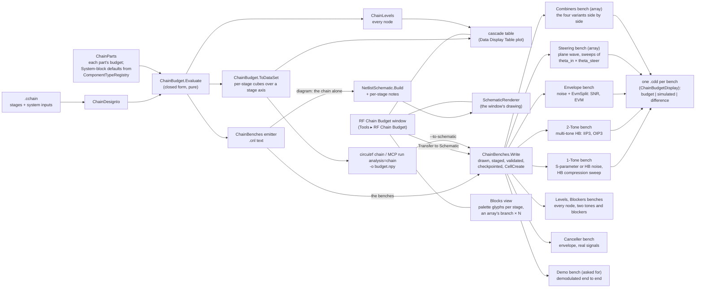
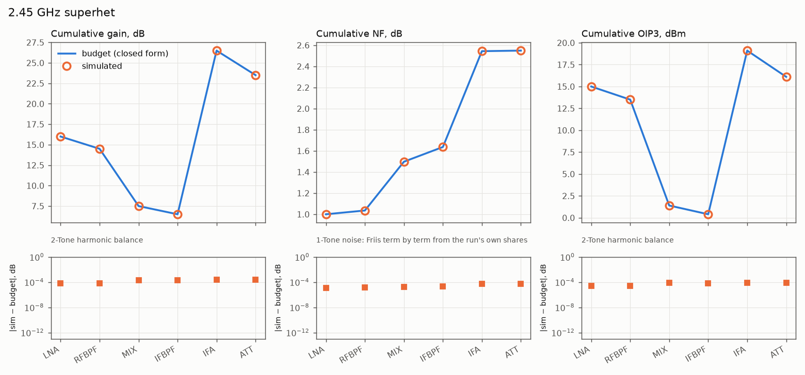
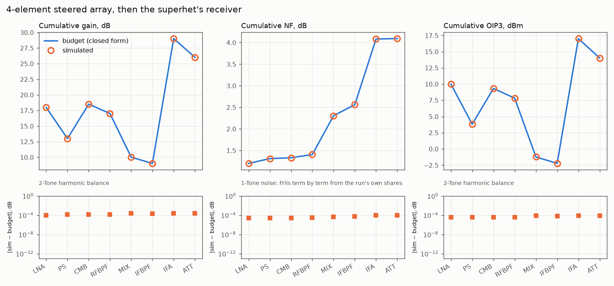
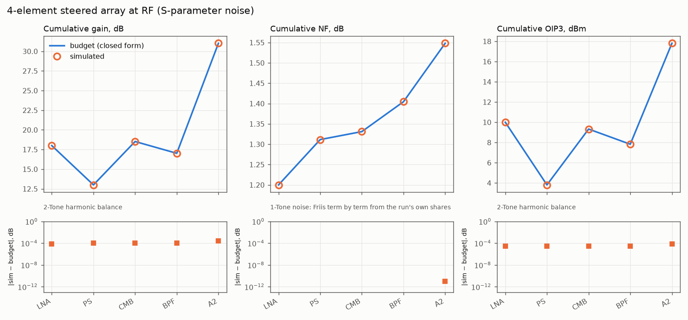
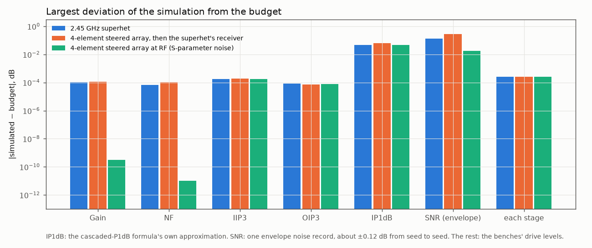
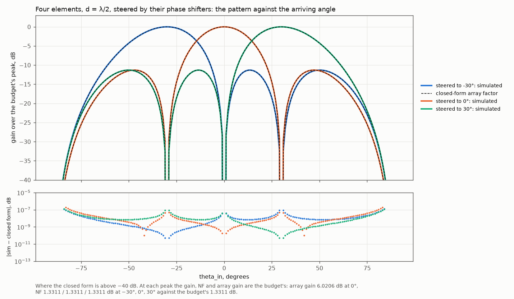
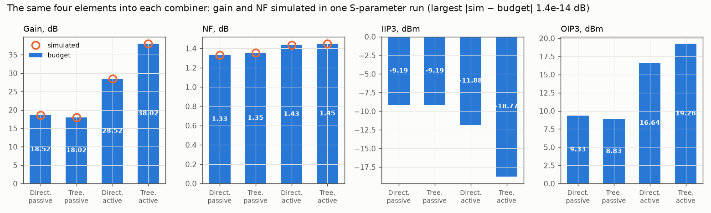
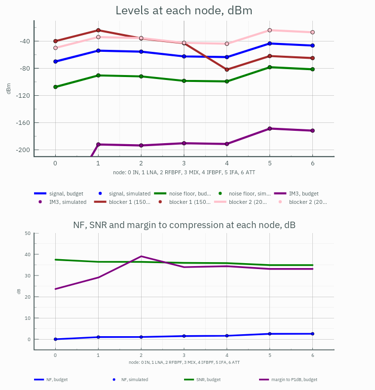
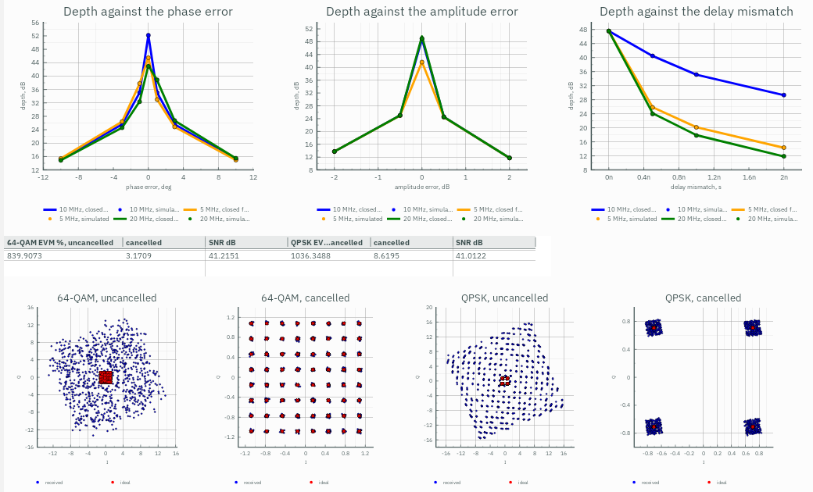
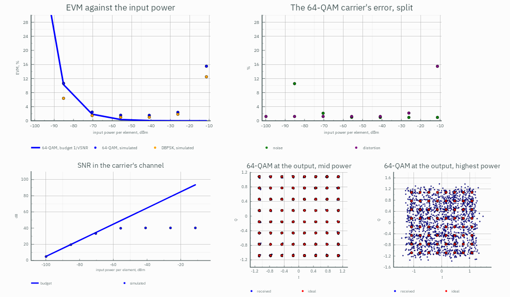

# RF chain budget

A receive chain's budget in closed form, and its transfer to test benches of circuitRF's own System blocks whose
simulations check every number of it. The user-facing page is `docs/user/src/reference/chain-budget.md`; this note is
how it is built and how it was verified.

## 1. Architecture

- **`src/Design/Chain`** — framework-free, below the firewall. `ChainDesign` and `ChainDesignIo` (the document),
  `ChainParts` (what each part does to a budget), `ChainBudget` (the cascade, and the same as a `DataSet`),
  `ChainBenches` (the transfer and the diagram). The emitter writes netlist TEXT and hands it to
  `NetlistSchematic.Build` — the drawing `circuitrf netlist --to-schematic` makes — with an `ExactPlacement` that puts an
  array's elements in rows. `Write` draws all the chain's benches, writes each into a temporary staging folder with
  `CellCreate.Create` (the function New Cell calls) and reads it back through `CellViewFileValidator`; only when every
  bench passes does it take a history checkpoint (`WorkspaceCheckpoints.BeforeWrite`) and create the cells in the
  workspace. `Diagram` emits the chain alone (ports in and out, no sources, analyses or isolators), draws it the same way
  and adds four text notes above each stage, its own and its cascaded numbers; it returns which drawn component belongs
  to which stage.
- **`src/Render/DataDisplay/ChainBudgetDisplay`** — the displays, ordinary Table plots. One per bench, of the bench's
  measurement rows, named after it, because `RunResultsWriter.AutoDisplayCandidates` opens an authored display beside
  the bench when the bench is simulated; and the window's cascade table, a Table plot over the budget `DataSet`'s stage
  axis.
- **`src/Cli/Chain.cs`** — the verb: parsing, refusals, reporting. `run analysis=chain` on the MCP server.
- **`src/Ui/Chain`, `src/Ui/Views/Chain`** — the window, a top-level tool window as the Match Designer's is: Tools ▸ RF
  Chain Budget, or a `.cchain` from the tree. It holds no budget arithmetic. The chain is drawn two ways: the
  Schematic tab, where `ChainSchematicCanvas` hands the diagram's model to `SchematicRenderer.Draw` with the renderer's
  own selection overlay; and the Blocks tab, an idealised block per stage — an `ItemsControl` of the palette's own
  `PaletteGlyphControl` symbols, an array's branch once with "× N", a combiner as its variant's levels — fed by the
  core's numbers. The cascade is a `PlotControl` over the Data Display table. A selection in either view and in the
  stage list is one `SelectedStage`.
- **`src/Core/Devices/System/CombinerModel`** — the library's N-way Combiner, an `IdealSBlockModel`: S(S,k) =
  10^(−IL_k/20)·e^(j·Phase_k)/√N, every other entry zero. It is the splitter, the direct combiner, each 2:1 of a tree
  and, with an Amp after it, the active combiner; its thermal noise comes from its S like every passive block's.

Nothing new in the engine. The benches are run by the analyses that already exist, and every check is a measurement row.

### 1.1 How it lines up with `docs/design/plugins.md`

It is a built-in tool, in one pull request, but shaped the way that note shapes a plugin, so that it could move to the
plugin route once the plugin runtime exists:

- **P-4, a function of its parameters.** `ChainBudget.Evaluate` is pure: a `.cchain` in, a result out, nothing read from
  the window or the workspace. The window, the verb and the test suite call the same function.
- **P-7, headless parity.** Everything the window does is a verb: `circuitrf chain` budgets a `.cchain` as a `DataSet`,
  `--to-schematic` transfers it, `check` reports its refusals, and the MCP server has it as `run analysis=chain`.
- **P-2, circuitRF draws every view.** The chain is a `.cnl` drawn as `netlist --to-schematic` draws one, rendered by
  `SchematicRenderer`; the cascade and every bench's comparison are Data Display Table and Rect plots (§5.1, §5.2). What
  the tool adds to the drawing is text: four `EditableText` notes per stage, which a plugin's `schematic` view (§5.4)
  has no field for today, so a plugin port would need the view to carry annotations or the notes to move into a Table.
  The Blocks view is the one drawing of the tool's own — XAML over the palette's glyphs, fed by the core — and the
  plugin vocabulary has no block-diagram view kind; a port would ask for one, or show the blocks as a Table.
- **P-5, circuitRF writes the workspace.** Transfer stages the benches, validates each one, takes a checkpoint, and only
  then creates the cells through `CellCreate`; a refusal leaves the workspace untouched. An existing bench is the
  Replace question, in the window and as `--replace` on the CLI.

By §14 a broadly useful calculator that fits circuitRF's standards is a pull request; that is the route taken here.

## 2. The parts

Seven parts are System blocks and carry that block's own parameters, with the block's own placement defaults read from
`ComponentTypeRegistry.DefaultParameters`, so a stage and a freshly placed block cannot disagree. The splitter and the
array combiner are the library's N-way Combiner, added with this tool (`system-components.md`, Combiner). The library
has no phase shifter or limiter; those two are composed of parts it does have, and so is the active combiner:

| Part | Placed as |
|---|---|
| PhaseShifter | `Amp` (gain −IL, NF, IIP3, `IP3Ref=Input`) + `TLIN` (Z0, E = phase at the stage's frequency) |
| Limiter | `Amp` (gain −IL, NF = IL, IIP3 = P1dB + 8.9625 dB) |
| Splitter | `Combiner` from its common port, output 1 followed, outputs 2…N terminated in Z0 |
| Combiner, Direct | one `Combiner` of N ways, `IL`, each path's `PathIL` as its `IL[k]` |
| Combiner, Tree | log2 N levels of 2:1 `Combiner`s, level l's part j fed by parts 2j−1 and 2j of level l−1 |
| Combiner, Active | either topology, an `Amp` (`Gain`, `NF`, `IIP3`, `IP3Ref=Input`) after each combiner |
| SnP | `SnP` on the file, other ports terminated in Z0; a stated NF or IIP3 an `Amp` of 0 dB after it (§2.1) |

An active combiner is a composition rather than a block of its own because the composition gives the same answers
with no new model: its noise, gain and intercept are an Amp's, after a passive combiner's.

**The variants' budget** is the cascade of their levels (`CombinerSpec.Budget`): the paths' weights a_k first —
coherent (Σa_k)²/N², incoherent Σa_k²/N, T0·(N/Σa_k² − 1) of noise by Bosma on the weighting network — then each
level's passive part (n·g signal, g noise, T0·(1/g − 1)) and, active, its amplifier, cascaded with Friis on the noise
gains and the intercept sum on the signal gains. The stage then enters the chain's cascade with that signal gain,
noise gain, noise figure and intercept, and the chain's array gain becomes the product of each stage's signal over
noise gain, (Σa_k)²/Σa_k² for the combiner. A tree with N not a power of 2 is refused, Direct named as the remedy,
rather than given uneven levels: an uneven tree's paths have unequal losses, which is what `PathIL` already states.

### 2.1 S-parameter data

An `SnP` stage is a Touchstone file on the library's SnP block (`ChainSnp`). The budget reads the file through
`TouchstoneCache` with the block's own interpolation (cubic spline in magnitude and phase, in S), at the stage's INPUT
frequency (`ChainDesign.StageInputFrequencies`: the chain's, moved by each mixer), renormalised to 50 Ω, the ports
other than `In` and `Out` terminated. Gain is |S(Out,In)|². Noise is what the S-parameter noise analysis gives the
placed block, so the bench checks it exactly: a two-port's noise rows (1 → 2) at a 50 Ω source, linear between rows
as `SnpModel.NoiseAt`; with none and σ_max(S) ≤ 1 + 10⁻⁶, Bosma on the network and its terminations at T0,
F = (1 − |S_oo|²)/|S_oi|²; with gain and none, nothing — the budget refuses rather than guess, until `NF` is stated.
A stated `NF` (not below the file's own F_file) or `IIP3` is placed as an ideal Amp of 0 dB after the block, its NF
1 + (F − F_file)·G and its input intercept IIP3 + G; a file with gain and no noise data is written `Noise=no`, so the
noise run lists it as stated rather than warning that it has no model.

Nothing is extrapolated: a stage frequency outside the file's range, or outside its noise rows when they set the NF,
is a refusal naming the stage; a blocker outside the range is carried at the edge value, as the block clamps it, with
a note. A relative `File` resolves against `ChainDesign.BaseDirectory` — the `.cchain`'s owning workspace by
`SchematicCircuit.ReferenceBaseOf`, which `LoadFromFile` sets — and the benches write it relative to the workspace they
land in when the file is under it, a full path otherwise. The window keeps an SnP stage that names no file yet instead
of undoing the pick, flags its File box and asks for a file (`ChainFileWanted`).

Measured on a matched three-stage chain (an LNA with noise data, a passive 3-port read 1 → 3, a gain block with NF and
IIP3 stated): 1-Tone gain and NF 4×10⁻¹⁵ dB from the budget, 2-Tone IIP3 1.6×10⁻⁴ dB
(`ChainBudgetTests.AnSnpStage_SimulatesToItsBudget`). The budget, like every stage's, ignores mismatch between stages:
a file whose S11 or S22 is not small reads differently in the simulation, which is the bench's point.

### 2.2 The levels, the canceller and the demo

**`ChainLevels`** walks the budget's own cascade node by node — the signal, the noise floor in the bandwidth, the NF,
the IM3 of two tones at the input power, every blocker, a canceller's interference, the margin to compression and the
SNR. A blocker is carried through every stage's gain at its own frequency: a filter's response there comes from
`FilterNetwork`, the model the Filter block itself simulates with, so a blocker's rejection is the block's and not a
second filter formula; a mixer moves it to |f − Flo|.

**The canceller** (`CancellerSpec`) is composed: a Directional Coupler whose through arm is the main path and whose
isolated port takes the reference path. Its budget on the wanted signal is the through arm's loss and the reference
path's injected noise, F = L_t + (F_ref·G_ref − 1)·c/(1 − c); on the interference, the band average of
|1 − a·e^(j(φ − 2πfτ))|², R = 1 + a² − 2a·cos(φ − 2πντ)·sinc(πBτ). On the ordinary benches the reference path is only its
noise (an Amp of the gain it would need, from a T0 termination, or a T0 termination when passive); the Canceller bench
drives it with the interference itself.

**The demo** uses what the envelope run already measures at every IProbe — EVM, the constellation, EvmSplit's noise and
distortion parts and the in-channel SNR — over a sweep of the input power. Nothing demodulates but the envelope run.

## 3. The benches, and what was found building them

**The mixer's image termination.** A mixer's SSB noise figure is stated with its image at T0. In a chain a filter in
front of the mixer reflects the image instead, and the ideal Mixer's equivalent noise current then develops a different
noise voltage there (an open-like reflection about four times the matched one). Measured on the superhet: harmonic-balance
NF 2.833 dB against Friis' 2.549 dB without anything in front of the mixer, 2.5489 dB with an isolator — a circulator whose
third port is terminated at the ambient, i.e. a T0 termination at the image. The benches place one, as the bench's and
not the chain's, and the docs say what removing it shows.

**Mixing order on a lattice with an LO.** Each LO raises every product's order by one. With MaxMixOrder 5 on (f1, f2, LO)
the IF stages' IM3 read 0.012 dB off; at 6 (5 + mixers) 1.8×10⁻⁴ dB, and 7 or 9 change nothing. The compression sweep
likewise converges at 3 + 2·mixers (0.088 dB → 0.048 dB → 0.047 dB at 3, 5, 7). The HB noise run needs 1 + 2·mixers to
keep the image sideband, and its output frequency is offset 1 kHz from the IF, where the noise at the IF is defined: on
the lattice point itself the run returns NaN, by design.

**A swept variable in a measurement is the sweep's axis.** In a schematic with a sweep over `Pin`, every measurement
reading `Pin` reads the swept cube, including one for a different analysis. The 1-Tone bench keeps its small-signal drive
in its own variable, `Pss`, and sets `Pin = Pss`. The Steering bench uses the same fact on purpose: its closed-form
array factor reads `theta_in` and `theta_steer` and comes out as a cube over both sweeps, aligned with the simulated
pattern by axis name.

**Two limits of measurement expressions over a sweep's cube, met on the Steering bench.** `sin`, `cos` and `exp` take a
number, not a cube ("Value is Cube, not Complex"), while `^` broadcasts; the bench writes e^(j·x) as
`2.718281828459045^(j*x)` and sin x as its imaginary part. And a variable DERIVED from a swept one (`psi_in =
…sin(theta_in…)`) reads its nominal value in a measurement, not the swept cube, though the circuit sees it swept; so the
array factor is written from `theta_in` and `theta_steer` themselves.

**A harmonic-balance result has an axis called `node`.** Its voltage cube's nets are on an axis of that name, so a
measurement reading a variable called `node` read the nets instead (ten of them, not the seven nodes swept). The
Levels displays' variable is `nodeix`.

**One number per node, one curve.** A display draws a cube against its axis; a bench's measurements are one number per
node. Each Levels bench sweeps `nodeix` over 0 … n around a trivial DC solve and writes each curve as
Σ v_k·L_k(nodeix), L_k the Lagrange basis polynomial that is 1 at node k and 0 at the others — exact at the integers in
arithmetic alone, the only operations a sweep's cube takes.

**A node's voltage is not its forward wave before a reflective stopband.** On the first Blockers run the 150 MHz
blocker read 3.1 dB high at the LNA's output and 5.8 dB high after the mixer: the filter after each reflects it, and the
node's voltage is the incident wave plus the reflection. The Blockers bench puts an ideal isolator after every stage,
so each node sees a match and reads the wave going forward, which is what the budget carries; the blockers then sit on
the budget to their own compression of the LNA, 0.001 to 0.003 dB.

**Blockers and the two tones are two runs.** In one harmonic-balance run, four tones and an LO on the mixing order the
IF's IM3 needs (5 + mixers) is some 1,800 frequencies; at 3 + mixers the run takes 34 s and the IF's IM3 reads 0.45 dB
off. The Levels bench runs the two tones alone on the 2-Tone bench's order (7 s, IM3 within 10⁻⁴ dB) and the Blockers
bench the blockers alone (3 s).

**A DBPSK carrier is its source's only one,** so the demo's DBPSK has its own source, joined to the NR one by a 2-way
Combiner.

**A flat phase needs a behavioural part.** A TLIN's phase is a delay as well, so the Canceller bench's phase setting is
one path of a 2-way Combiner, whose `Phase[k]` is flat, and its delay a line.

**A splitter-fed plane wave gives each element its own noise.** One Port into a lossless N-way Combiner used as a
splitter: by Bosma the splitter's isolation network puts kT0·(I − s·s†) on its outputs and the Port's termination
kT0·s·s†, so each element sees kT0 of its own, uncorrelated with the others — what an element of a real array receives
from its own antenna. The NF from that Port at the beam's peak is then one element's, for any steer angle; with unequal
paths it is the budget's plus the taper's loss, 10·log10 N − (Σa_k)²/Σa_k², because the splitter shares the wave equally
where the combiner weighs it unequally.

## 4. Verification

`testdata/chain/plot_chain_compare.py` runs the example's superhet and array, and an RF-only array, through the CLI
and plots the budget against the simulation, stage by stage:

Everything that is exact in the budget is within the benches' drive levels: 3×10⁻¹⁰ dB in gain and NF from the
S-parameter analysis, 10⁻⁴ dB from harmonic balance at 40 dB below compression and two tones 50 dB below the intercept.
The four combiner variants, each transferred and run, read the same (gain and NF to 10⁻⁶ dB, intercepts to 10⁻³ dB,
`ChainBudgetTests.EveryCombinerVariant_SimulatesToItsBudget`), and on the example's Combiners bench gain and NF to
10⁻¹⁴ dB. The Steering bench's pattern is the closed-form array factor to 3×10⁻⁹ dB within 3 dB of each peak and 10⁻⁶ dB
down to −60 dB:

The levels, the canceller and the demo, read from the example's benches as the GUI simulates them:

- **Levels**: the signal at every node to 2×10⁻⁵ dB, the IM3 to 8×10⁻⁵ dB; each blocker 0.001 to 0.003 dB under the
  budget, its own slight compression at −40 and −50 dBm (`ChainBudgetExampleTests.Superhet_LevelsAndBlockers_EveryNodeOnTheBudget`).
- **The canceller's noise**: the front end's 1-Tone NF on F = L_t + (F_ref·G_ref − 1)·c/(1 − c) to 10⁻⁶ dB.
- **The canceller's depth**: at three carriers (10 MHz centred, 5 MHz at −15 MHz, 20 MHz at +20 MHz) and every swept
  error, within 0.64 % of the closed form's depth, 0.09 dB at 49.7 dB deep, under 0.12 dB shallower than 45 dB (1.4 %
  and 0.7 dB before the envelope step resolved the +20 MHz carrier's band edge). The wanted 64-QAM carrier's EVM goes
  from 840 % to 3.1 %, the QPSK one's from 1036 % to 8.6 %.

- **The demo**: the SNR 0.04 dB over the budget at the lowest power, the EVM's noise part 55.4 % against 1/√SNR's
  56.2 %. Higher, the noise part stops at about 1 %, 40 dB of SNR, for the DBPSK carrier too: the LO's phase noise,
  which EvmSplit's noiseless run leaves out with the thermal noise. Its mask integrates to −38.5 dBc over the channel,
  1.18 % of EVM; without the mask the SNR follows the budget to 64 dB. The Canceller bench's 41 dB is its own thermal
  SNR at −60 dBm (61 dB at −40 dBm), not a floor. The distortion part is 0.39 % until compression, the NR source's own
  0.35 % and the draft step's, and 15.4 % past it. It read 1.23 % before the envelope step resolved the band edge of a
  carrier off the envelope's centre (the NR carrier sits 4.5 MHz below the centre of its group with the DBPSK one;
  `src/Engine/RESOLVED.md`).

Two quantities are not exact and are said to be: the cascaded compression point is a formula of the intercept's form
and reads 0.02 to 0.06 dB early, and the envelope SNR is one record of noise, ±0.12 dB from seed to seed.

## 5. References

Friis 1944 (doi:10.1109/JRPROC.1944.232049); Pozar, *Microwave Engineering*, 4th ed., §10.1 and §10.3; Razavi,
*RF Microelectronics*, 2nd ed., §2.2–2.3; Wilkinson 1960 (doi:10.1109/TMTT.1960.1124668); Van Trees, *Optimum Array
Processing*, §2.2. The feature list of RxCalc (https://github.com/arhiv6/rxcalc, GPL-3) is the inspiration; only its
README was read, and no code is taken from it.
