# Small-signal noise in the S-parameter analysis

Design note for `Noise=yes` on an `analysis … type=sparam`. Code: `src/Engine/SParameterNoise.cs`,
`src/RfCore/Data/NoiseMetrics.cs`, `SnpModel.NoiseAt`, the OSDI worker's `noise` command
(`tools/osdi-worker/README.md`, Noise), and `nf`/`te`/`rn`/`ns_circle` in `src/Core/Expressions/Evaluator.Network.cs`.
User reference: `docs/user/src/reference/simulations.md#sp-noise`. Findings: the 2026-11-09 entries in
`src/RfCore/RESOLVED.md`, `src/Engine/RESOLVED.md`, `src/Core/RESOLVED.md` and `tools/osdi-worker/RESOLVED.md`.

## 1. Method

The noise runs on the network the wave path already factorises, with every port terminated in its own noiseless Z0.
This is the adjoint method on that terminated assembly: no new matrix and no new factorisation.

- **Noise waves.** With no drive, port k's outgoing power wave is `b_k = (√Re Z0_k / Z0_k)·V_k`. The port-voltage row
  of `M⁻¹` is one transposed solve per port on the same `SparseLU` the S columns used. `SolveTranspose` solves
  `Mᴴy = e`, so the row is `conj(y)`. For each noisy part e, with node-current correlation `C_e` (A²/Hz):
  `Cs = D·Σ_e H_e·C_e·H_eᴴ·Dᴴ`, where `H_e[k, a] = conj(y_k[node_a])` and `D = diag(√Re Z0 / Z0)`. The cost is N
  back-substitutions per frequency.
- **Passive parts: Bosma / Twiss.** Each eligible part (linear, `ActivityFor` passive; a `Mutual` together with the
  inductors it couples) is recorded from its own stamp, every node tied to ground through R. With `Z_t` the
  terminated part's impedance matrix, the open-circuit noise is `C_V = kT[2(Z_t + Z_tᴴ) − (4/R)·Z_t·Z_tᴴ]` and the
  node currents are `C_j = Z_t⁺·C_V·Z_t⁺ᴴ`, with an SVD pseudo-inverse. Where Y exists this is `2kT(Y + Yᴴ)`. An ideal
  tie (a short, an ideal transformer) makes `Z_t` singular, and the pseudo-inverse drops exactly the injections no
  node voltage sees. A lossless part comes out as zero. T is `Temp`, then `Dtemp` over the ambient, then the ambient.
  The parts are recorded before `StampAll`, because a stamp writes the model's branch index.
- **SnP noise data.** A two-port file's noise rows give `C_A = 4kT0·[[Rn, (Fmin−1)/2 − Rn·Yopt*], [(Fmin−1)/2 −
  Rn·Yopt, Rn·|Yopt|²]]`, linear in Fmin, Γopt and Rn between rows, and the end rows are held outside them. It goes
  onto the block's nodes as `C_Y = T⁻¹·C_A·T⁻ᴴ` with `T⁻¹ = [[−Y11, 1], [−Y21, 0]]`, Y at the file's R, and onto a
  floating reference node with minus the port currents. A passive file with no noise rows is thermal (Bosma); a
  file with gain and none, and every Deembed, are noiseless.
- **OSDI devices.** The worker evaluates the model at the DC bias the run linearises it about, with
  `CALC_NOISE|ANALYSIS_NOISE`, and calls `load_noise` per frequency. Each declared source between device nodes
  (a, b) is a current source on the circuit nodes they map to, times the instance multiplicity.
- **Two-port parameters.** `C_Y = (I + Y·Z0)·R^−½·Cs·R^−½·(I + Y·Z0)ᴴ`, then `C_A = T·C_Y·Tᴴ` and
  `Rn = C11/4kT0`, `Bopt = Im C12/C11`, `Gopt = √(C22/C11 − Bopt²)`, `Fmin = 1 + (Re C12 + C11·Gopt)/2kT0`.
  NF from port 1's Z0 is `1 + Cs22/(kT0·|S21|²)`. Y is the power-wave Y: S is renormalised to Re Z0 first, because
  `RFNetwork.SToY` is the pseudo-wave form.
- **An N-port's output port k.** With port 1 the source, every other port stays in its own noiseless Z0, which neither
  reflects nor adds a wave. So the two-port from port 1 to port k has exactly the {1, k} submatrices of S and Cs, and
  `nf`/`te` with a port run the two-port formulas on them. No cube is added for N > 2: the per-port figures are the
  functions'.

**Names.** The cubes and functions use the names Qucs and ngspice use (Qucs: `F`, `Fmin`, `Sopt`, `Rn` and a noise
circle function; ngspice: `NF`, `NFmin`, `SOpt`, `Rn`), plus the usual per-port noise figure, equivalent noise
temperature `te` and noise circle `ns_circle`. The one departure is the linear noise factor, `Fn` and not `F`:
`SP1.F("probe")` is the WSProbe's return difference in the same analysis group, and its accessor takes every
one-argument `SP1.F(…)`.

## 2. Conventions

| Quantity | Convention |
|---|---|
| Spectral densities | Single-sided, absolute: a matched load's outgoing wave is kT W/Hz; k = 1.380649e-23 J/K exact. |
| `Cs` | `⟨b·bᴴ⟩` of the outgoing power waves (Kurokawa), every port in its own noiseless Z0, W/Hz. |
| NF, NFmin | dB, referred to T0 = 290 K. The default ambient is 26.85 °C = 300 K, so a design that states no temperature is not at T0. |
| `Fn`, `Fmin`, `Te`, `Tmin` | The noise factors linear, and T0·(F − 1), T0·(Fmin − 1) in K. |
| `Sopt`, `Zopt`, `Rn` | Γopt on R = Re Z0 of port 1, and as an impedance R·(1 + Sopt)/(1 − Sopt); Rn in Ω, `rn()` = Rn/R. Touchstone writes Sopt and rn on the option line's R. |
| Data-file noise | Absolute at T0; it does not move with the ambient. |
| Refused | `Noise=yes` with a port whose Re Z0 ≤ 0 (`sparam.noise.reactive-z0`): nothing terminates it. |
| Noiseless, named once | Built-in nonlinear models, active or black-box linear parts, an SnP with gain and no noise data, every Deembed, an external device with no declared sources (`sparam.noise.noiseless`). Ports and independent sources are noiseless silently. |

`Noise=no` (the default) changes nothing: the same cubes, S bit for bit and the same run statistics.

## 3. Not in scope

Harmonic-balance noise, phase noise, an AC noise analysis, and noise in the built-in nonlinear models. The noise
cubes other than `Cs` are two-port quantities; an N-port gets `Cs`, and `nf`/`te` to any output port.

## 4. References

- H. Hillbrand and P. H. Russer, "An efficient method for computer aided noise analysis of linear amplifier networks,"
  *IEEE Trans. Circuits Syst.*, vol. 23, no. 4, 1976. Correlation matrices and their transformations.
- S. W. Wedge and D. B. Rutledge, "Wave techniques for noise modeling and measurement," *IEEE Trans. Microw. Theory
  Techn.*, vol. 40, no. 11, 1992. Noise waves, and the noise parameters straight from them.
- H. Bosma, "On the theory of linear noisy systems," *Philips Res. Rep. Suppl.*, no. 10, 1967. `Cs = kT(I − S·Sᴴ)`
  for a passive network at one temperature.
- R. Q. Twiss, "Nyquist's and Thevenin's theorems generalized for nonreciprocal linear networks," *J. Appl. Phys.*,
  vol. 26, 1955.
- D. M. Pozar, *Microwave Engineering*, 4th ed., §12 (noise figure, noise circles; Ex. 12.5).

## 5. Validation

`testdata/noise/` (generator `gen_noise_refs.py`, references in `refs.json`, written outside circuitRF):

- closed forms: a matched pad at 290 K and 400 K, Bosma's `kT(I − S·Sᴴ)` entry by entry on a lossy reactive
  network, coupled inductors and an ideal transformer, and the Friis cascade;
- scikit-rf: a mismatched cascade (`connect`), Touchstone noise data at R = 50 and 25 Ω with re-referencing, and
  Pozar's noise circle (`nf_circle`);
- ngspice 47 `.sp … donoise`: mixed temperatures, coupled inductors, a controlled-source amplifier with 75/50 Ω ports;
- numpy nodal three-ports at 350 K: a matched star splitter (Bosma: F = 1 + 2T/T0 to each output, Te = 700 K) and an
  unequal splitter with a VCCS stage to a 75 Ω port 3, each output's F and noise parameters from a two-port run with the
  third port a noiseless Z0;
- the fake OSDI `crf_noise` device against its closed form.

Gates: `tests/RfCore.Tests/NoiseMetricsTests.cs`, `TouchstoneNoiseBlockTests.cs`,
`tests/Engine.Tests/Linear/SParamNoiseTests.cs`, `tests/Engine.Tests/External/OsdiNoiseTests.cs`, and
`tests/Core.Tests/Expressions/NetworkMetricFunctionTests.cs` for `nf`/`te`/`rn`/`ns_circle`.

The example workspace `examples/S-Parameter Noise` (a pad over temperature, a Friis cascade, a noise-matched LNA with
its noise circles) is held to its closed forms by `tests/Ui.Tests/Examples/SParameterNoiseExampleTests.cs`.

## 6. Comparison figures

`testdata/noise/plot_noise_compare.py` draws these from circuitRF's own results and the independent references:
`run CLI RESULTS` runs every `refs.json` bench, the example's first two benches and the OSDI part through the
`circuitrf` build under test, and `plot RESULTS docs/images/sparam-noise` adds scikit-rf, ngspice and the closed
forms. circuitRF is drawn as markers and a reference as lines; each lower panel is |circuitRF − reference| on a log
scale, with the tests' 1e-9 tolerance dotted (an exact 0 is drawn at 1e-18).

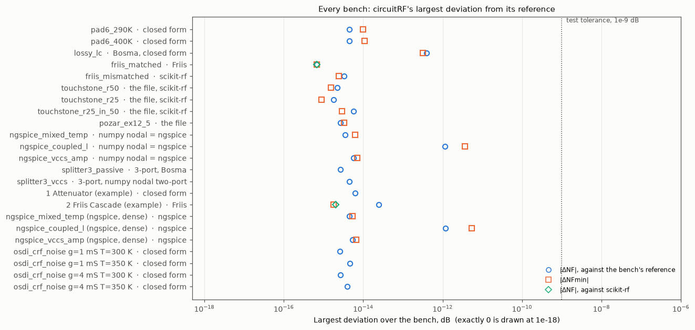

Every bench's largest |ΔNF| and |ΔNFmin|; for the two three-port splitters, `nf(SP1.S, 0, k)` to both outputs (4e-15 dB).
The worst is the coupled-inductor bench against ngspice, 1.2e-12 dB in NF and 5e-12 dB in NFmin near its 4.7 GHz
resonance, where Rn reaches 1.5 kΩ; everything else is below 4e-13 dB.

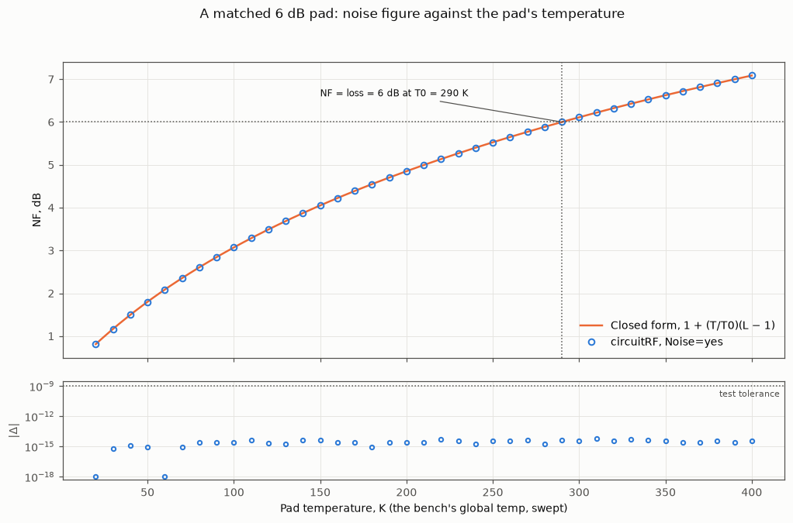

The example's matched 6 dB pad from 20 K to 400 K against `1 + (T/T0)(L − 1)`: 6.000 dB at 290 K, within 6e-15 dB at
all 39 temperatures.

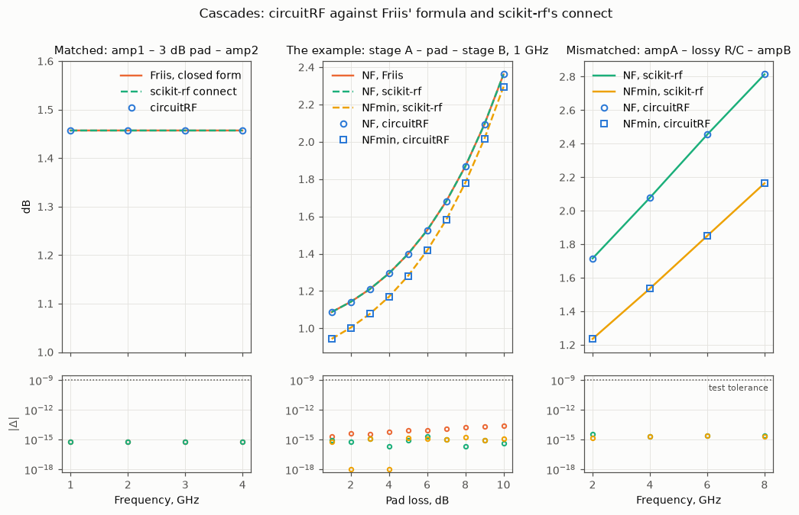

Left, `friis_matched` against Friis' formula and scikit-rf's `connect`, 7e-16 dB. Middle, the example's cascade with
its pad swept from 1 to 10 dB: NF against Friis (2e-14 dB) and scikit-rf (2e-15 dB), NFmin against scikit-rf
(2e-15 dB). Right, `friis_mismatched`, every block mismatched, against scikit-rf: 3e-15 dB.

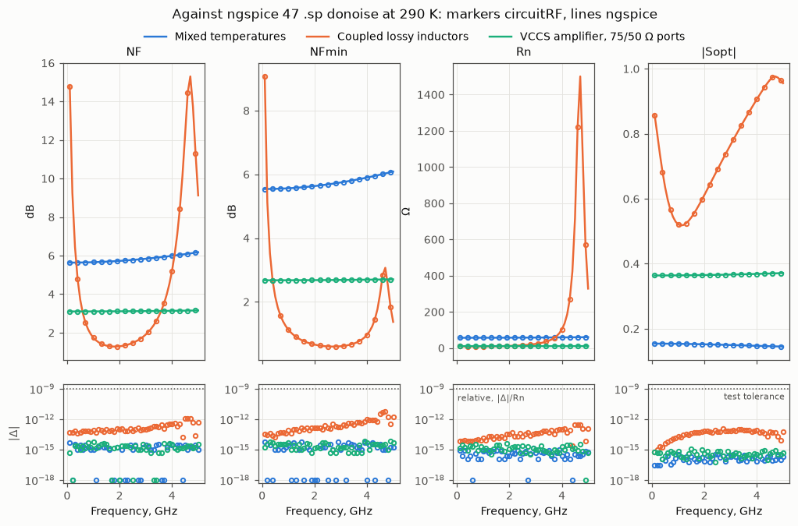

NF, NFmin, Rn and |Sopt| of the three ngspice benches over 0.1–5 GHz (50 points) against ngspice 47 `.sp donoise`,
run live at 16.85 °C, where ngspice's reference temperature (the circuit's) is T0. Mixed temperatures and the VCCS
amplifier with 75/50 Ω ports: 7e-15 dB. Coupled lossy inductors: 1.2e-12 dB in NF, 5e-12 dB in NFmin, 3e-13 in Rn
relative and 1.2e-13 in Sopt.

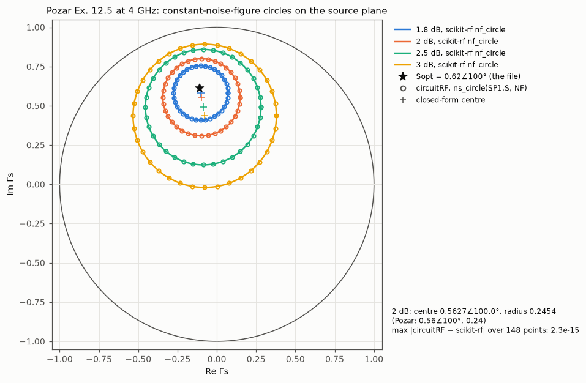

Pozar's Ex. 12.5 at 4 GHz: `ns_circle(SP1.S, NF, 37)` at 1.8, 2, 2.5 and 3 dB against scikit-rf's `nf_circle` and the
closed-form centres. The 148 points agree to 2.3e-15.

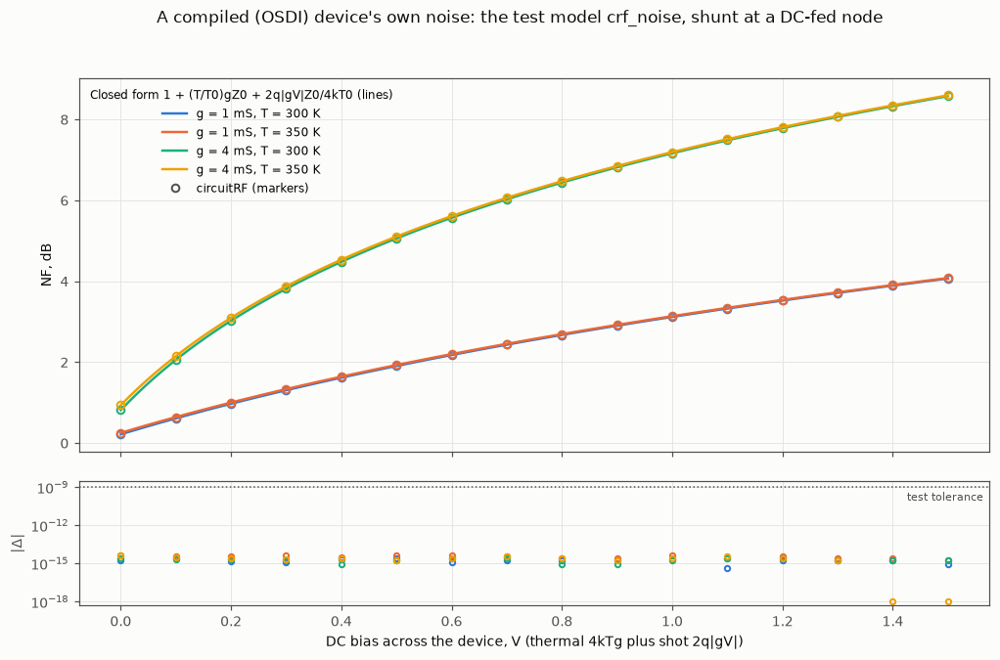

The fake OSDI `crf_noise` part shunting a DC-fed node, g = 1 and 4 mS at 300 and 350 K, its bias swept from 0 to 1.5 V,
against `1 + (T/T0)·g·Z0 + 2q|gV|·Z0/(4kT0)`: within 5e-15 dB. The noise comes from the worker's `noise` command at
each bias point.

## 7. In the GUI

The example workspace `examples/S-Parameter Noise` (File ▸ New ▸ Examples ▸ S-Parameter Noise), run in the
application: open a bench's schematic, Simulate, and its Data Display opens on the result. Captured from this
branch's build.

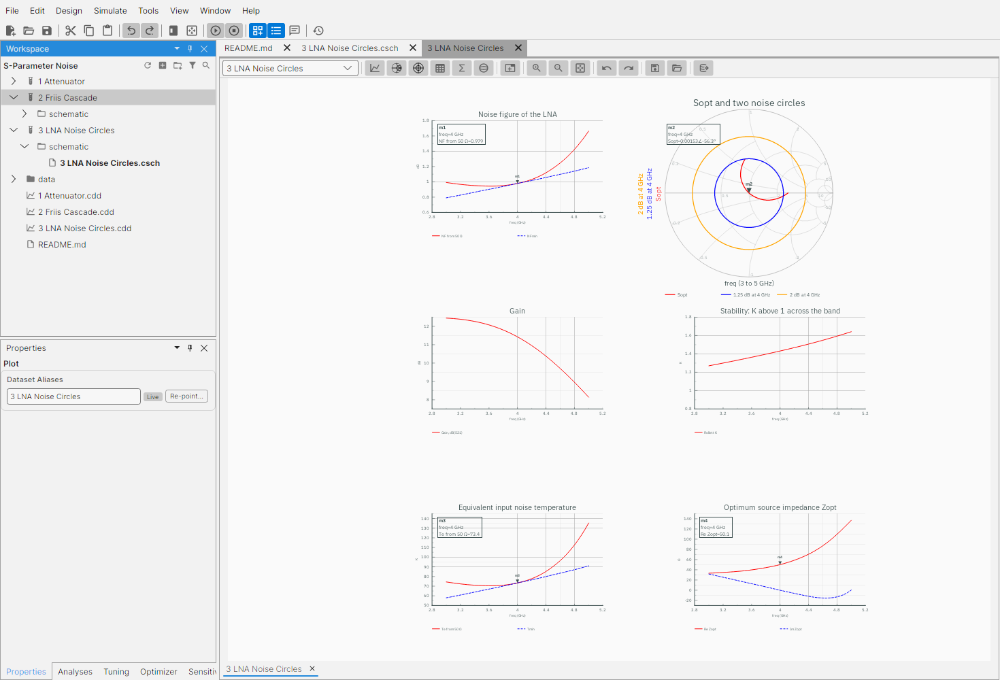

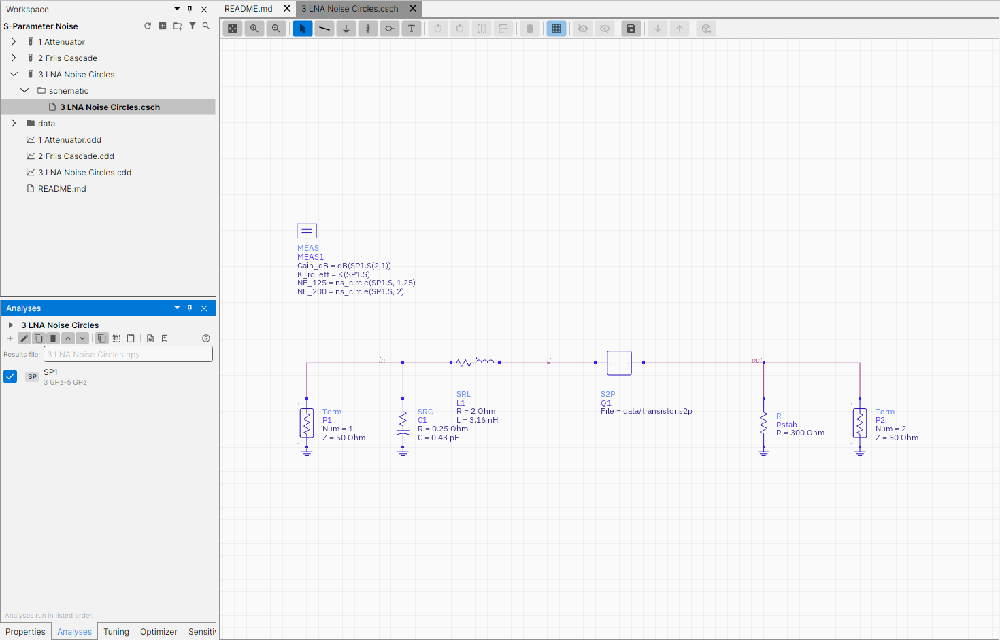

`3 LNA Noise Circles`: a transistor-like SnP with noise data behind a lossy input match and a stabilising resistor.
The measurement block draws two constant-NF circles with `ns_circle(SP1.S, 1.25)` and `ns_circle(SP1.S, 2)`.

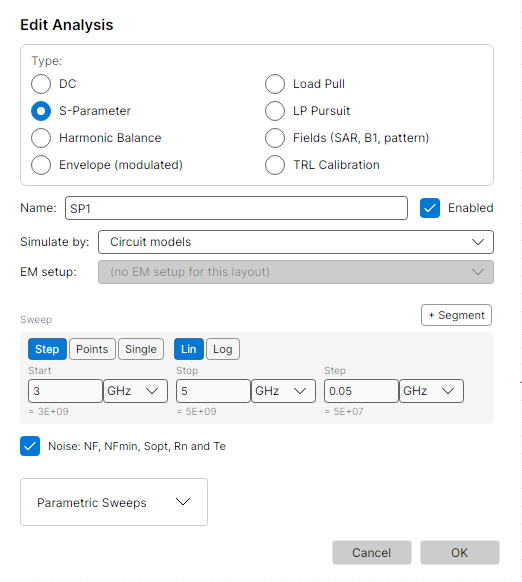

The S-parameter analysis's Edit Analysis dialog: the Noise box under the frequency plan writes `Noise=yes`.

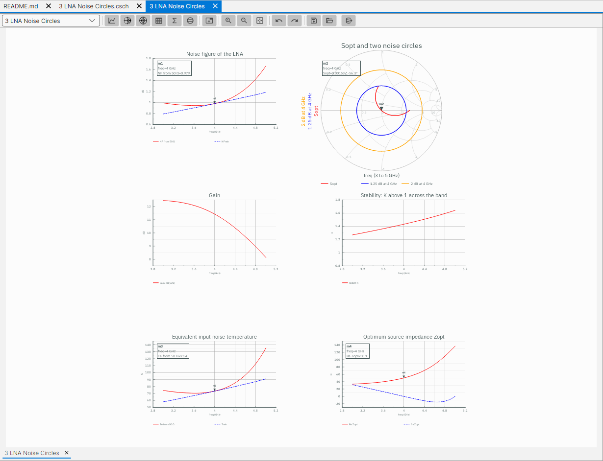

NF from 50 Ω against NFmin (m1: 0.979 dB at 4 GHz); Sopt and the two noise circles on a Smith chart (m2: |Sopt| =
0.0015 at 4 GHz, the match puts the optimum source at 50 Ω there); gain; Rollett's K; Te against Tmin (m3: 73.4 K);
Re and Im of Zopt (m4: 50.1 Ω).

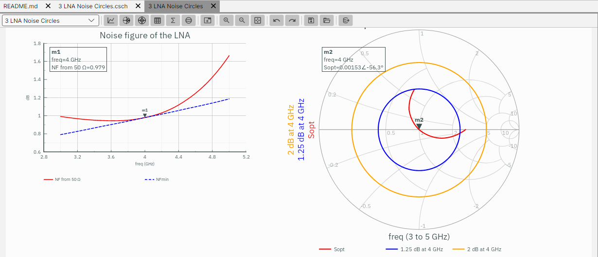

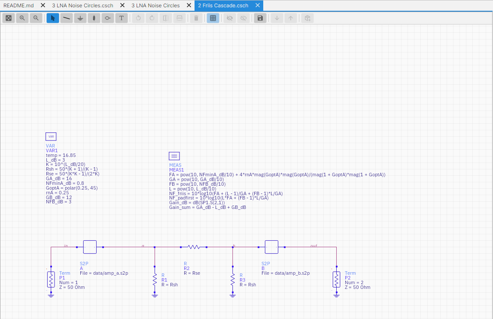

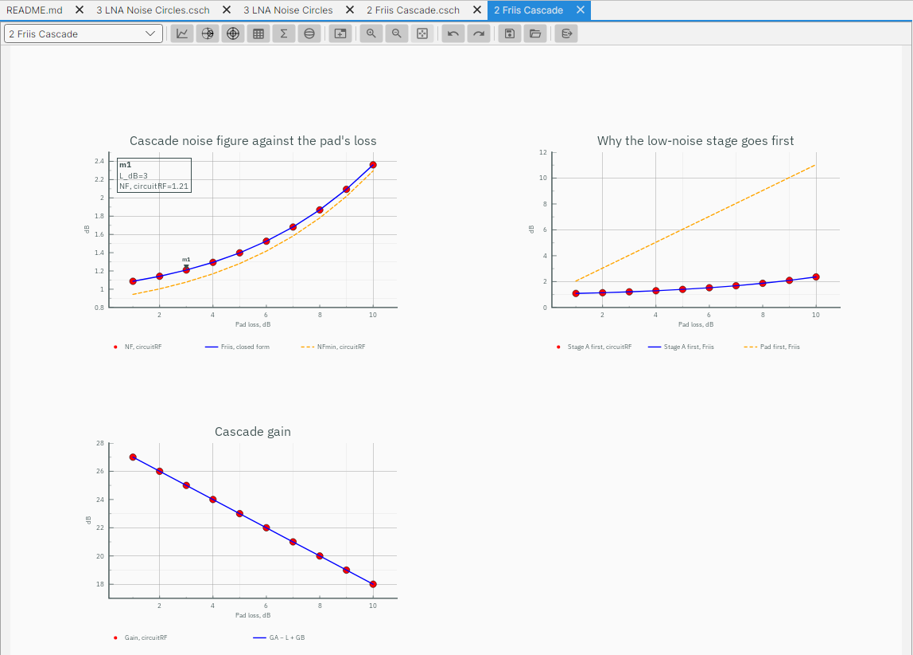

`2 Friis Cascade`: stage A, a resistive pad swept from 1 to 10 dB, stage B. The run's NF (dots) lies on Friis' formula,
written as a measurement (line); m1 reads 1.21 dB at a 3 dB pad. The middle plot puts the pad first.

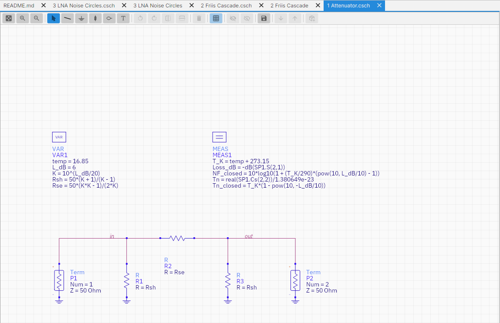

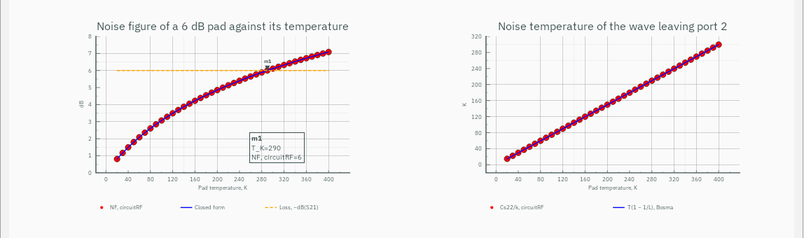

`1 Attenuator`: a matched 6 dB pad with the ambient swept from 20 K to 400 K. NF crosses the loss at 290 K (m1: 6 dB)
and follows `1 + (T/T0)(L − 1)`; `Re Cs22/k` follows Bosma's `T(1 − 1/L)`.
