# Dividers and Couplers

RF dividers and couplers placed as single parts, each stated by its specifications and drawn from the same plan its
circuit model simulates. One cell per component, each at 2.4 GHz on a 20 mil RO4350B board, laid out by Update Layout
from Schematic and solved on the Planar MoM solver, EMerge and Palace. The workspace holds the **Wilkinson divider** (an
MWPD) with an **unequal split**, a **two-section broadband divider**, a **four-way tree** and **mitred and square
corners**; the **branch-line hybrid**
(an MBLC); the **rat-race hybrid** (an MRRC); the **coupled-line coupler** (an MCLC); and the **coupled-line balun** (an
MCBL). The **Gysel**, **Bagley** and **tee** dividers (MGPD, MBPD, MTPD), the **Schiffman phase shifter** (MSPS), a
**meandered delay line** (MDLY), the **compact rat-race**, the **three-section** and **tandem** couplers, the **lumped
Wilkinson** and a **resistive pad** (MRPAD) are each compared with an equations model, the same topology on ideal lines
or parts, and most of them on Planar MoM too, on a coarse mesh.

Each EM cell, and each of the new cells, has a test bench beside it, holding the cell's circuit, the new cells'
equations model and one SnP block per EM setup, which reads the Touchstone file that setup writes into `results/`. Simulate the bench and open the cell's `.cdd`: the circuit model is a
line and each solver a set of markers. No results ship; the benches read what your own runs write.

## The cells

| Cell | Views | What it is |
|---|---|---|
| **Wilkinson** | schematic, layout, EM setup, 3D view | A 5 mm input line, the MWPD, a 100 Ω resistor with an 0402 land pattern on R2-R3, and each output bending away through a 90° MCURVE and a 5 mm line to its port |
| **Unequal** | schematic, layout, EM setup, 3D view | The same board with `K` = 1.4142, so port 3 takes twice port 2's power, and a 106.07 Ω resistor |
| **Broadband** | schematic, layout, EM setup, 3D view | The same board with `N` = 2 over an octave: two sections and two resistors, 242.14 Ω and 97.69 Ω |
| **FourWay** | schematic, layout | Three equal-split MWPDs in a tree, ports 2 to 5 on the second stage's outputs |
| **Mitred** | schematic, layout | The Wilkinson cell's circuit three times, its MWPD with `Corner` = `Curve`, `Miter` and `Square` |
| **Branch-Line** | schematic, layout, EM setup, 3D view | A one-section MBLC with a 5 mm line from each of its four pins to a port |
| **Rat-Race** | schematic, layout, EM setup, 3D view | An MRRC with a 5 mm line from each of its four pins to a port |
| **Coupler** | schematic, layout, EM setup, 3D view | A 10 dB MCLC, each of its four ports reached through a 90° MCURVE and a 5 mm line that bend away from the other strip |
| **Balun** | schematic, layout, EM setup, 3D view | An MCBL from 50 Ω to 200 Ω on each output, a via to ground on each coupled strip |
| **Gysel** | schematic, layout, EM setup | An MGPD, a 50 Ω 0402 from each isolation node to a ground via, and a 5 mm line from each port pin to its port |
| **Bagley** | schematic, layout, EM setup | A three-way MBPD with a 5 mm line from each of its four pins to a port |
| **Tee** | schematic, layout, EM setup | An MTPD with `K` = 1.4142, so port 3 takes twice port 2's power, through no resistor |
| **Schiffman** | schematic, layout, EM setup | A 90° MSPS, port 1 turning away from port 2 and the reference's feeds as long at F as the C-section's |
| **Delay** | schematic, layout, EM setup | A 360° MDLY meandered in two half-turns |
| **Compact Rat-Race** | schematic, layout, EM setup | The Rat-Race cell with `Meander` = 1, its 3λ/4 arm folded inside the ring |
| **Sections** | schematic, layout, EM setup | The Coupler cell's board with `Sections` = 3: a 15 dB coupler over 2:1 |
| **Tandem** | schematic, layout | A 3 dB MCLC with `Tandem` = 1, two 0.5 nH bond wires on its crossovers |
| **Lumped Wilkinson** | schematic, layout | An MWPD with `Realization` = `Lumped`, its six 0402s placed by Place Site Parts, each capacitor to a via |
| **Pad** | schematic, layout, EM setup | A 6 dB π MRPAD, its three 0402s placed by Place Site Parts, each shunt one to a via |
| **Wilkinson Bench** … **Pad Bench** | schematic | One per EM cell and per new cell: the cell's circuit, the new cells' equations model, and one SnP block per EM result with its ports closed |
| `Wilkinson.cdd` … `Pad.cdd` | data display | One per cell, at the top of the workspace |

## Run it

Run a cell's EM setups, then simulate its bench and open its `.cdd`. **Planar** is the setup in the cell's `em/` folder;
**EMerge** and **Palace** are the two setups in its 3D view.

| Cell | Planar MoM | EMerge | Palace | Then |
|---|---|---|---|---|
| Wilkinson | 4½ min | 1 min | 1½ min | Simulate **Wilkinson Bench**, open `Wilkinson.cdd` |
| Unequal | 34½ min | 1 min | 3 min | Simulate **Unequal Bench**, open `Unequal.cdd` |
| Broadband | 49 min | 1 min | 3 min | Simulate **Broadband Bench**, open `Broadband.cdd` |
| Branch-Line | 1½ min | 1½ min | 7 min | Simulate **Branch-Line Bench**, open `Branch-Line.cdd` |
| Rat-Race | 24½ min | 1½ min | 12½ min | Simulate **Rat-Race Bench**, open `Rat-Race.cdd` |
| Coupler | 9½ min | 3 min | 12 min | Simulate **Coupler Bench**, open `Coupler.cdd` |
| Balun | refused | 2 min | 6½ min | Simulate **Balun Bench**, open `Balun.cdd` |
| FourWay | — | — | — | Simulate **FourWay**, open `FourWay.cdd` |
| Mitred | — | — | — | Simulate **Mitred**, open `Mitred.cdd` |
| Gysel | 2½ min | — | — | Simulate **Gysel Bench**, open `Gysel.cdd` |
| Bagley | 17 s | — | — | Simulate **Bagley Bench**, open `Bagley.cdd` |
| Tee | 16 s | — | — | Simulate **Tee Bench**, open `Tee.cdd` |
| Schiffman | 3 min | — | — | Simulate **Schiffman Bench**, open `Schiffman.cdd` |
| Delay | 9 s | — | — | Simulate **Delay Bench**, open `Delay.cdd` |
| Compact Rat-Race | 3 min | — | — | Simulate **Compact Rat-Race Bench**, open `Compact Rat-Race.cdd` |
| Sections | 1 min | — | — | Simulate **Sections Bench**, open `Sections.cdd` |
| Tandem | — | — | — | Simulate **Tandem Bench**, open `Tandem.cdd` |
| Lumped Wilkinson | — | — | — | Simulate **Lumped Wilkinson Bench**, open `Lumped Wilkinson.cdd` |
| Pad | 4½ min | — | — | Simulate **Pad Bench**, open `Pad.cdd` |

Times are from Linux machines, 8 threads for Planar and EMerge and 8 Palace processes; the first 3D run offers to
install its solver. A bench simulates in under a second and reads every result its cell has, so run them all first.

**A resistor on the board is a component port.** The Wilkinson's ring joins the 0402's two pads the long way round, so
the port across them closes a loop; at RF it is an ordinary port. The bench closes it with the cell's own resistor, as
the co-simulation netlist each run writes does, and the tables below are those closed results.

**A bench sweeps the eleven frequencies the EM setups solve**, F·2^(k/5) from F/2 to 2F, so every marker is a solved
point and the circuit line joins the model's values at the same eleven. Each cell's own schematic is a test bench too,
swept finely: simulate it for a smooth circuit curve. A bench with no EM result keeps its cell's fine sweep.

**The new cells' benches hold an equations model**: the same topology on ideal TLIN and CLIN lines of the closed-form
impedances and lengths, or ideal R, L and C, with each port's feed an ideal line of that feed's own impedance and length
at F. Its ports follow the cell's, and each `.cdd` draws it dashed, so the table under each cell gives what the
microstrip models and the board add.

## Wilkinson

An MWPD with `Z0` 50 Ω, `F` 2.4 GHz and `Gap` 1.35 mm, the 0402's pin span. Its outputs bend away from each other
because a calibrated Planar port needs five substrate heights clear of other metal.

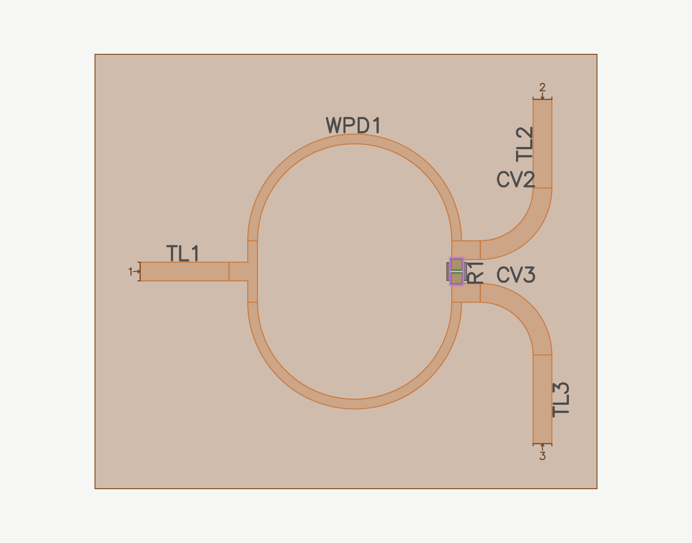

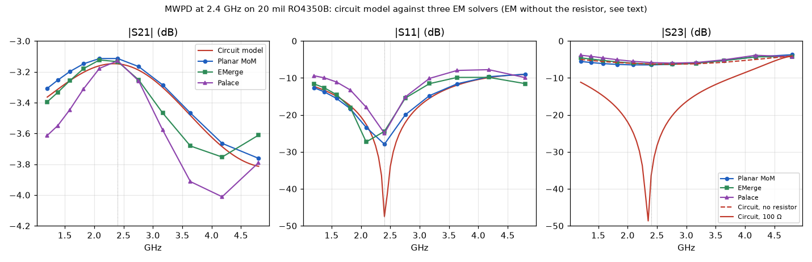

| At 2.4 GHz | Circuit | Planar MoM | EMerge | Palace |
|---|---|---|---|---|
| \|S11\| | −47.5 dB | −28.2 dB | −24.6 dB | −23.5 dB |
| \|S21\| | −3.149 dB | −3.113 dB | −3.130 dB | −3.163 dB |
| \|S23\| | −36.4 dB | −29.2 dB | −25.1 dB | −18.6 dB |

All three put |S21| within 0.04 dB of the model. The nulls are shallower on every solver, and in 3D the isolation null
sits at 2.09 GHz, mostly because of the Draft mesh.

## Unequal split

The Wilkinson with `K` = 1.4142: 3.01 dB more into port 3, through a 103 Ω arm to port 2 and a 51.5 Ω arm to port 3,
and `R1` = Z0·(K + 1/K) = 106.07 Ω.

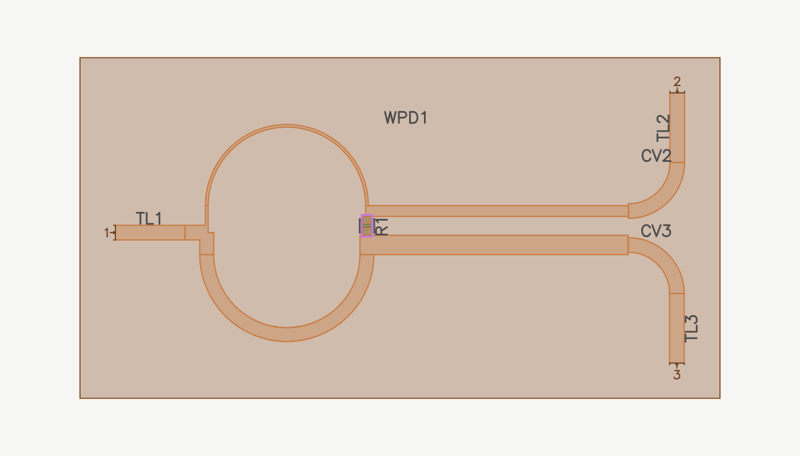

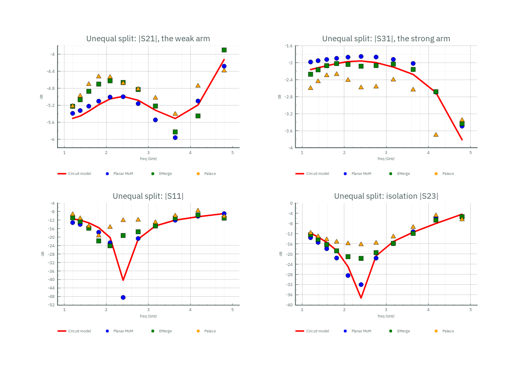

| At 2.4 GHz | Circuit | Planar MoM | EMerge | Palace |
|---|---|---|---|---|
| \|S21\| | −4.993 dB | −5.000 dB | −4.666 dB | −4.683 dB |
| \|S31\| | −1.958 dB | −1.853 dB | −2.084 dB | −2.587 dB |
| P3/P2, 3.01 dB asked for | 3.04 dB | 3.15 dB | 2.58 dB | 2.10 dB |
| \|S23\| | −37.2 dB | −32.0 dB | −21.7 dB | −16.3 dB |

Planar divides as the model does, with its nulls at 2.4 GHz. Its setup meshes 2 cells across a conductor: at the
default 4, the 0.2 mm arm would set a cell size that needs about 100 GB per frequency.

## Broadband divider

The Wilkinson with `N` = 2 and `Band` = 2: two sections over 1.6 to 3.2 GHz, `R1` (242.14 Ω) at the outputs and `R2`
(97.69 Ω) where the ring meets section 1.

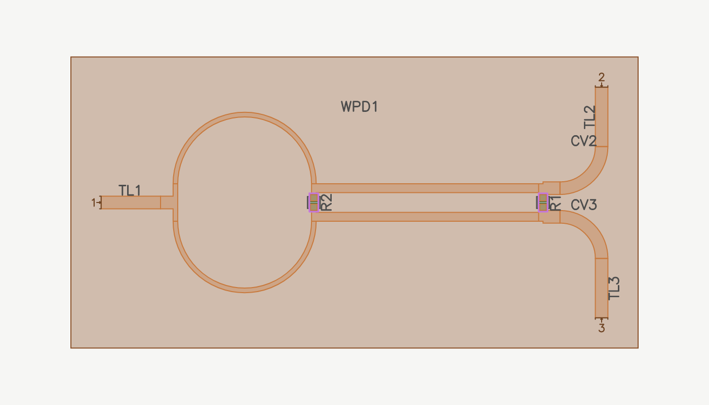

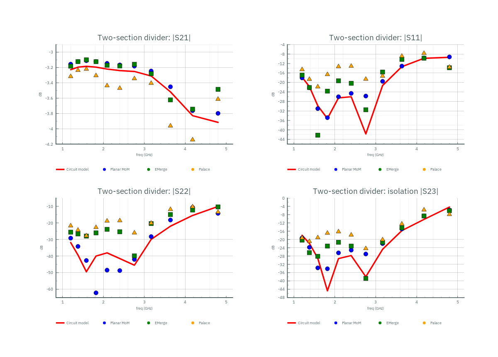

| At 2.4 GHz | Circuit | Planar MoM | EMerge | Palace |
|---|---|---|---|---|
| \|S11\| | −26.0 dB | −24.6 dB | −20.3 dB | −13.1 dB |
| \|S21\| | −3.240 dB | −3.166 dB | −3.179 dB | −3.470 dB |
| \|S23\| | −27.8 dB | −25.1 dB | −23.2 dB | −17.8 dB |

The model keeps |S11| below −20 dB from 1.31 to 3.22 GHz, 2.5:1, against one section's 1.98 to 2.85 GHz. Planar and
EMerge follow it across the band; Palace's Draft mesh reads the match 7 to 13 dB shallower below 2.8 GHz.

## Four-way tree

Three MWPDs, each with its own 100 Ω 0402: the planar way to four outputs, since a single N-way divider's resistors
meet at one point that no one-layer drawing reaches. Circuit only: each divider is the Wilkinson cell's.

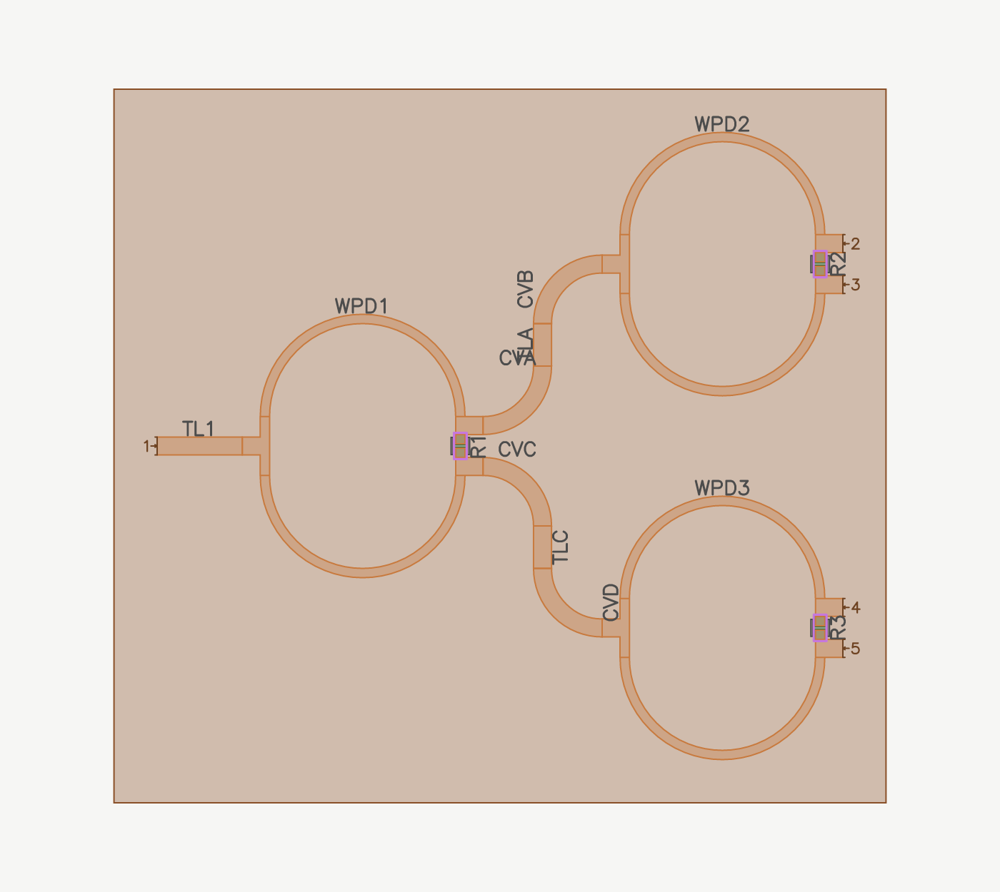

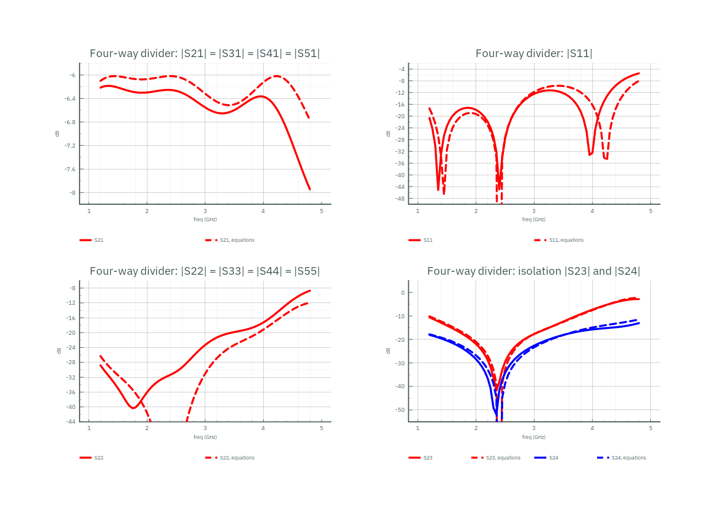

| At 2.4 GHz | Circuit |
|---|---|
| \|S21\| = \|S31\| = \|S41\| = \|S51\| | −6.256 dB, all four in phase |
| \|S11\| | −42.0 dB |
| \|S23\|, one divider's outputs | −38.9 dB |
| \|S24\|, two dividers' outputs | −42.7 dB |

|S11| stays below −20 dB from 2.15 to 2.63 GHz, narrower than one divider's band: each stage sees the next one's
mismatch through the line between them.

## Mitred and square corners

The Wilkinson's circuit three times on one bench, its MWPD drawn with curved arms (`Corner` = `Curve`, ports 1-3), mitred
corners (`Miter`, ports 4-6) and square corners (`Square`, ports 7-9). With corners the ring is a rectangle as tall as
the curved ring, so its arms stay as far apart, and each straight run is shortened by its corners' own electrical
length at F, so every arm is still a quarter wave there.
Circuit only, swept every 10 MHz.

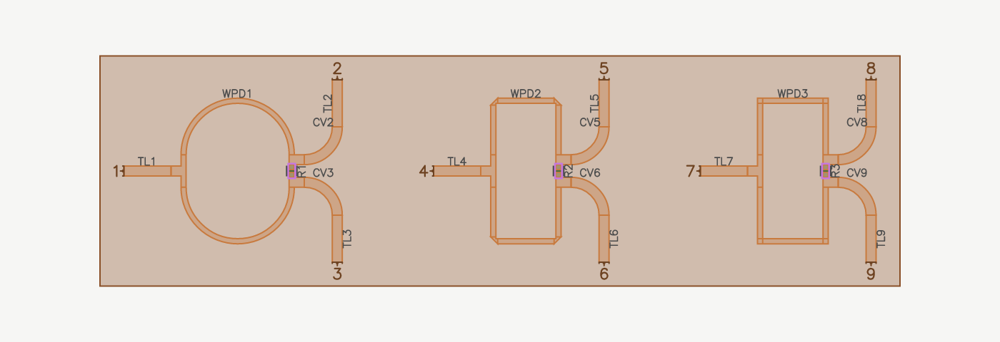

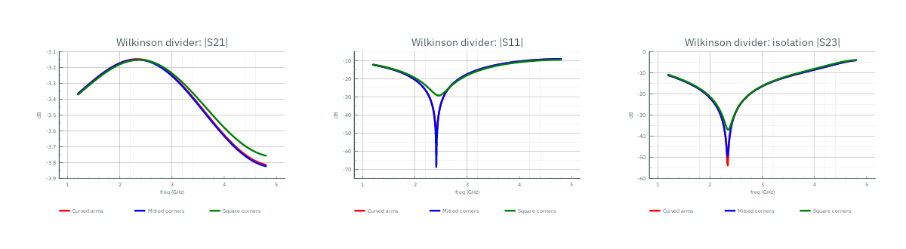

| At 2.4 GHz | Curve | Miter | Square |
|---|---|---|---|
| \|S11\| | −47.5 dB | −51.7 dB | −28.7 dB |
| \|S21\| | −3.149 dB | −3.152 dB | −3.152 dB |
| \|S23\| | −36.4 dB | −36.2 dB | −34.5 dB |
| ∠S21 | −173.0° | −173.0° | −172.8° |

The mitred divider's |S21| is the curved one's to 0.01 dB across the band, and all three keep |S11| below −20 dB from
about 2.0 to 2.8 GHz. Square corners reflect, from the excess capacitance an unchamfered corner carries: their match
bottoms out at −29 dB, and their |S21| strays from the curved one's by up to 0.06 dB.

## Branch-line hybrid

A one-section MBLC with `Z0` 50 Ω and `F` 2.4 GHz: 35.4 Ω series arms and 50 Ω shunt arms, each a quarter wave between
the reference planes of its junctions.

| At 2.4 GHz | Circuit | Planar MoM | EMerge | Palace |
|---|---|---|---|---|
| \|S11\| | −30.4 dB | −27.2 dB | −18.2 dB | −18.0 dB |
| \|S21\|, through | −3.20 dB | −2.98 dB | −3.53 dB | −3.60 dB |
| \|S31\|, coupled | −3.19 dB | −3.35 dB | −2.99 dB | −3.14 dB |
| ∠S21 − ∠S31 | 90.1° | 90.0° | 90.2° | 90.4° |

Planar is within 0.22 dB of the model, and every solver holds the 90° within 0.5°. The two 3D solvers agree with each
other within 0.15 dB, and both read the through port low.

## Rat-race hybrid

An MRRC with `Z0` 50 Ω and `F` 2.4 GHz, its 70.7 Ω ring drawn as two straight runs and two half-turns: ports 2, 1 and 3
a quarter wave apart on the upper run, and port 4 on the lower.

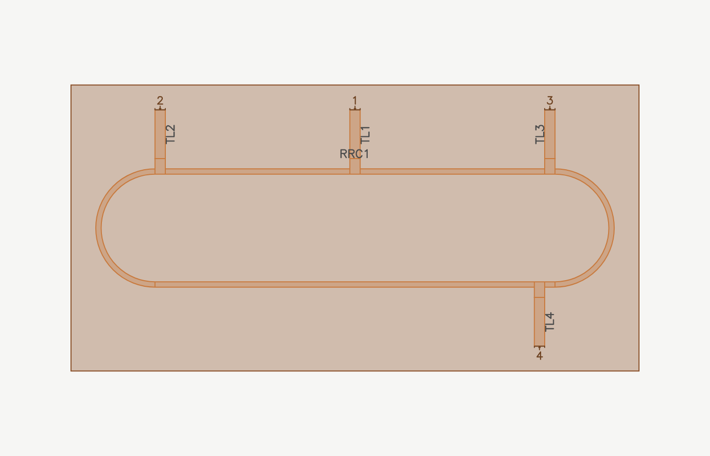

| At 2.4 GHz | Circuit | Planar MoM | EMerge | Palace |
|---|---|---|---|---|
| \|S11\|, Σ | −51.0 dB | −27.4 dB | −21.1 dB | −25.7 dB |
| \|S21\| | −3.21 dB | −3.14 dB | −3.18 dB | −3.24 dB |
| \|S31\| | −3.16 dB | −3.11 dB | −3.16 dB | −3.12 dB |
| \|S41\|, Σ to Δ | −50.3 dB | −53.3 dB | −41.8 dB | −33.6 dB |
| ∠S21 − ∠S31 | 0.0° | 0.1° | −0.7° | −2.2° |

Every split is within 0.1 dB of the model and the sum within 2.2° of in phase. Outside the band the ring's nulls move
fast with frequency, so a small shift reads as several dB.

## Coupled-line coupler

An MCLC with `Coupling` 10 dB, `Z0` 50 Ω and `F` 2.4 GHz: two 0.888 mm strips 0.115 mm apart and 19.2 mm long. The
feeds are drawn at the strip width, so no step in the copper sits outside the model.

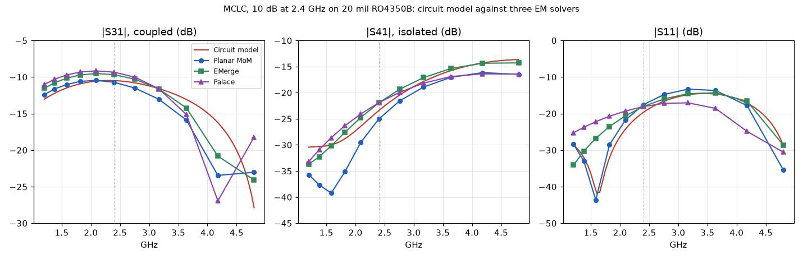

| At 2.4 GHz | Circuit | Planar MoM | EMerge | Palace |
|---|---|---|---|---|
| \|S31\|, coupled | −10.49 dB | −10.72 dB | −9.67 dB | −9.33 dB |
| \|S21\|, through | −0.64 dB | −0.60 dB | −0.72 dB | −0.82 dB |
| \|S41\|, isolated | −23.4 dB | −25.1 dB | −21.9 dB | −21.9 dB |
| \|S11\| | −19.7 dB | −17.6 dB | −18.1 dB | −18.1 dB |

Planar lands within 0.23 dB of the model's coupling and the 3D solvers read about 1 dB more. The directivity, 12 to
14 dB, is microstrip's limit: the odd mode outruns the even.

## Coupled-line balun

An MCBL from 50 Ω to 200 Ω on each output at 2.4 GHz, with `Gap` 4 mm between its sections. 50 Ω outputs would need a
gap under a tenth of the substrate height, which the part refuses.

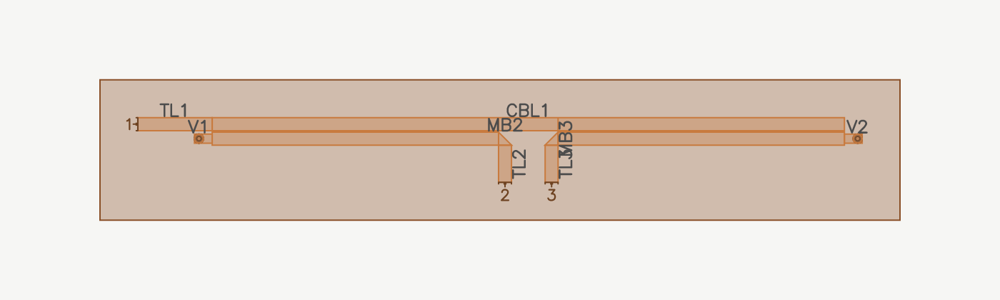

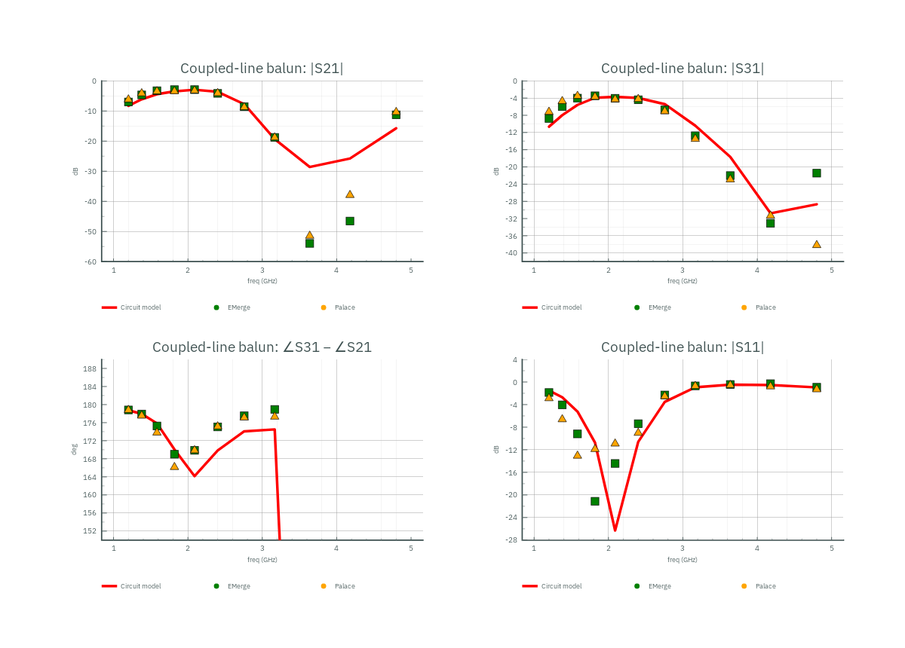

| At 2.4 GHz | Circuit | Planar MoM | EMerge | Palace |
|---|---|---|---|---|
| \|S21\| | −3.63 dB | refused | −4.15 dB | −4.10 dB |
| \|S31\| | −3.96 dB | refused | −4.39 dB | −4.24 dB |
| ∠S31 − ∠S21 | 169.8° | refused | 175.1° | 175.1° |
| \|S11\| | −10.6 dB | refused | −7.4 dB | −9.0 dB |

Planar refuses the layout: its two ground vias are 0.71 λ apart at 4.8 GHz, past its via kernel's tenth of a wavelength.
The match is narrow and sits below F, because the joining and output lines the board needs add to the sections' length.

## Gysel divider

An MGPD with `Z0` 50 Ω and `F` 2.4 GHz: the ring's quarter waves of 70.7 Ω to each output and of 50 Ω to each
isolation node, and the half wave between the nodes, each node to a ground via through a 50 Ω 0402.

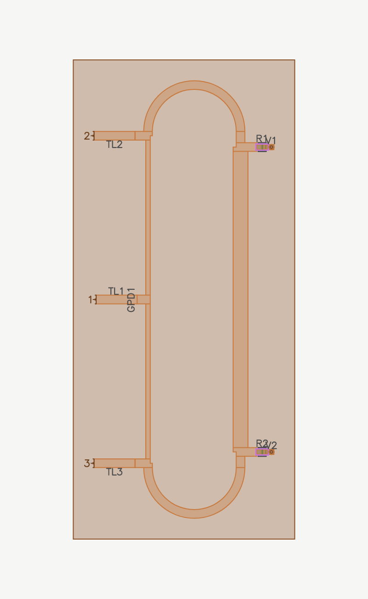

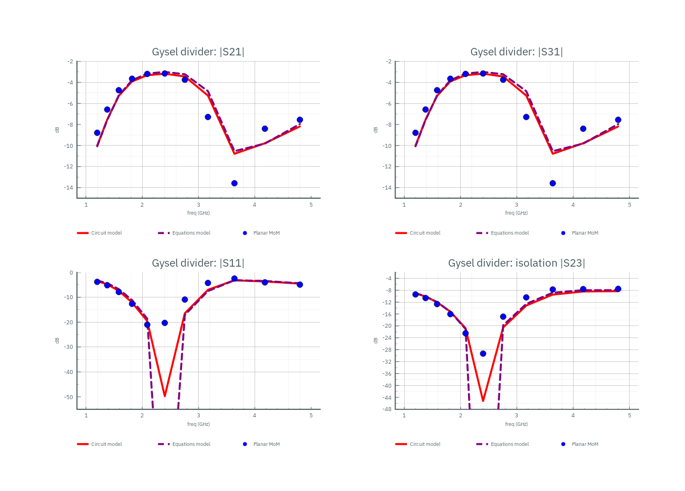

| At 2.4 GHz | Equations | Circuit | Planar MoM |
|---|---|---|---|
| \|S11\| | below −100 dB | −49.8 dB | −20.3 dB |
| \|S21\| = \|S31\| | −3.01 dB | −3.18 dB | −3.16 dB |
| \|S23\| | below −100 dB | −45.2 dB | −29.3 dB |

The vias are half a wavelength apart, past the reach of Planar's via kernel, so the setup cuts each out with a port of
its own and the bench closes it with the via's model, as it closes each resistor.

## Bagley divider

A three-way MBPD with `Z0` 50 Ω and `F` 2.4 GHz: the outputs on the corners of a polygon of half waves, the input a
quarter wave from the first and last corners. Only the input is matched.

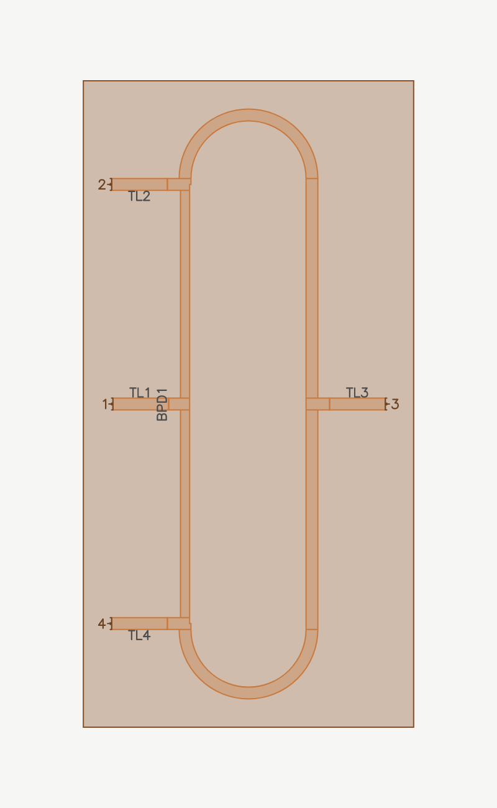

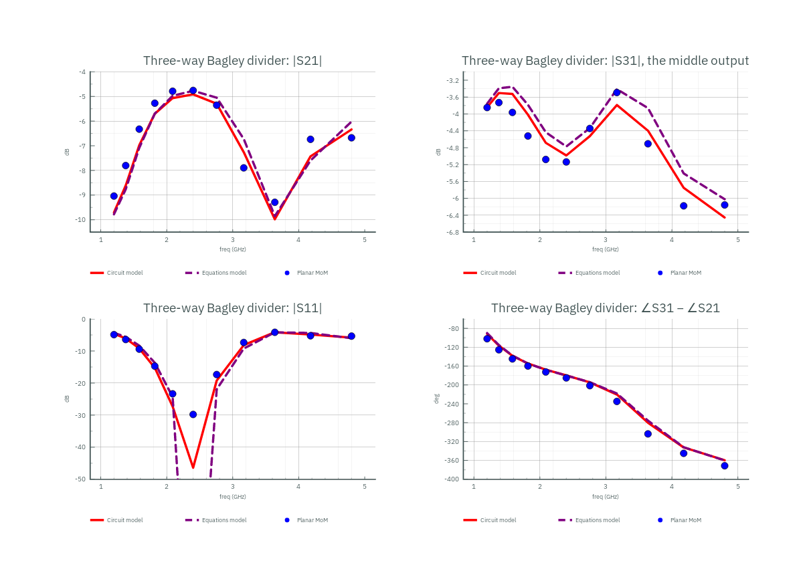

| At 2.4 GHz | Equations | Circuit | Planar MoM |
|---|---|---|---|
| \|S11\| | below −100 dB | −46.4 dB | −29.8 dB |
| \|S21\| = \|S41\| | −4.77 dB | −4.92 dB | −4.76 dB |
| \|S31\| | −4.77 dB | −4.98 dB | −5.14 dB |
| ∠S31 − ∠S21 | −180.0° | −179.8° | −185.1° |

The model's outputs are within 0.21 dB of a third each, neighbouring corners in opposite phase.

## Tee divider

An MTPD with `K` = 1.4142: one tee whose arms are quarter-wave transformers to 86.6 Ω and 61.2 Ω, so port 3 takes
twice port 2's power. There is no resistor, so the outputs are not isolated.

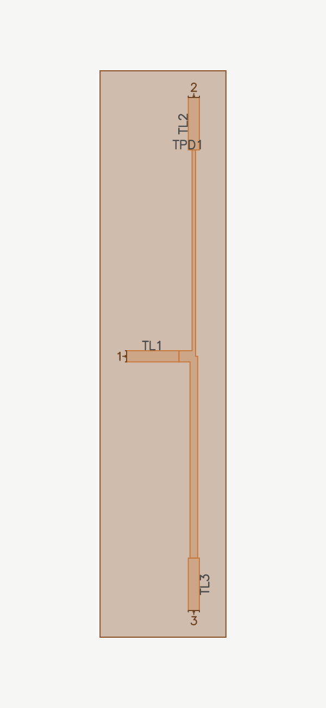

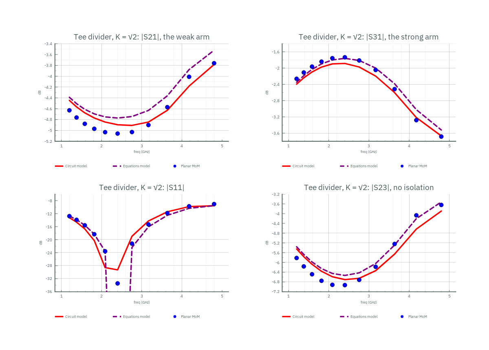

| At 2.4 GHz | Equations | Circuit | Planar MoM |
|---|---|---|---|
| \|S11\| | below −100 dB | −29.3 dB | −33.4 dB |
| \|S21\| | −4.77 dB | −4.89 dB | −5.06 dB |
| \|S31\| | −1.76 dB | −1.89 dB | −1.74 dB |
| \|S23\| | −6.53 dB | −6.70 dB | −6.93 dB |

The model splits 3.00 dB between the outputs, as the ideal lines do; Planar splits 3.32 dB.

## Schiffman phase shifter

An MSPS with `Phase` 90° and `Band` 1.4: a C-section on ports 1-2 and a reference line, folded on a half-turn, on
ports 3-4. Ports 1 and 2 leave the C-section's strips at their own width, and the reference's feeds are 8.06 mm, which
brings the bench's difference in phase to the part's 90° at F.

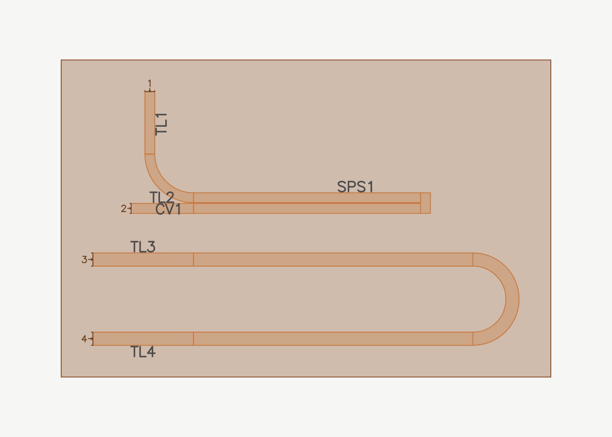

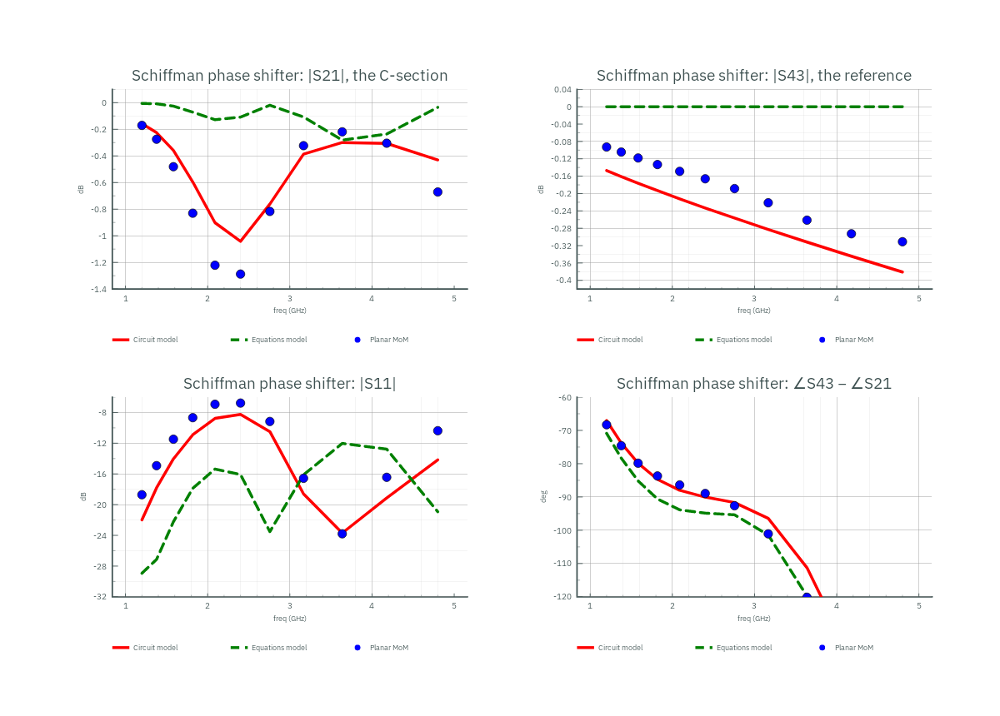

| At 2.4 GHz | Equations | Circuit | Planar MoM |
|---|---|---|---|
| \|S21\|, C-section | −0.11 dB | −1.04 dB | −1.29 dB |
| \|S43\|, reference | 0.00 dB | −0.23 dB | −0.17 dB |
| \|S11\| | −16.1 dB | −8.3 dB | −6.8 dB |
| ∠S43 − ∠S21 | −94.9° | −90.0° | −89.0° |

The ideal pair is matched, and its −16 dB is the feeds' 59 Ω; on microstrip the modes travel at different speeds, which
no length fixes, and the model's match is −8 dB.

## Delay line

An MDLY of 360° at 2.4 GHz meandered in two half-turns, each pin on a 5 mm line to its port.

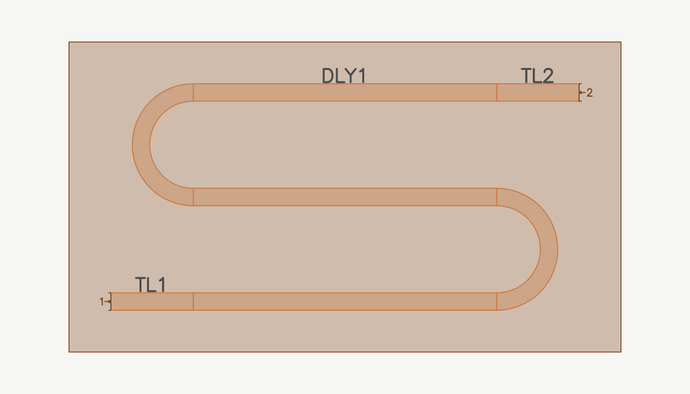

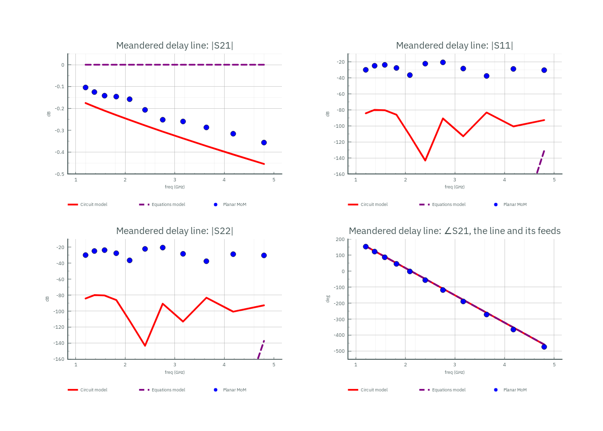

| At 2.4 GHz | Equations | Circuit | Planar MoM |
|---|---|---|---|
| \|S11\| | below −100 dB | below −80 dB | −22.3 dB |
| \|S21\| | 0.00 dB | −0.28 dB | −0.21 dB |
| ∠S21, the line and its feeds | −408.8° | −408.8° | −416.3° |

The model holds the 360° through its turns to 0.01°; Planar reads the run 7.5° long, 1.8 %.

## Compact rat-race

The Rat-Race cell with `Meander` = 1: the ring's 3λ/4 arm folded inside it, so the copper takes 54 % of the curved
ring's area.

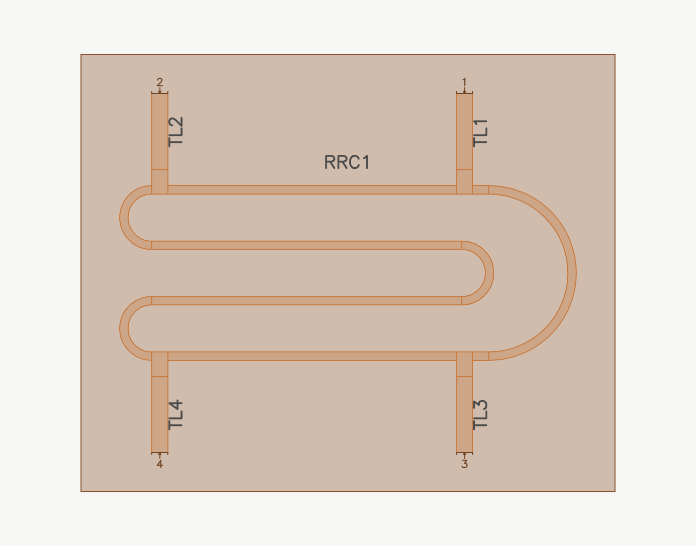

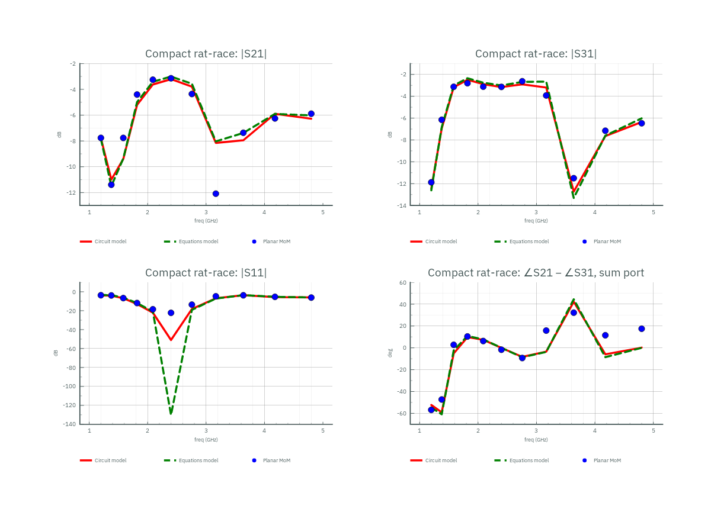

| At 2.4 GHz | Equations | Circuit | Planar MoM |
|---|---|---|---|
| \|S11\|, Σ | below −100 dB | −51.0 dB | −22.2 dB |
| \|S21\| | −3.01 dB | −3.21 dB | −3.14 dB |
| \|S31\| | −3.01 dB | −3.16 dB | −3.14 dB |
| \|S41\|, Σ to Δ | below −100 dB | −50.3 dB | −47.9 dB |
| ∠S21 − ∠S31 | 0.0° | 0.0° | −1.7° |

The split is the full ring's to 0.1 dB in both the model and Planar; Planar's sum match is 5 dB shallower than on the
full ring.

## Three-section coupler

The Coupler cell's board with `Sections` = 3 at 15 dB over 2:1: three quarter-wave pairs in a row, the middle one the
tightest. The feeds are drawn at the end sections' strip width.

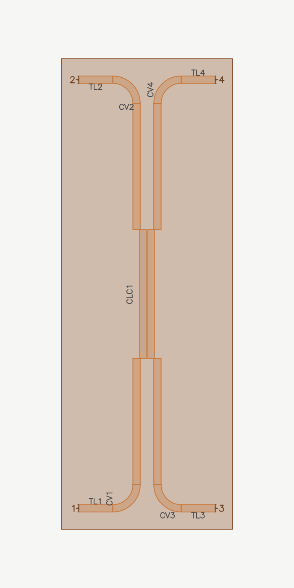

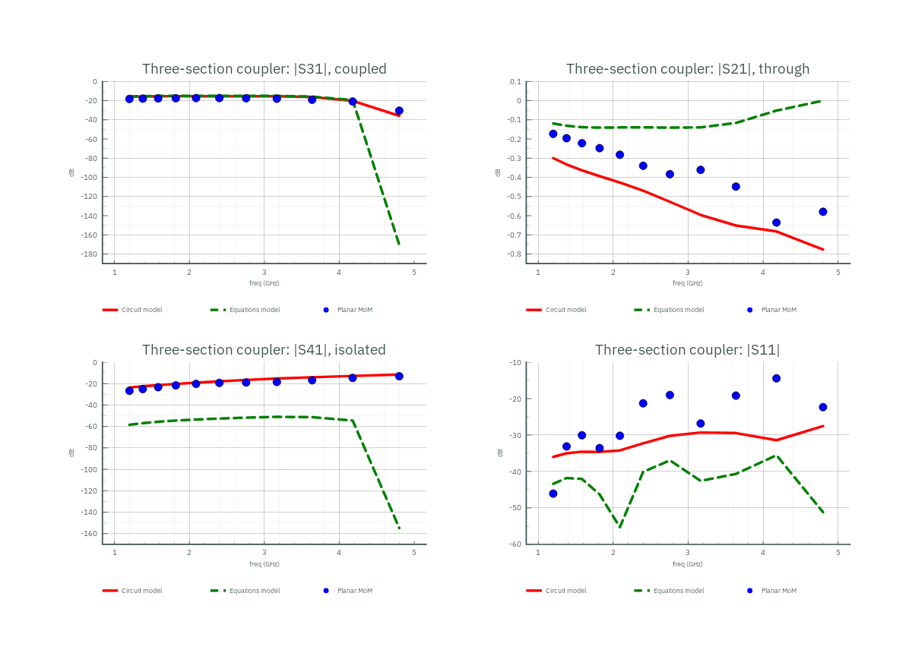

| At 2.4 GHz | Equations | Circuit | Planar MoM |
|---|---|---|---|
| \|S31\|, coupled | −15.03 dB | −15.44 dB | −17.29 dB |
| \|S21\|, through | −0.14 dB | −0.47 dB | −0.34 dB |
| \|S41\|, isolated | −52.6 dB | −17.9 dB | −19.4 dB |
| \|S11\| | −40.1 dB | −32.3 dB | −21.3 dB |

On ideal lines the isolation is the feeds' alone; on microstrip the odd mode outruns the even over three quarter waves,
and the model and Planar both put the isolated port within 2.5 dB of the coupled one.

## Tandem coupler

An MCLC with `Tandem` = 1 and `Coupling` 3 dB: two 8.33 dB couplers joined around both ends. Each joining line is
broken where a port's lead crosses it, and a bond wire, stood in for by a 0.5 nH inductor, closes each break on J1-J2
and J3-J4. Circuit only: a bond wire has no artwork, so Planar cannot model it and LVS reports the two as
schematic-only devices, as for the interdigitated coupler. Its bench compares the circuit with the equations model.

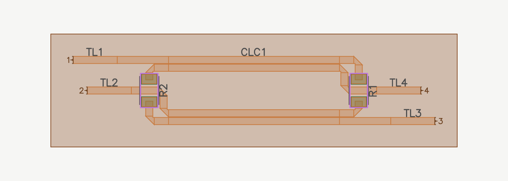

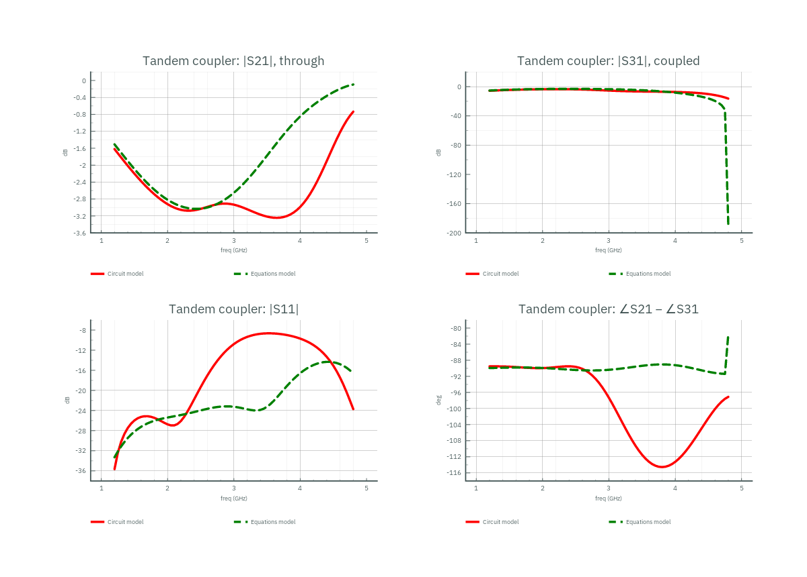

| At 2.4 GHz | Equations | Circuit |
|---|---|---|
| \|S21\|, through | −3.03 dB | −3.07 dB |
| \|S31\|, coupled | −3.05 dB | −3.60 dB |
| \|S11\| | −24.3 dB | −21.8 dB |
| ∠S21 − ∠S31 | −90.3° | −89.5° |

The equations model joins the two couplers directly. The model's outputs are within 1 dB of each other from 1.87 to
2.60 GHz, and in quadrature within 1° from 1.2 to 2.68 GHz.

## Lumped Wilkinson

An MWPD with `Realization` = `Lumped`, `Arm` = `Pi` and `Footprint` = `smt:0402`: its interconnect only, and on its
sites the parts Place Site Parts put there, 100 Ω on R2-R3, 4.69 nH on each arm and 1.88, 0.94 and 0.94 pF to ground,
all 0402s. Each capacitor's ground pad goes to a via.

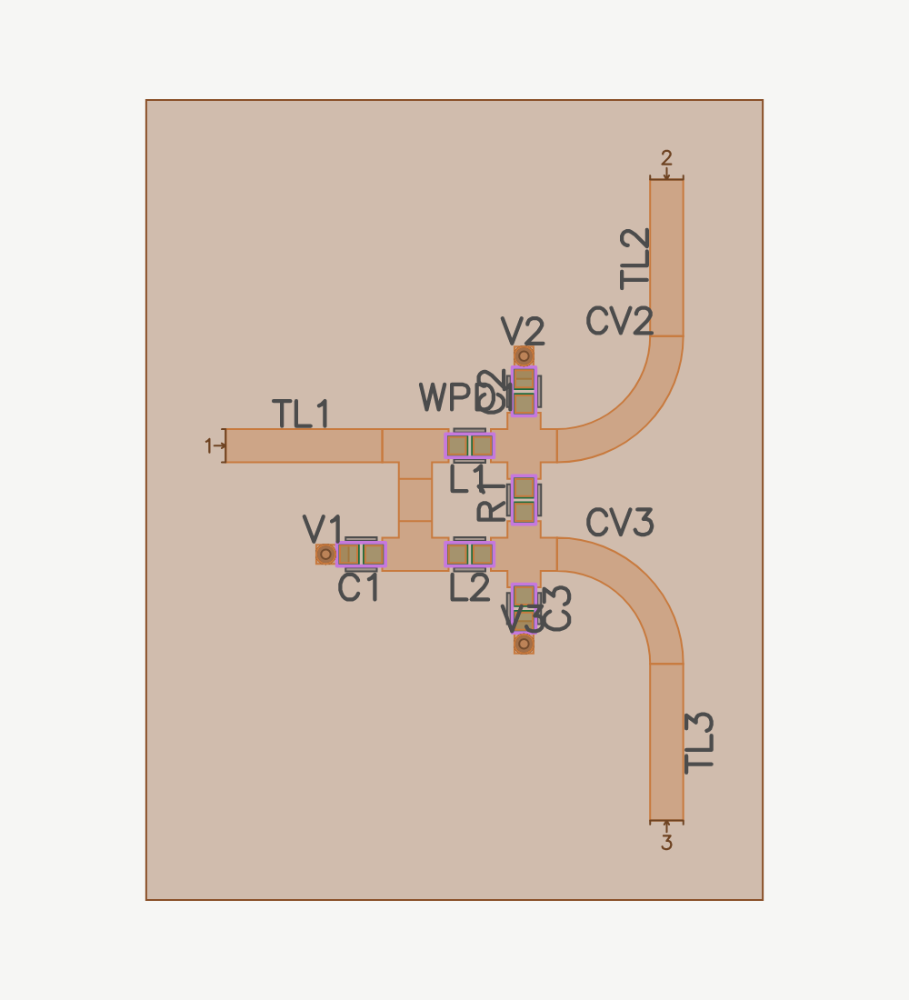

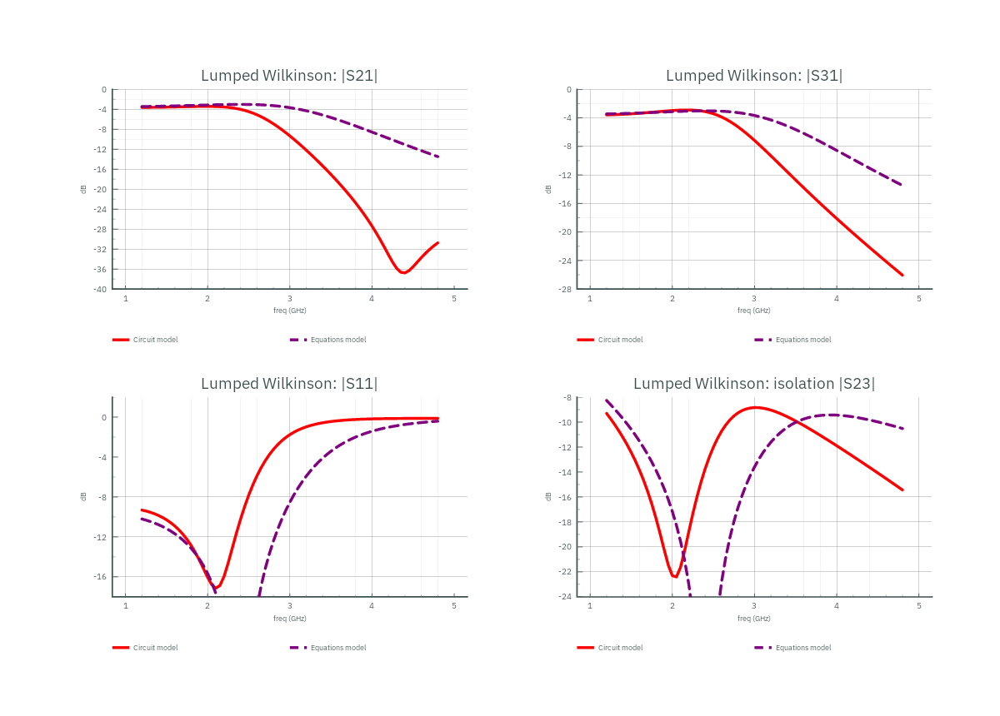

| At 2.4 GHz | Equations | Circuit |
|---|---|---|
| \|S11\| | below −100 dB | −10.3 dB |
| \|S21\| | −3.01 dB | −4.01 dB |
| \|S31\| | −3.01 dB | −3.12 dB |
| \|S23\| | below −100 dB | −13.7 dB |

The values are the lines' equivalents at F and do not absorb the interconnect, so on this board the pads and junctions
detune the divider: its match bottoms out at −17.2 dB at 2.10 GHz. Circuit only.

## Resistive pad

An MRPAD with `Form` = `Pi` and `Attenuation` 6 dB: 37.35 Ω in series and 150.48 Ω from each port to a ground via,
the three 0402s placed by Place Site Parts.

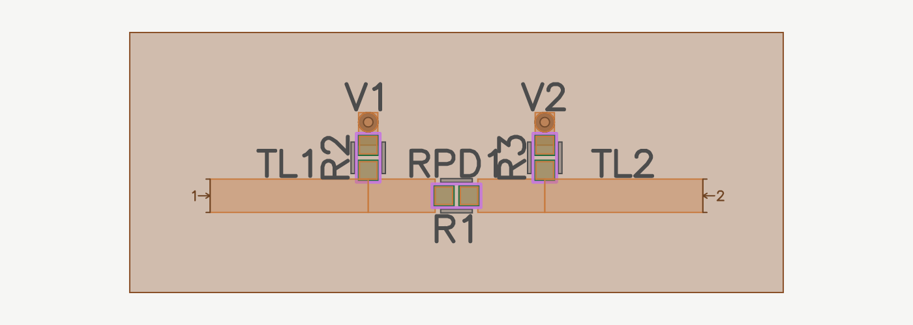

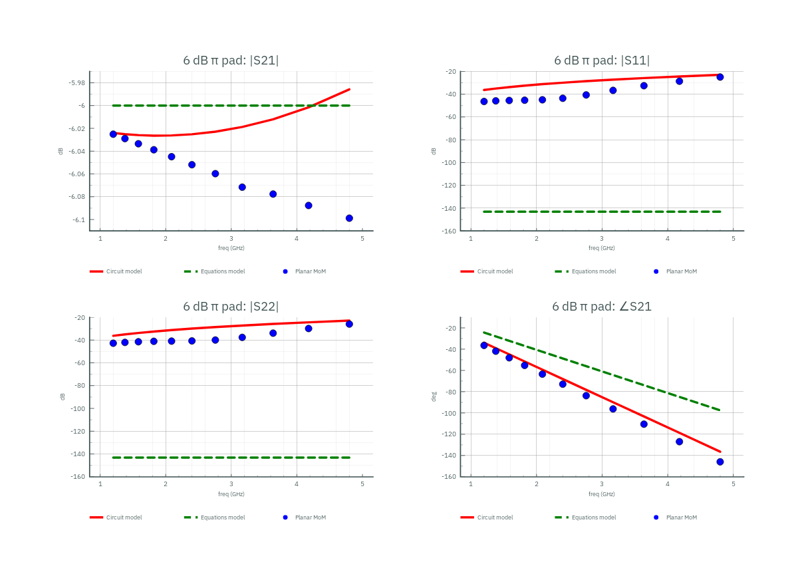

| At 2.4 GHz | Equations | Circuit | Planar MoM |
|---|---|---|---|
| \|S21\| | −6.00 dB | −6.03 dB | −6.05 dB |
| \|S11\| | below −100 dB | −30.0 dB | −43.6 dB |
| ∠S21 | −48.8° | −68.1° | −72.9° |

The loss is the ideal resistors' to 0.05 dB; the pads' interconnect adds 19° of line in the model and 24° in Planar.

## Open points

- **Branch-line:** the 3D |S21| reads 0.33 to 0.40 dB low; a series reactance per lumped port does not explain it.
- **Unequal split:** the 3D results send 0.5 to 0.9 dB too much to port 2; the cause is not established.
- **Balun:** the outputs are about 170° apart, not 180°: microstrip's even and odd modes travel at different speeds.
- **Coupler:** the 3D results read about 1 dB more coupling than the model and Planar.
- **Narrow gaps** need Planar's edge mesh and finer 3D meshes, which the coupler's and the balun's setups have.
- **Tandem:** its crossovers are bond wires with no artwork, so Planar cannot model them and LVS reports both. An SMT
  jumper does not fit: the break is three strip widths, too narrow for a pad either side of the lead.
- **Lumped Wilkinson:** the values do not absorb the interconnect yet, so at 2.4 GHz the board detunes the divider.
- **The interdigitated coupler (MIDC) has no cell yet.** Its jumpers cross a finger, which Planar cannot model and the
  3D view needs drawn by hand, and its 163 µm fingers need tapered feeds before a calibrated port can sit on them.

## Things to try

- **Change `F` or `Z0`** on a part: it is re-planned, and Update Layout redraws the board for a new EM run.
- **Change a closing resistor on a bench**, such as `R1_pl` on Wilkinson Bench, and watch |S23| move with no EM run.
- **Change `K` on Unequal** and set `R1` to Z0·(K + 1/K); a `K` the board cannot draw is refused (4 asks for 412 Ω).
- **Set `N` to 3 on Broadband**: the part grows `R2_3`/`R3_3`, and the readout gives the three resistors.
