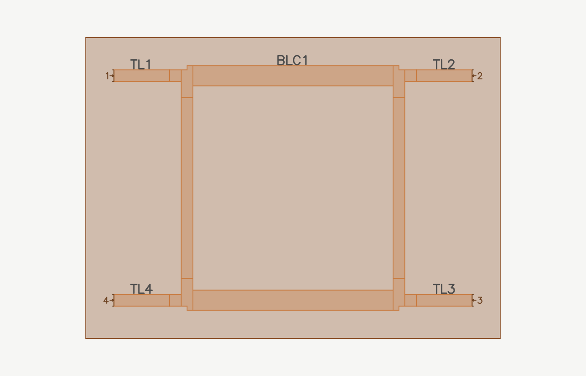
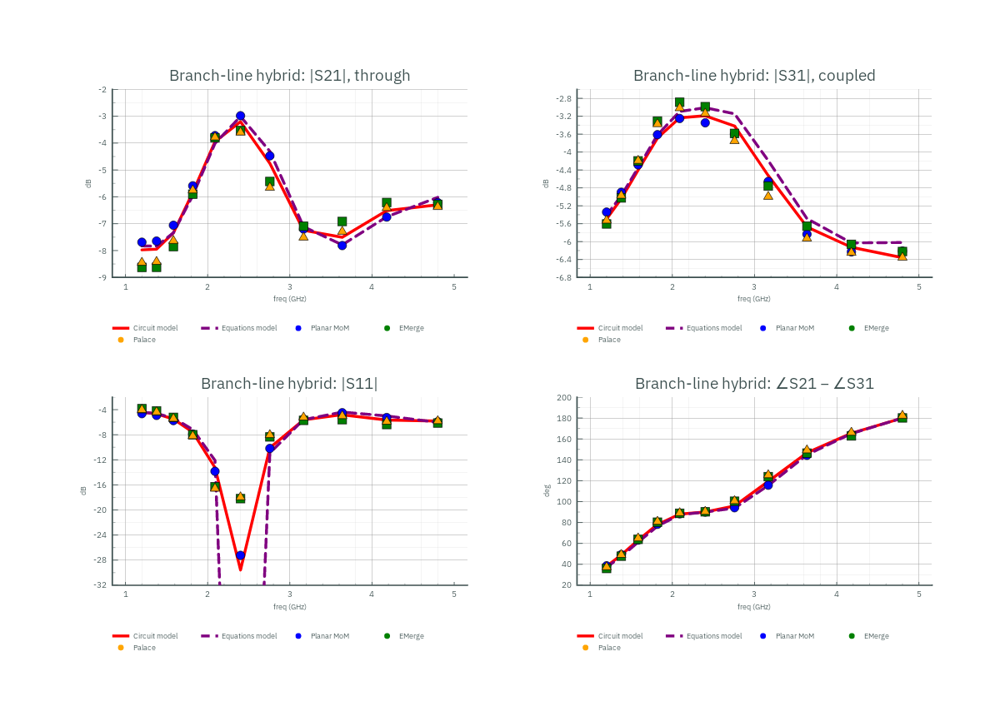
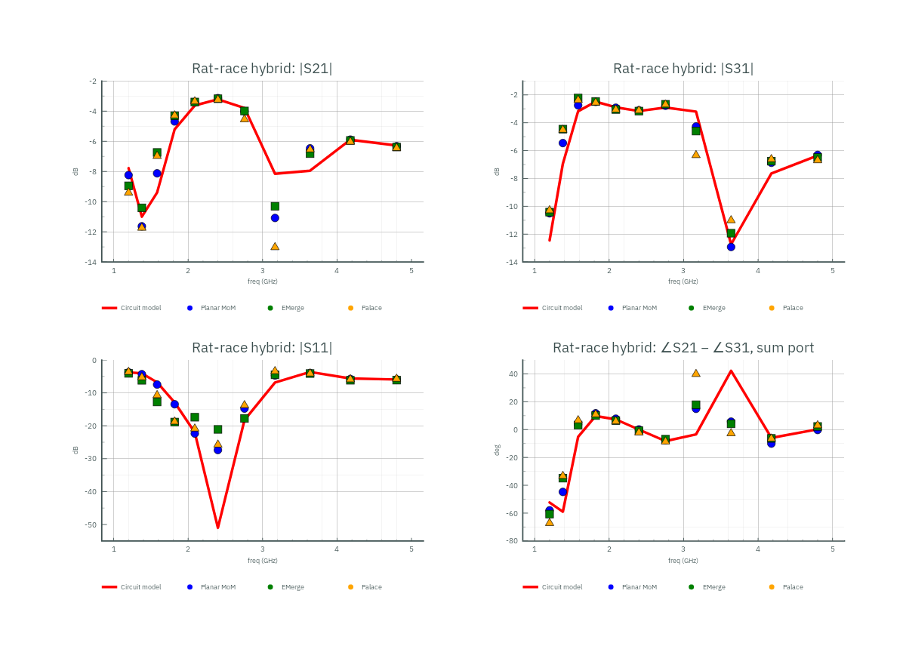
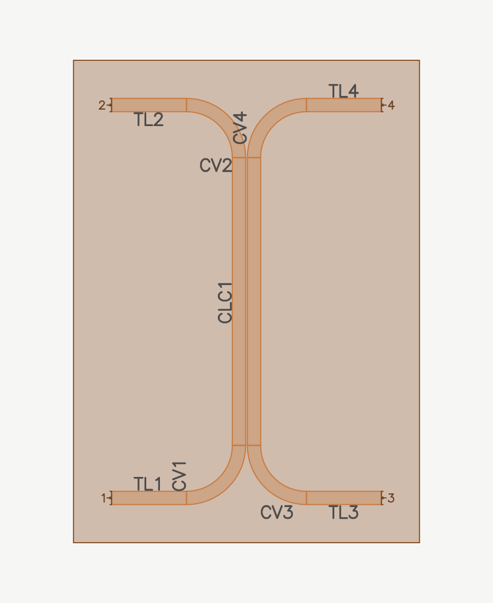

# Dividers and Couplers

RF dividers and couplers placed as single parts, each stated by its specifications and drawn from the same plan its
circuit model simulates. One cell per component. Today the workspace holds the **Wilkinson divider** (an MWPD), the
**branch-line hybrid** (an MBLC), the **rat-race hybrid** (an MRRC), the **coupled-line coupler** (an MCLC) and the
**coupled-line balun** (an MCBL), each at 2.4 GHz on a 20 mil RO4350B board, laid out by Update Layout from Schematic and
solved against its circuit model on the Planar MoM solver, EMerge and Palace (the balun on the two 3D solvers only).
The sections up to [Things to try](#things-to-try) are the Wilkinson's; the other four follow, one section each, and
the interdigitated coupler, which has no cell yet, closes the page.

## The cells

| Cell | Views | What it is |
|---|---|---|
| **Wilkinson** | schematic, layout, EM setup, 3D view | The test bench and the board: a 5 mm input line, the MWPD, a 100 Ω resistor with an 0402 land pattern on R2-R3, and each output bending away through a 90° MCURVE and a 5 mm line to its port |
| **Branch-Line** | schematic, layout, EM setup, 3D view | A one-section MBLC with a 5 mm line from each of its four pins to a port |
| **Rat-Race** | schematic, layout, EM setup, 3D view | An MRRC with a 5 mm line from each of its four pins to a port |
| **Coupler** | schematic, layout, EM setup, 3D view | A 10 dB coupled-line coupler (MCLC) at 2.4 GHz, each of its four ports reached through a 90° MCURVE and a 5 mm line that bend away from the other strip |
| **Balun** | schematic, layout, EM setup, 3D view | A coupled-line balun (MCBL) from 50 Ω to 200 Ω on each output at 2.4 GHz, a via to ground on each coupled strip, a 5 mm input line and each output turned down through a mitred bend and 2.5 mm of line |

## How it was built

1. **Schematic.** `WPD1` is an MWPD with `Z0` 50 Ω, `F` 2.4 GHz and `Gap` 1.35 mm, the 0402's pin span. Nothing else is
   typed: select it, and its parameters show what the board makes of those specs — a 1.05768 mm port width, 0.548 mm arms
   of 70.7 Ω, a quarter wave of 18.903 mm and a ring radius of 5.743 mm. `R1` is 100 Ω, 2·Z0, with `Footprint`
   `smt:0402`, dropped on the symbol's R2-R3 pins. The lines use the VAR `W50`, set to the readout's port width exactly,
   so they meet the divider's pins with no step in the copper.
2. **Why the outputs bend away.** The divider's two output pins are only Gap + W apart, 2.4 mm centre to centre. The
   Planar solver calibrates each port on an isolated line and refuses a port with another port's metal closer than five
   substrate heights, so each output turns 90° away and runs 5 mm before its port. A board would route them apart anyway.
3. **Design ▸ Update Layout from Schematic.** It places the ring, lays the 0402 across the ring's gap, chains the lines
   on, puts the three ports at the line ends and pours the ground plane on Bottom Copper. LVS matches
   (`circuitrf lvs Wilkinson`).
4. **EM setups.** `Wilkinson/em/Wilkinson Planar.cem` is the Planar setup. **Design ▸ New 3D View from Layout** made the
   3D view, which has two setups, **Palace** and **EMerge**. All three name `R1` as a component port.

## Run it

| Step | What | Time here |
|---|---|---|
| 1 | Simulate the schematic | under a second |
| 2 | Simulate the EM setup **Wilkinson Planar** | about 6½ min |
| 3 | Open the 3D view, run setup **EMerge** | about 1 min |
| 4 | Run setup **Palace** in the same view | about 1½ min |

Times are from a shared Linux server, 8 threads for Planar and EMerge, and 8 Palace processes on one compute node. The
first 3D run offers to install its solver. The three Touchstone files the runs write are in `results/`, so the comparison
below can be read without running anything.

## The resistor and the EM runs

**Each EM run leaves the resistor out, and says so.** The ring joins R2 to R3, so the 0402's two pads lie on one piece
of copper. A component port is built only across pads that are not already joined, so `R1` is left out of every run
with a warning, and each result is a three-port: the divider without its resistor. That does not spoil the comparison:

- **Driven from port 1, the resistor carries no current.** The two arms are mirror images, so R2 and R3 sit at the same
  voltage. |S11|, |S21| and |S31| are the same with and without the resistor; the circuit model gives identical
  numbers both ways.
- **The isolation, |S23|, does depend on it.** The EM results are compared with the circuit model with the resistor
  removed, which is the same structure. The designed isolation is the circuit model's with 100 Ω.

## What you will see

At 2.4 GHz:

| | Circuit, 100 Ω | Circuit, no resistor | Planar MoM | EMerge | Palace |
|---|---|---|---|---|---|
| \|S11\| | −47.5 dB | −47.5 dB | −27.9 dB | −24.5 dB | −25.0 dB |
| \|S21\| | −3.149 dB | −3.149 dB | −3.114 dB | −3.134 dB | −3.128 dB |
| \|S31\| | −3.149 dB | −3.149 dB | −3.114 dB | −3.133 dB | −3.210 dB |
| \|S23\| | −36.4 dB | −6.2 dB | −6.5 dB | −6.3 dB | −5.9 dB |

Across 1.2 to 4.8 GHz, eleven points from F/2 to 2F:

| | Planar MoM | EMerge | Palace |
|---|---|---|---|
| Largest difference in \|S21\| from the circuit model | 0.06 dB | 0.20 dB | 0.43 dB |
| Largest difference in \|S31\| from the circuit model | 0.06 dB | 0.31 dB | 0.54 dB |
| Largest difference in \|S23\| from the circuit model without the resistor | 0.7 dB | 0.7 dB | 1.2 dB |
| Worst \|S11\| in the band (circuit model −9.1 dB) | −9.0 dB | −9.9 dB | −7.8 dB |
| Deepest \|S11\| of the eleven points | 2.40 GHz | 2.09 GHz | 2.40 GHz |

**All three solvers put |S21| within 0.04 dB of the model at 2.4 GHz.** The model's |S21| of −3.149 dB is the ideal
−3.01 dB plus about 0.14 dB of conductor and dielectric loss in the arms and the 10 mm of line. Planar follows the model
within 0.06 dB across the whole band. Its |S11| null is where the model's is, but 28 dB deep rather than 47 dB: a deep
null is a small difference of two large numbers, and a few hundredths of a dB of arm loss or junction reactance moves
it.

**The 3D runs read further from the model away from 2.4 GHz**, Palace most. Both use coarse meshes (below), and in 3D
each port is a lumped sheet from the line down to the ground plane, 20 mil tall, whose own inductance stays in the
answer. Palace's |S21| and |S31| also differ from each other by up to 0.1 dB on a layout that is symmetric: its draft
mesh is not. Its |S11| is up to 3 dB worse than the model's at the band edges.

**The model warns, and it should.** The run's Messages say that MTEE's junction formulas are calibrated at εr 9.9 and
this board is 3.66, that the tee's branch is a little wider than their W/h range, and that the ring's bend radius,
10.5 widths, is past the 3 to 7 widths MCURVE's length rule is stated for. At 2.4 GHz none of this moves |S21| by more
than the solvers disagree with one another.

## Run times and meshes

| | Mesh | Unknowns | Wall time | Peak memory |
|---|---|---|---|---|
| Circuit model | — | — | under a second | — |
| Planar MoM | 3,036 cells | 5,466 | 6 min 24 s | 1.6 GB |
| EMerge | 11,033 tetrahedra | 79,972 | 58 s | 1.7 GB |
| Palace | 54,807 tetrahedra | 72,034 | 1 min 24 s | 2.0 GB |

## What was traded for speed

- **Planar: edge mesh off, and `"LocalGrid": false`.** The local grid sizes its cells from the sweep's top frequency, so
  with it on the mesh, and the answer, would change if the band changed.
- **EMerge: the Draft preset, no adaptive mesh passes, and its adaptive frequency sweep.**
- **Palace: the Draft preset and `AdaptiveMaxIterations` 0** — one solve on the initial mesh, no refinement — with its
  adaptive frequency sweep, built from 4 full solves. The two hybrids refine twice; their sections say why.
- **The 3D air box is 5 mm on the sides and the top**, about ten substrate heights.
- **Eleven log-spaced points from 1.2 to 4.8 GHz**, F·2^(k/5) for k = −5 … 5, so 2.4 GHz is one of them.

## Things to try

- **Change `F` or `Z0`** and simulate: the ring is redrawn and re-solved from the new specs. Update Layout redraws the
  layout; re-run the EM setups to compare again.
- **Remove `R1`, or change it**, and watch |S23| and |S22| while |S21| and |S11| stay put.

## The branch-line hybrid

**The cell.** `BLC1` is an MBLC with `Z0` 50 Ω, `F` 2.4 GHz and `N` 1. Select it, and its parameters show what the board
makes of those specs: 1.05768 mm feeds, series arms 1.81424 mm wide (35.4 Ω) and 18.05 mm long, and shunt arms of the
feed width (50 Ω), 18.46 mm long, each length measured between the reference planes of the junctions it joins. A 5 mm
line of `W50` runs from each pin to a port. The ports are an arm's length apart, so no line needs to bend away. Update
Layout from Schematic places the part and the lines and pours the ground plane; `Branch-Line/em/Branch-Line Planar.cem`
is the Planar setup, and the 3D view holds **EMerge** and **Palace**.

**At 2.4 GHz**, driven at port 1:

| | Circuit model | Planar MoM | EMerge | Palace |
|---|---|---|---|---|
| \|S11\| | −30.4 dB | −27.2 dB | −18.2 dB | −18.0 dB |
| \|S21\| (through) | −3.20 dB | −2.98 dB | −3.53 dB | −3.60 dB |
| \|S31\| (coupled) | −3.19 dB | −3.35 dB | −2.99 dB | −3.14 dB |
| \|S41\| (isolated) | −30.5 dB | −27.1 dB | −18.5 dB | −18.2 dB |
| ∠S21 − ∠S31 | 90.1° | 90.0° | 90.2° | 90.4° |

Across 1.2 to 4.8 GHz, the eleven points from F/2 to 2F, and in brackets the three of them from 2.09 to 2.76 GHz:

| Largest difference from the circuit model | Planar MoM | EMerge | Palace |
|---|---|---|---|
| \|S21\| | 0.31 dB (0.26) | 0.70 dB (0.70) | 0.92 dB (0.92) |
| \|S31\| | 0.19 dB (0.19) | 0.39 dB (0.35) | 0.48 dB (0.34) |
| ∠S21 − ∠S31 | 3.4° (1.7°) | 4.8° (4.6°) | 6.4° (4.8°) |
| Deepest \|S11\| of the eleven points | 2.40 GHz | 2.40 GHz | 2.40 GHz |

**Planar follows the model within 0.22 dB at 2.4 GHz** and keeps the quadrature to 0.1°. The two 3D solvers agree with
each other within 0.15 dB; against the model they put 0.33 to 0.40 dB less into the through port and up to 0.2 dB more
into the coupled port, with |S11| and |S41| near −18 dB. A series reactance at each port in the circuit model, standing in for a
3D lumped port, moves the split the other way, so the 3D ports alone do not explain it; where the difference comes from
is not settled here. The 90° between ports 2 and 3 holds within 0.5° on every solver.

**The model's best match is a little below 2.4 GHz** (2.36 GHz), because the junctions' own reactance adds to the arms;
at 2.4 GHz it is still −30 dB. The model warns that MTEE's junction formulas are calibrated at εr 9.9.

| | Mesh | Unknowns | Wall time | Peak memory |
|---|---|---|---|---|
| Circuit model | — | — | under a second | — |
| Planar MoM | 2,248 cells | 4,110 | 1 min 26 s | 0.7 GB |
| EMerge | 7,377 tetrahedra | 52,786 | 1 min 20 s | 1.3 GB |
| Palace | 69,610 → 215,686 tetrahedra | 211,529 | 6 min 51 s | 5.9 GB |

**Palace refines its mesh twice here** (`AdaptiveMaxIterations` 2), where the Wilkinson's solves once. On the initial
Draft mesh alone it read |S21| 1.2 dB below the model and put the deepest |S11| at 2.09 GHz; two passes bring it within
0.15 dB of EMerge.

## The rat-race hybrid

**The cell.** `RRC1` is an MRRC with `Z0` 50 Ω and `F` 2.4 GHz. Its parameters show a 0.54815 mm ring (70.7 Ω) and
1.05768 mm feeds, a quarter wave of 18.903 mm (εeff 2.729) and half-turns of 5.79 mm centre-line radius. A plan's pieces
turn only in quarter turns, so the ring is two straight runs and two half-turns rather than a circle: ports 2, 1 and 3 sit
a quarter wave apart on the upper run and port 4 on the lower one, a quarter wave round the right half-turn from port 3.
A 5 mm line of `W50` runs from each pin to a port; the three upper ports are a quarter wave apart, so none needs to bend
away. Update Layout from Schematic, the Planar setup and the 3D view are as for the branch-line.

**At 2.4 GHz**, driven at the sum port 1 and at the difference port 4:

| | Circuit model | Planar MoM | EMerge | Palace |
|---|---|---|---|---|
| \|S11\| (Σ) | −51.0 dB | −27.4 dB | −21.1 dB | −25.7 dB |
| \|S21\| | −3.21 dB | −3.14 dB | −3.18 dB | −3.24 dB |
| \|S31\| | −3.16 dB | −3.11 dB | −3.16 dB | −3.12 dB |
| \|S41\| (Σ to Δ) | −50.3 dB | −53.3 dB | −41.8 dB | −33.6 dB |
| \|S23\| (output to output) | −50.3 dB | −32.1 dB | −25.2 dB | −30.3 dB |
| \|S24\| | −3.27 dB | −3.17 dB | −3.19 dB | −3.21 dB |
| \|S34\| | −3.21 dB | −3.15 dB | −3.15 dB | −3.24 dB |
| ∠S21 − ∠S31 (Σ, in phase) | 0.0° | 0.1° | −0.7° | −2.2° |
| ∠S24 − ∠S34 (Δ, out of phase) | 180.0° | 180.0° | 179.3° | 177.6° |

Across the eleven points from 1.2 to 4.8 GHz, and in brackets the three from 2.09 to 2.76 GHz:

| Largest difference from the circuit model | Planar MoM | EMerge | Palace |
|---|---|---|---|
| \|S21\| | 2.93 dB (0.22) | 2.66 dB (0.23) | 4.87 dB (0.75) |
| \|S31\| | 1.95 dB (0.13) | 2.48 dB (0.24) | 3.13 dB (0.22) |
| \|S24\| | 0.74 dB (0.27) | 0.62 dB (0.21) | 1.07 dB (0.36) |
| \|S34\| | 2.09 dB (0.24) | 5.54 dB (0.45) | 4.09 dB (0.74) |
| ∠S21 − ∠S31 | 36.5° (0.8°) | 38.0° (1.4°) | 44.9° (2.2°) |
| ∠S24 − ∠S34 | 16.3° (0.4°) | 27.7° (2.4°) | 39.2° (2.4°) |
| Deepest \|S11\| of the eleven points | 2.40 GHz | 2.40 GHz | 2.40 GHz |

**All three solvers put every split within 0.1 dB of the model at 2.4 GHz**, the sum within 2.2° of in phase and the
difference within 2.4° of opposite. Inside the hybrid's band Planar and EMerge stay within 0.25 dB of the model and
Palace within 0.75 dB.
Outside it the ring's nulls move fast with frequency: at 3.17 GHz, where the model's |S21| is falling through −8 dB
towards a null, a small shift of that null reads as several dB, which is what the eleven-point figures above measure.
The model's |S11| null at 2.4 GHz is 51 dB deep and the solvers' 21 to 27 dB: a null that deep is a small difference of
two large numbers, and any small difference in loss or junction reactance moves it. Palace refines its mesh twice here as well; on the initial Draft mesh alone it was 0.22 dB off at
2.4 GHz, with |S11| at −17 dB.

| | Mesh | Unknowns | Wall time | Peak memory |
|---|---|---|---|---|
| Circuit model | — | — | under a second | — |
| Planar MoM | 4,696 cells | 8,340 | 24 min 26 s | 3.0 GB |
| EMerge | 14,325 tetrahedra | 102,774 | 1 min 36 s | 2.1 GB |
| Palace | 103,776 → 314,861 tetrahedra | 313,090 | 12 min 31 s | 8.3 GB |

**Planar takes longest on the ring**: its grid follows the half-turns' arcs (367 × 169 lines against the branch-line's
123 × 85), which doubles the unknowns, and a dense solve grows with the cube of their count; the run took seventeen
times the branch-line's.

## The coupled-line coupler (cell Coupler)

**How it was built.** `CLC1` is an MCLC with `Coupling` 10 dB, `Z0` 50 Ω and `F` 2.4 GHz; its readout gives W 0.88809 mm,
S 0.11537 mm and L 19.193 mm. The four feeds are drawn at the coupler's own strip width (the VAR `WC`), so no step in the
copper sits outside the circuit model, and each turns away from the other strip through a 90° MCURVE of 3.5 mm radius and
runs 5 mm to its port: the coupler's ports 1 and 3 are only W + S = 1.0 mm apart, inside the Planar calibration's
isolation rule. Update Layout from Schematic joins 8 of 8 connections and LVS matches. Each run is the four-port
the schematic is.

At 2.4 GHz:

| | Circuit | Planar MoM | EMerge | Palace |
|---|---|---|---|---|
| \|S31\|, coupled | −10.49 dB | −10.72 dB | −9.67 dB | −9.33 dB |
| \|S21\|, through | −0.64 dB | −0.60 dB | −0.72 dB | −0.82 dB |
| \|S41\|, isolated | −23.4 dB | −25.1 dB | −21.9 dB | −21.9 dB |
| \|S11\| | −19.7 dB | −17.6 dB | −18.1 dB | −18.1 dB |
| Directivity | 12.9 dB | 14.3 dB | 12.3 dB | 12.6 dB |
| ∠S31 − ∠S21 | 91.3° | 91.3° | 92.3° | 92.0° |

Across the eleven points from 1.2 to 4.8 GHz:

| | Planar MoM | EMerge | Palace |
|---|---|---|---|
| Largest difference in \|S21\| from the circuit model | 0.21 dB | 0.15 dB | 0.22 dB |
| Largest difference in \|S31\| up to 3.2 GHz | 1.5 dB | 1.5 dB | 2.0 dB |
| Worst \|S11\| (circuit model −14.7 dB) | −13.3 dB | −14.3 dB | −17.1 dB |

**Planar MoM lands within 0.23 dB of the model's coupling at F; the two 3D solvers read about 1 dB more.** The coupling
lives in a 0.115 mm gap, a fifth of the substrate's height, and the field there is what each mesh has to resolve:

- **Planar needs its edge mesh here.** With the edge mesh off, the Wilkinson's setting, it read −11.96 dB (2,394
  unknowns, 51 s); with it on, −10.72 dB. The coupler's setup has it on.
- **The 3D Draft meshes are far too coarse for the gap.** EMerge's Draft preset read −7.2 dB and Palace's −5.8 dB, 3 to
  5 dB too strong. Refining moved both towards the model and towards each other: EMerge −8.0 dB on its Standard preset,
  −9.7 dB with three adaptive mesh passes (where its own refinement stops); Palace −8.5 dB with second-order elements on
  the Draft mesh, −9.33 dB with three refinement passes (its adaptive refinement from 58 k to 348 k tetrahedra). The setups here are those refined ones. What remains, about
  1 dB, was not chased further.
- **Away from F** all three follow the model to the 2F null, where the coupling falls through −20 dB and a small shift of
  the null is a large difference in dB.

**Directivity is microstrip's limit, not the solvers'.** The odd mode is faster than the even, so the isolated port sees
−22 to −25 dB while the coupled one sees −10: 12 to 14 dB of directivity at F, falling to about 6 dB by 3.2 GHz.

## The coupled-line balun (cell Balun)

**How it was built.** `CBL1` is an MCBL with `Z0` 50 Ω, `ZL` 200 Ω on each output, `F` 2.4 GHz and `Gap` 4 mm; its
readout gives W 0.86952 mm, S 0.10194 mm, L 19.244 mm, and sections of −9.5 dB coupling. **50 Ω on each output cannot be
built on this board**: it needs −4.8 dB sections, a gap under 0.1·h, and the part refuses it; 200 Ω each, a 400 Ω
balanced load, is the lightest a 100 µm gap matches. A VIAGND sits on each of `G2` and `G3`, which Update Layout places
beside the pin and ties to its pad. The outputs turn down through a mitred bend and 2.5 mm of line at the strip width
(the VAR `WB`); `Gap` is 4 mm so the two output lines are more than five substrate heights apart for the ports. Ports 2
and 3 are 200 Ω. Update Layout joins 5 of 5 connections and LVS matches.

At 2.4 GHz:

| | Circuit | EMerge | Palace |
|---|---|---|---|
| \|S21\| | −3.63 dB | −4.15 dB | −4.10 dB |
| \|S31\| | −3.96 dB | −4.39 dB | −4.24 dB |
| Amplitude balance, \|S21\| − \|S31\| | 0.33 dB | 0.24 dB | 0.14 dB |
| Phase balance, ∠S21 − ∠S31 | 169.8° | 175.1° | 175.1° |
| \|S11\| | −10.6 dB | −7.4 dB | −9.0 dB |

From 2.09 to 2.76 GHz (the points around F):

| | Circuit | EMerge | Palace |
|---|---|---|---|
| Amplitude balance | −2.3 to 0.8 dB | −1.8 to 1.2 dB | −1.7 to 1.1 dB |
| Phase balance | 164° to 174° | 170° to 178° | 170° to 177° |
| Worst \|S11\| | −3.5 dB | −2.3 dB | −2.5 dB |

**The Planar solver refuses this layout.** Its vertical (via) current kernel is validated to a tenth of a wavelength
between vias, and the two ground vias sit at the ends of the two sections, 44.5 mm apart: 0.71 λ at 4.8 GHz. The run stops
with that sentence, so the balun is compared on the two 3D solvers only.

**The balance holds; the match is narrow.** All three put the outputs within 0.35 dB of each other at F and within 5° to
10° of opposite phase. The model's 10° is microstrip's: the odd mode runs faster than the even, so the sections are not a
quarter wave for both, and as TEM pairs the same sections give exactly 180°. The 3D solvers read the sections' coupling a
little stronger, as on the coupler, which here lands their phase nearer 180° and their outputs about 0.5 dB lower. The
match is the weak part: the 4 mm joining line and the 2.5 mm output lines, which the board needs, move it off F, to
−10.6 dB at F in the model and −7 to −9 dB in 3D, with the best match below F, at 2.1 GHz in the model and 1.6 to 1.8 GHz in 3D. Shortening the sections for the extra line would recentre it; the plan keeps them a quarter wave.

### Run times and meshes, coupler and balun

| | Mesh | Unknowns | Wall time | Peak memory |
|---|---|---|---|---|
| Coupler, Planar MoM (edge mesh on) | 3,156 cells | 5,874 | 9 min 28 s | 1.3 GB |
| Coupler, EMerge (Standard, 3 adaptive passes) | 26,782 tetrahedra | 184,572 | 2 min 49 s | 3.5 GB |
| Coupler, Palace (Draft, 3 refinement passes) | 58,156 → 348,222 tetrahedra | 332,229 | 12 min 16 s | 8.7 GB |
| Balun, EMerge (Standard, 3 adaptive passes) | 30,992 tetrahedra | 212,444 | 1 min 52 s | 4.0 GB |
| Balun, Palace (Draft, 3 refinement passes) | 44,888 → 224,970 tetrahedra | 212,772 | 6 min 27 s | 6.0 GB |

The same eleven log-spaced points from 1.2 to 4.8 GHz, the same 5 mm air box, and `"LocalGrid": false` on Planar, as the
Wilkinson's. What is not the Wilkinson's is the refinement: the coupled lines' narrow gaps need the edge mesh and the
refined 3D meshes above, and the Draft settings read them several dB wrong.

## The interdigitated coupler: no cell yet

MIDC has no cell here. Its four jumpers are bond wires across a finger, which the Planar solver cannot model (a planar
component port across the fingers would short the finger between), and which the 3D view needs drawn as wires by hand;
its 163 µm fingers also need tapered feeds before a calibrated port can sit on them. Its model is checked against Ou's
equations and against two coupled pairs wired by hand in `CoupledLinePartsSParamTests`, and its layout through Update
Layout in `testdata/schematic-to-layout/F13-interdigitated-coupler`.

