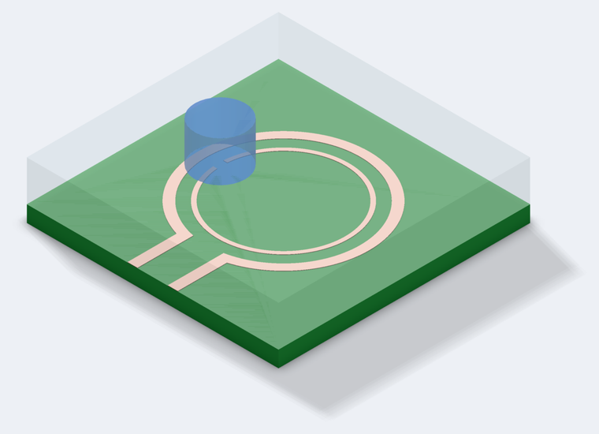
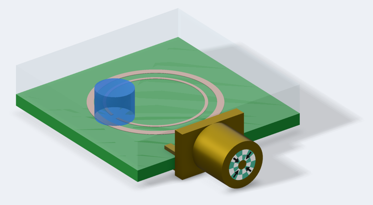
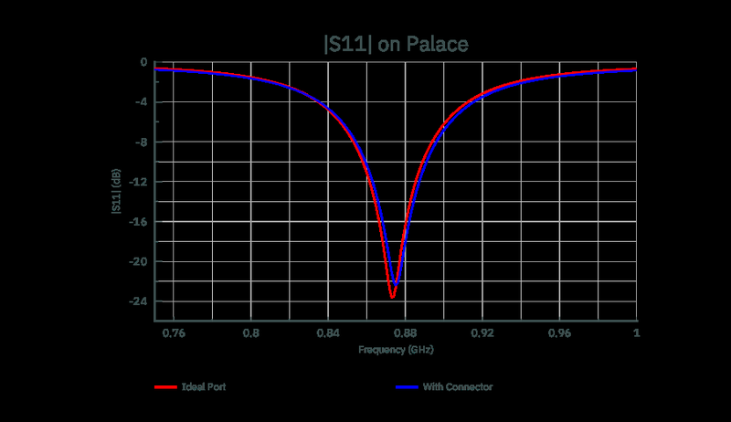
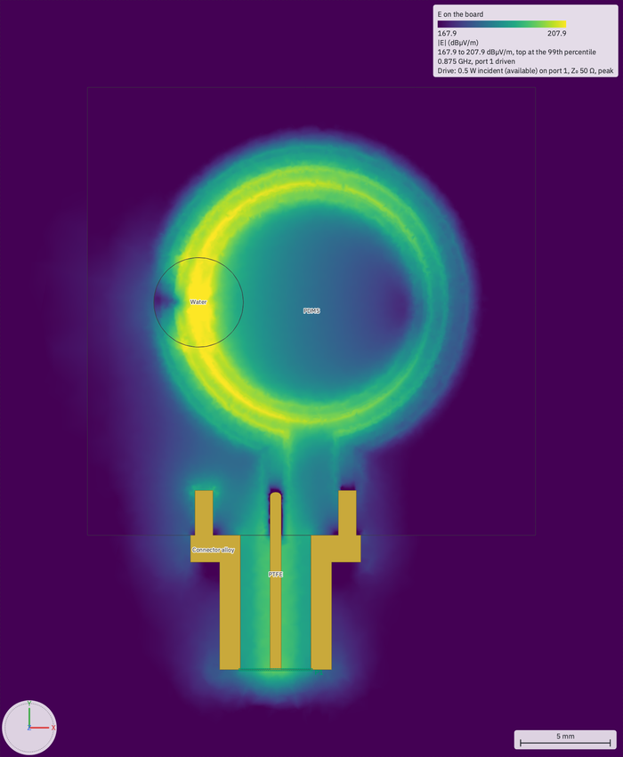
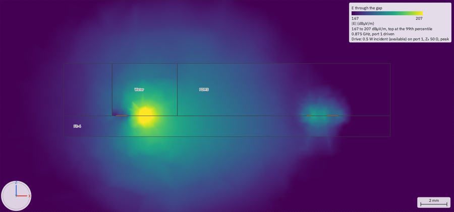

# Loop Sensor

A small printed loop antenna is measured through the coaxial connector soldered to it, and the first question anyone
simulating one asks is what to do with that connector. A port across the loop's two open ends is quick; a connector fed
where its cable would feed it is what was measured. This example builds both, on one board, and measures the difference:
a printed split-ring loop sensor, fed by an ideal port across its arms and by a **real-size edge-launch SMA** whose port
is a **coaxial port** across the ring of PTFE at its back face. The fed boards solve on **Palace** and **EMerge**, and the
ideal port on **openEMS** too.

The design follows a published, open-access paper:

> W. Cui, J. Wang, C. Ding, P. Van Cappellen, E. A. Ho, C. L. Ren, "A functionalized microwave biosensor for rapid,
> reagent-free detection of E. coli in water samples," *Biosensors and Bioelectronics* 278 (2025) 117334.
> https://doi.org/10.1016/j.bios.2025.117334 (open access, CC BY-NC-ND 4.0)

Its figures and text are not reproduced here; this example draws its own. The chapters that teach the gestures and the
port are **The 3D Editor ▸ A coaxial port** and **EM Setup ▸ Coaxial ports**, in **Help ▸ circuitRF Documentation**.

## What is here

| Cell | View | What it is |
|---|---|---|
| **Sensor** | layout, mm | The 25 × 25 mm board: the outer loop and its two arms to the board's edge, and the inner split ring with its 1 mm gap |
| **Sensor** | 3D view, mm | The layout placed, the PDMS layer bonded on top with its reservoir punched through over the gap, and the **sample**: the reservoir full of water |
| **SMA Flange** | 3D view, mm | The SMA's flange and its four ground legs, drawn here; the source of `SMA/3d/sma-flange.step` |
| **SMA** | 3D view, mm | A real-size edge-launch SMA jack on its own: a body with its PTFE bore, the flange from STEP, a pin with a filleted tip, and a coaxial port at its back face. Setup *Palace* |
| **Ideal Port** | 3D view, mm | *Sensor* placed, and a 3 × 1 mm lumped port joining the two arms' ends at the board's edge: the quick model. Setups *Palace*, *EMerge*, *openEMS* |
| **With Connector** | 3D view, mm | *Sensor* placed, and *SMA* placed at the board's edge, its pin on one arm and a leg on the other. **P1 is the coaxial port** at the SMA's back face. Setups *Palace* and *EMerge*, and two field plots |
| **Gap Fed** | 3D view, mm | *With Connector* fed instead by a rectangular gap port between the pin's end and a metal floor 0.3 mm behind it, as the **3D Connector** example feeds its connector. Setup *Palace* |

One technology, `tech/loop-sensor.ctech`: FR-4, copper, PDMS, water, and the **3D Connector** example's PTFE (εr 2.1) and
connector alloy (σ = 15 MS/m).

**There is no ground plane.** The loop is fed between its two arms: the pin on one arm and the connector's shell, through
one of its legs, on the other.

## The design, as the paper gives it and as assumed

**Stated in the paper** (its Fig. 2): a board **25 × 25 mm**; an outer ring of radius **R2 = 8.5 mm**, fed at its bottom
through two parallel arms **l2 = 3 mm** apart running to the board's edge; an inner, split ring of radius **R1 = 6.5 mm**
with a capacitive gap **l1 = 1 mm**, centred under a sample reservoir punched through a PDMS layer bonded on top; an SMA
connector soldered at the arms; a resonance designed near **1 GHz**, simulated at about **−14 dB**; measurements swept over
0.75–1.25 GHz with **80 µL** of sample in the reservoir.

**Not stated, so assumed.** Each is one value in the technology, the layout or a 3D view's Variables panel:

- **The laminate**: FR-4, εr 4.4, tan δ 0.02, 1.6 mm (the technology's `FR-4`). The paper says only that the sensor was
  made on a PCB.
- **The copper**: 35 µm (`cu_t`).
- **The traces, read from the figure's proportions**: the outer ring 0.9 mm wide, the inner ring 0.4 mm and the arms
  1.0 mm. Measured on the published figure, the ratio of the two rings' **outer edges** is 8.5/6.5 to 0.1 %, where their
  centre lines would give 1.28 against 1.31, so **R1 and R2 are taken to the rings' outer edges**; and the arrow marking
  l2 spans the **clear gap between the arms**, so their centre lines are 4.0 mm apart. *What the other reading gives*,
  below, runs the other set (every trace 1 mm, radii to centre lines, l2 between centre lines).
- **Where the rings sit**: centred 13 mm from the feed edge, across the board's width, so the arms are 4.9 mm long; the
  gap faces the board's left edge, as drawn in the paper.
- **The PDMS layer**: 4 mm thick (`pdms_t`), εr 2.7, tan δ 0.02, over the whole board and down onto the laminate between
  the traces.
- **The reservoir**: 5 mm across (`res_d`), through the PDMS, centred on the gap, so it holds 79 µL: the paper's 80 µL
  sample fills it.
- **The sample**: water, εr 78, tan δ 0.05 — the object `sample` in the Sensor's 3D view, **modelled in every shipped run**
  because the paper measures with a sample in the reservoir. Untick its **Model** box (the object tree, or Properties) to
  empty the reservoir: question 5 below.

## The SMA

**Real size**, from the SMA interface standard (MIL-STD-348) — every value a VAR of the SMA cell, with its source:

| VAR | Value | Source |
|---|---|---|
| `pin_d` | 1.27 mm | the standard's centre contact, 0.050 in |
| `bore_d` | 4.1 mm | the standard's PTFE dielectric, about 0.162 in |
| `body_d` | 6.35 mm | the 1/4-36 thread, drawn as a plain cylinder: threads are outside the field |
| `body_l` | 6 mm | assumed: the barrel behind the flange |
| `fl_t` | 1.5 mm | assumed: the flange's thickness; the coax runs 7.5 mm from the port to the board's edge |
| `pin_out` | 2.5 mm | assumed: the pin over the arm, its tip filleted to `tip_r` = 0.3 mm |

The flange (*SMA Flange*: `fl_w` 9.5 × `fl_h` 6.35 mm) carries four legs, 1 mm wide, 0.5 mm thick and 2.5 mm long, two on
top of the board and two under it, 1.6175 mm apart: the 1.6 mm board plus half the copper, since the pin and the top legs
sit **half the copper's thickness into it** (the 3D Connector's rule), so `axis_z` = 1.6 + 0.035/2 + 1.27/2 = 2.2525 mm.
**The interface standard does not fix where the legs are.** They are drawn at ±4.0 mm from the pin so that one top leg
lands on the other arm, whose centre is 4.0 mm from the pin's (3 mm between the arms plus a 1 mm arm): that leg stands for
the shell's solder joint, and the other three touch nothing, as on the real board with no ground plane.

**The coax's impedance**, by the closed form with the technology's PTFE, is
Z₀ = η₀/(2π√εr)·ln(D/d) = η₀/(2π√2.1)·ln(4.1/1.27) = **48.49 Ω**, and `check` says so: *As a coax filled with 'PTFE'
(εr 2.1), its ring is 48.49 Ω; its Z0 is 50 Ω*. That is 1.5 Ω low, and no dimension was changed to reach 50 Ω: the
standard's bore suits a PTFE nearer εr 2.0 (at which the same bore is 49.69 Ω), and at εr 2.1 a 50 Ω coax needs a bore of
4.25 mm. That closed form is this page's one external reference; every other number is a run's.

**How it was drawn** — the gestures are the **3D Connector** example's, whose README lists them: in *SMA Flange*, a Box
and a Cylinder on the XZ plane, *Boolean ▸ Subtract* for the hole and *Boolean ▸ Unite* with the four leg boxes;
*File ▸ Export ▸ STEP…* to `SMA/3d/sma-flange.step`; in *SMA*, a Cylinder for the body and one for the bore (PTFE),
*Boolean ▸ Subtract* with **Keep tools**, *File ▸ Import ▸ STEP…* and *Boolean ▸ Unite* with the flange, a Cylinder for
the pin and *Fillet* on its tip; then **Make Port ▸ Coaxial** on the ring face at the body's back, which binds the ring to
`pin_d/2` and `bore_d/2`. *With Connector* places *SMA* with its axis on the pin's arm at `axis_z`.

## The numbers, and where they come from

Every time and size below was **measured once**, on an Apple M4 with 10 cores and 16 GB, running macOS 27.2, Palace
0.18.1 on 10 processes, Gmsh 4.15.2, EMerge 3.0.0 and openEMS 0.37.0. A time is the wall clock for the whole run; a size
is the run's own tetrahedron count, or openEMS's grid cells. Each board's sweep is 0.4–1.6 GHz, the paper's plotted range,
in 1 MHz steps — 1201 points, built by Palace's and EMerge's adaptive sweeps from a handful of full solves — so a dip is
placed to the MHz. All of it, with **every** frequency's |S11| for the seven shipped runs, is in `expected-numbers.json`
beside this file.

| Cell | Setup | Time | Size | Dip | \|S11\| at the dip |
|---|---|---|---|---|---|
| Ideal Port | Palace | 1 min 18 s | 135,752 tetrahedra | 873 MHz | −23.61 dB |
| Ideal Port | EMerge | 19 s | 134,392 tetrahedra | 879 MHz | −22.81 dB |
| Ideal Port | openEMS | 4 min 11 s | 1,022,970 cells | 829 MHz | −17.04 dB |
| With Connector | Palace | 1 min 40 s | 180,485 tetrahedra | 875 MHz | −22.40 dB |
| With Connector | EMerge | 20 s | 142,030 tetrahedra | 885 MHz | −22.36 dB |
| Gap Fed | Palace | 1 min 34 s | 175,574 tetrahedra | 880 MHz | −22.99 dB |
| SMA | Palace | 8 s | 23,423 tetrahedra | — | — |

**`check`** on this workspace reports no error and no warning.

## 1. Where is the resonance, and how deep?

**Near 875 MHz, about −23 dB**, on Palace and EMerge with the connector or without it, against the paper's simulated
≈1 GHz and ≈ −14 dB: 12 % low and deeper. Palace and EMerge agree to 6 MHz on the ideal port and 10 MHz with the
connector, and to 0.8 dB in depth. openEMS puts it at 829 MHz, 5 % below them: its grid staircases the rings, the gap and
the round reservoir (300 µm cells there), and its loss is the FR-4's fitted at the band's centre.

**What puts it near 1 GHz is the sample.** With the reservoir empty (untick the `sample` object's **Model** box) the
same board on Palace resonates at **1,989 MHz, −11.95 dB**: the water over the capacitive gap more than halves the
frequency, which is the sensing mechanism the paper relies on. The paper designs and measures with a sample in place, so
every shipped run has one.

**What the other reading of the figure gives.** Every trace 1 mm wide, R1 and R2 to the rings' centre lines and l2
between the arms' centre lines — a ring 0.5 mm larger and an inner ring 2.5 times wider — moves the dip to **825 MHz,
−15.34 dB** on Palace. The depth then lands near the paper's −14 dB and the frequency moves further from 1 GHz, so neither
reading is tuned to it. The remaining 12 % lies within the assumptions the paper does not state — the reservoir's size,
the PDMS's thickness and permittivity and the water's — which were not changed to reach 1 GHz.

## 2. Does the connector move it?

**Hardly.** Fed through the SMA, the dip moves **+2 MHz**, from 873 MHz to 875 MHz, and is **1.2 dB** shallower,
−23.61 dB to −22.40 dB (Palace). EMerge sees the same: +6 MHz, 0.45 dB. What does it, from runs that add the connector a
piece at a time, each on Palace with the loop still fed by an ideal port at the board's edge (moved 50 µm in and just under
the legs' feet so it touches only the arms):

| Ideal Port, and | Dip | \|S11\| at the dip |
|---|---|---|
| nothing else | 876 MHz | −23.28 dB |
| the SMA's flange and legs (`sma-flange.step`) | 873 MHz | −21.83 dB |
| and the pin on its arm | 875 MHz | −21.05 dB |
| the whole SMA, fed through its coax (*With Connector*) | 875 MHz | −22.40 dB |

The **flange and legs** cost 1.5 dB of depth: metal next to the arms, three of its legs touching nothing. The **pin**
resting on its arm takes 0.8 dB more. Feeding through the connector's own **7.5 mm of coax** gives 1.3 dB of that back and
moves nothing: carried through 7.5 mm and 10.1 mm of 48.49 Ω PTFE line by hand, Ideal Port's own result comes out at
874 MHz, −23.57 dB and −23.65 dB — a line barely turns an impedance that is already close to 50 Ω, which is what a loop at
its dip is. None of these moves the resonance by more than 3 MHz: on this board, a connector is a few tenths of a dB in the
dip's depth.

## 3. Why a coaxial port

*Gap Fed* is *With Connector* fed the way the **3D Connector** example feeds its connector: a rectangular lumped port
across a 0.3 mm gap between the pin's end and a metal floor behind the bore. It puts the dip at **880 MHz, −22.99 dB**,
5 MHz and 0.6 dB from the coaxial port's 875 MHz and −22.40 dB — more than the whole connector moved it. The gap's
capacitance and its single forced field direction are in that answer, and the gap is not part of the connector that was
measured. The coaxial port feeds the coax in its own radial field across the PTFE, with no gap of its own.

## 4. Does the connector alone behave?

*SMA* on its own, its pin's board end open in air, on Palace: at 1 GHz |S11| is **−0.07 dB** at **−35.2°**. An open line
returns all its power, so the magnitude says only that the connector loses almost nothing (its alloy, and radiation from
the open pin); the phase is the round trip, and 35.2° at 1 GHz is **10.1 mm** of PTFE line each way: the 7.5 mm of coax
from the port to the flange's face and about 2.6 mm more for the pin over the arm and its open end. The coax's own
mismatch, 48.49 Ω against the 50 Ω port, is a reflection 36 dB down. So near 1 GHz the connector is a 48.5 Ω line about
10 mm long, which is why question 2 found the line turning almost nothing.

## 5. What a sample does

The sensing mechanism the paper measures is a shift in this resonance when the sample's permittivity changes. Here the
shift between an empty reservoir and a full one is **1,989 MHz** against **873 MHz**: more than a gigahertz for water
against air. The paper's E. coli shifts are a few MHz, a far smaller change in the sample's permittivity; to model one,
change the technology's `Water` (its εr or tan δ) and run *Ideal Port* again.

## The electric field

*With Connector* carries two field plots of |E| at the dip, from the Palace run (*Save fields at* 0.875 GHz), drawn in dB
on two projections as the paper draws its own: **E on the board**, a horizontal cut 65 µm above the copper, and **E
through the gap**, a vertical cut across the board through the ring's gap. Run the Palace setup, then show the plots in the object tree; the pictures
below are those plots, drawn headlessly:

    circuitrf render "With Connector/3d/With Connector.c3d" -o board.png --field "E on the board" --labels --scale-bar

Both plots have **Smooth** ticked (the plot's Properties, beside *dB*). Palace at element order 1 writes each
tetrahedron's own corner values, so neighbouring cells disagree at a shared point and a cut is drawn as a mosaic of its
cells. *Smooth* averages each value over the coincident corners of cells of one material, and never across a material's
boundary, where the field's normal part really jumps (by 29 times between the water and the PDMS). It is worked out once
when the field loads, so panning, zooming and orbiting the 3D view cost the same as without it. Untick it to see the field
cell by cell; `render --smooth` smooths any plot for one picture.

The field sits in the capacitive gap, in the water over it and the FR-4 under it — the sensitive zone the paper identifies
— and along the rings. The cut on the board also shows the field running back through the connector's PTFE to the ring of
the coaxial port, the TEM field of the coax.

## The settings traded away, and what they cost

All the setups are chosen so a first Simulate finishes in about two minutes or less.

- **Palace at *Draft*** (element order 1, no adaptive refinement). The mesh near the rings moves its answer: before the
  rings' mesh region (below) existed, the same setups put Ideal Port at **884 MHz, −27.32 dB** and With Connector at
  **865 MHz, −18.50 dB**. That is 11 MHz and 4 dB on one cell, and an apparent connector shift of −19 MHz that the finer
  mesh does not reproduce. So at these settings the resonance is good to about 1 % and its depth to a few dB; compare the
  cells with each other, on the same settings, as above. *Standard* (adaptive refinement) and element order 2 were not run.
- **EMerge at element order 1.** At its default order 2, EMerge's own size check said **29.1 GB** for this board, most of
  it past a 16 GB machine; order 1 runs in 20 s and agrees with Palace to 10 MHz.
- **The rings' mesh region.** A curved or diagonal edge places no openEMS grid line of its own, so without help the grid
  is set by the wavelength and the 0.4 mm inner ring falls between cells. Each fed board holds a mesh region `rings` over
  the copper layer, 300 µm, which the openEMS setup reads (`"MeshRegions": true` in its `OpenEms` section) and which also refines Palace's
  and EMerge's meshes on the copper.
- **openEMS on Ideal Port only.** Its run took **47,676 time steps** to ring down to −50 dB — the resonance is sharp. On
  *With Connector* the coaxial port's thin slab and probe lines put an 88 µm cell on the grid, and its dry run says
  **1,426,368 cells**, a smallest cell of **88 µm** and **about 18 min**, so no openEMS setup ships for it. To run it,
  add an openEMS setup (Setup Analyses ▸ Add ▸ openEMS) and copy *Ideal Port*'s `OpenEms` section into it.

## The regression test

`LoopSensorExampleTests` re-runs every shipped run, one test per solver, and holds every recorded |S11| to ±0.1 dB at
every frequency of its sweep, naming the run and the frequency of anything that moved. The solves are
`Category=Benchmark` (about five minutes on Palace, under a minute on EMerge and four on openEMS) and are skipped when
their solver is absent:

    dotnet test tests/Ui.Tests --settings circuitrf.benchmark.runsettings --filter "FullyQualifiedName~LoopSensorExampleTests"

The routine tier checks that this page quotes only recorded values, that each quoted dip is its run's recorded minimum and
that the coax's closed form is the drawn SMA's. A deliberate change that moves an answer re-records the table and the
values quoted here.
