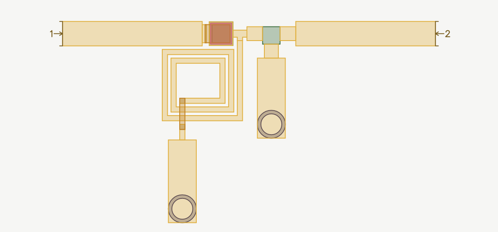
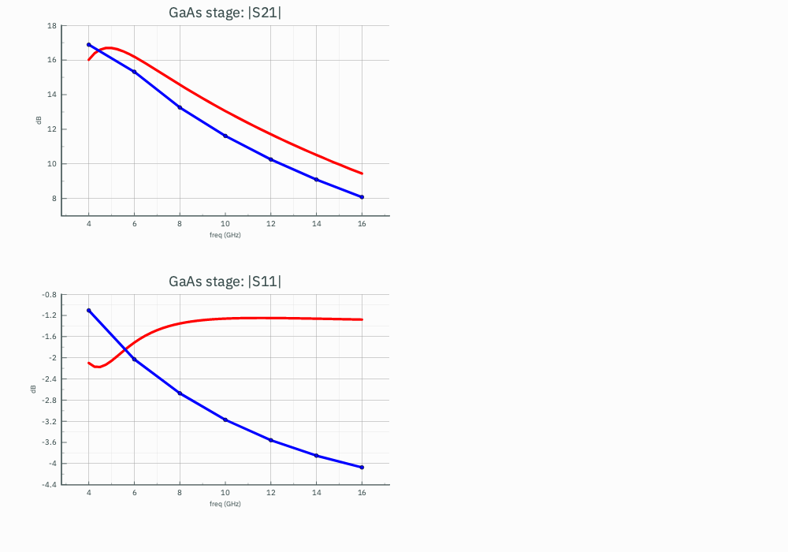

# MMIC Component Ports

**Run order: 1. Simulate the EM setup `Stage EM`. 2. Simulate `Stage EM_cosim`, the cell that run makes. 3. Simulate
`Stage`, and open `Stage.cdd`.**

A small amplifier stage on the shipped 100 µm GaAs technology: an input line, a series MIM capacitor, a tee to a shunt spiral
inductor, a three-pin device and an output line. The device and the MIM capacitor are **cut out** of the EM problem. Their
metal leaves the solved layout, each pin they connect by gets a port at its face, and a netlist puts each one's own model back
on its ports. The spiral, the tee and the lines stay in the EM, where their lumped models are least sure.



## The cells

| Cell | Views | What it is |
|---|---|---|
| **Stage** | schematic, layout, EM setup | The stage. Its schematic is the circuit, with `P1` and `P2` and the `Circuit` analysis, 4–16 GHz; its layout was made from it by Update Layout from Schematic |
| **FET** | schematic, symbol, layout | The device: pins `G`, `D` and `S`. Its schematic is a small-signal model (an 80 mS transconductance, 0.25 pF gate capacitance, 250 Ω output resistance and their parasitics); its layout is three pads on Metal1 |

The device is a cell of your own here so that the example needs no kit. A transistor from a kit is taken the same way.

## How it was built

1. **The schematic.** `TL1` and `TL2` are 70 µm MLINs on Metal1, `C1` a 60 × 60 µm MIMCAP, `T1` an MTEE, `L1` a 2.5-turn
   SPIRAL to ground, and `X1` the FET cell with its source on ground.
2. **Design ▸ Update Layout from Schematic.** It places every part, joins them, and puts a backside via beside the spiral's
   inner end and beside the device's source pad, each tied to its pin.
3. **The EM setup, `Stage EM`** (`Stage/em`). Under **Component ports**, **Every part and device (\*)** is ticked, and
   `C1` is ticked under **Cell instances**. `"*"` takes the FET because its schematic is a model: its layout is pads round
   something the EM cannot see. It does not take `C1`, `L1` or the lines, which are copper the solver can solve, so `C1`
   is named to be cut out too. In the file it is `"ComponentPorts": ["*", "C1"]`.
4. **Check.** `circuitrf explain "Stage/em/Stage EM.cem" --component-ports` lists each cut instance and each pin:
   `X1 (FET), selected by "*"` and `C1 (MIMCAP), selected by name`, every pin routed, each with its port.

## Run it

| Step | What | Time on a 10-core Mac |
|---|---|---|
| 1 | Simulate the EM setup **Stage EM** | about 2 min |
| 2 | Simulate **Stage EM_cosim** | under a second |
| 3 | Simulate **Stage**, then open `Stage.cdd` | under a second |

The run writes `results/Stage EM.s7p`, `Stage EM_cosim.cnl` and the cell **Stage EM_cosim**, the same circuit drawn as a
schematic. The Touchstone has seven ports, the two drawn ones and one at each cut pin, and its header names them:

```
! Port[1] = 1
! Port[2] = 2
! Port[3] = X1.G
! Port[4] = X1.D
! Port[5] = X1.S
! Port[6] = C1.1
! Port[7] = C1.2
! circuitRF-EM port 3: 'X1.G' on 'Metal1' at (528, 135 um), edge, uncalibrated (not de-embedded), 50 Ohm
```

`Stage EM_cosim.cnl` puts the parts back. Each model is the schematic's own part, with its terminals on the ports by pin name:

```
SnP:BOARD  p1  p2  p3  p4  p5  p6  p7  NumPorts=7  File="results/Stage EM.s7p"
Port:P1  p1  0  Num=1  Z=50 Ohm
Port:P2  p2  0  Num=2  Z=50 Ohm
FET:X1  p3  p4  p5
MIMCAP:C1  p6  p7  W=60 um  L=60 um  …
```

The device's source, `X1.S`, is a port of its own and not ground: its pad reaches ground through the tie and the via in the
EM result, so their inductance is in the answer, as it is on the chip.

## What you will see



| | 4 GHz | 8 GHz | 12 GHz | 16 GHz |
|---|---|---|---|---|
| \|S21\|, circuit models | 16.0 dB | 14.6 dB | 11.7 dB | 9.4 dB |
| \|S21\|, EM with the parts on their ports | 16.9 dB | 13.3 dB | 10.3 dB | 8.1 dB |
| \|S11\|, circuit models | −2.1 dB | −1.4 dB | −1.3 dB | −1.3 dB |
| \|S11\|, EM with the parts on their ports | −1.1 dB | −2.7 dB | −3.6 dB | −4.1 dB |

**The EM answer reads about 1.4 dB less gain from 8 GHz up, and a different input match.** The device and the capacitor
are the same models in both: what differs is everything between them. The spiral's lumped model is valid to a twentieth of a
wavelength along its trace, about 3.4 GHz here, and says so when the circuit runs; the tee's arms are narrower than its model
was fitted for; and the circuit knows nothing of the pads, the ties and the vias. The EM result has all of them.

**The cut faces are Uncalibrated Ports.** Each port at a cut pin is driven against the ground plane at its face and not
de-embedded, so the half cell beyond the face and the port's own small launch are in the result. A calibrated port needs its
feed clear of other metal for hundreds of µm on this stack, which no device's pins are; on isolated lines the difference from
a calibrated port is between 5e-3 and 7e-2 in S from 5 to 30 GHz. See
[The Uncalibrated Port](../../reference/mom-engine.html#uncalibrated-port) for what that means for a result. The drawn ports
`1` and `2` are ordinary calibrated edge ports.

## Things to try

- **Change the device.** Edit a value in the FET's schematic and simulate `Stage EM_cosim` again. The answer moves with no
  EM run, because the device is not in the EM result.
- **Run the stage itself by EM.** Add an S-parameter analysis to Stage's schematic and set its **Model** to **EM of this
  schematic's layout**. It solves the same cut, closes it with the parts from the schematic being run, and lays the result
  beside `Circuit` in one run. That is a second solve of about 2 minutes, kept in the EM cache afterwards.
- **Cut at the cell edge.** Give `X1` its own entry with **Port at** set to **Cell**. The ports move to where the lines cross
  the device's box, and the box's margin enters the answer.
- **Leave the capacitor in the EM.** Untick `C1`. The MIM capacitor is then solved as metal, and only the device goes back as a
  model.

## What was traded for speed

- **The mesh: Cells across a conductor 2 and the edge mesh off** (the setup's surface mesh settings). The narrowest metal, the
  spiral's 15 µm turns, sets the cell size over the whole layout, so these two are the levers. They give 1,758 unknowns and
  about 0.2 GB a frequency point, about 17 s a point. Cells across 4 gives 5,664 unknowns (1.6 GB) and about 55 s a point,
  and moves the answer by at most 0.04 dB (the table below). The edge mesh on, at 2 across, gives 8,101 unknowns (3.2 GB).
  The defaults with 10 µm turns gave 20,048 unknowns and about 20 GB a frequency point.
- **Seven frequency points**, 2 GHz apart. The EM curve in `Stage.cdd` joins them with straight lines.
- **The spiral's turns are 15 µm wide** where 10 µm is the generator's default, for the same reason.
- **The parts are ideal models**, and the device's model is a small-signal one: there is no bias, so this is not a run for
  harmonic balance or compression.

The mesh against a finer one, the parts on their ports in both:

| | \|S21\| at 8 GHz | \|S21\| at 16 GHz | \|S11\| at 8 GHz | \|S11\| at 16 GHz |
|---|---|---|---|---|
| Cells across 2 (shipped) | 13.26 dB | 8.08 dB | −2.67 dB | −4.07 dB |
| Cells across 4 | 13.26 dB | 8.04 dB | −2.70 dB | −4.08 dB |
