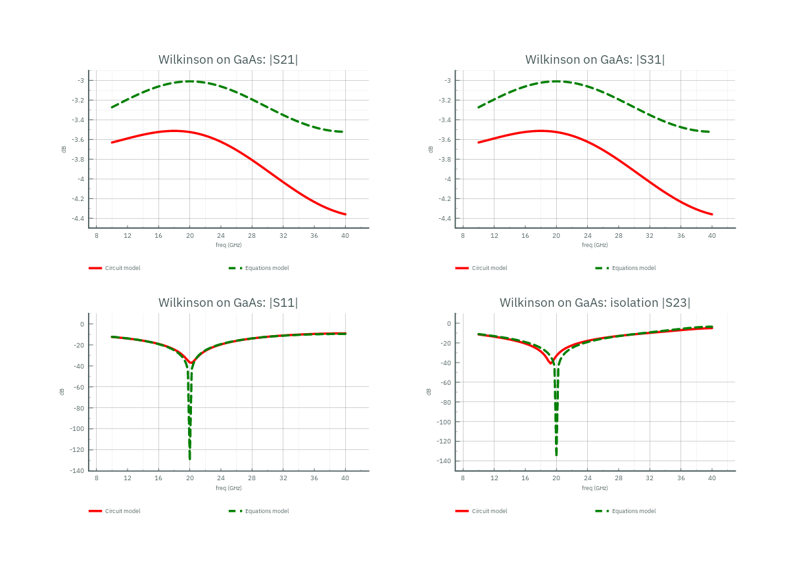

# MMIC Wilkinson

The Wilkinson divider of the Dividers and Couplers example on a die: an MWPD at 20 GHz on the shipped GaAs stack, 100 µm
of GaAs under gold, with its isolation resistor a thin-film resistor (TFR). It is laid out by Update Layout from
Schematic, and a test bench sets its circuit model beside an equations model. The workspace's default technology is the
die's, `tech/mmic-GaAs_2LM_100um.ctech`.

## The cells

| Cell | Views | What it is |
|---|---|---|
| **Wilkinson** | schematic, layout | A 0.5 mm input line, the MWPD, a TFR across R2-R3, and each output bending away through a 90° MCURVE of 0.35 mm radius and a 0.5 mm line to its port, all on Metal1 |
| **Wilkinson Bench** | schematic | The cell's circuit, and its equations model: ideal lines of the closed-form impedances and lengths, an ideal 100 Ω resistor, and each feed an ideal line of its own impedance and length at F |
| `Wilkinson.cdd` | data display | \|S21\|, \|S31\|, \|S11\| and \|S23\|, the circuit model as a line and the equations model dashed |

## Run it

Simulate **Wilkinson Bench** and open `Wilkinson.cdd`. No results ship.

## Wilkinson

An MWPD with `Z0` 50 Ω, `F` 20 GHz and `Gap` 56 µm: the TFR's pin span, its 40 µm film and a contact at each end, so
Update Layout lays it straight across the ring's gap. The TFR is two 20 µm squares of the 50 Ω/sq film, 100 Ω. Every
line is on Metal1, the film's own metal, through `SignalLayer`; left empty it would be the top metal, Metal2. LVS matches
the layout to the schematic.

| At 20 GHz | Equations | Circuit |
|---|---|---|
| \|S11\| | below −100 dB | −36.7 dB |
| \|S21\| = \|S31\| | −3.01 dB | −3.53 dB |
| \|S23\| | below −100 dB | −33.1 dB |

The model loses 0.5 dB at 20 GHz in the 3 µm gold lines, and stays matched and isolated below −30 dB.
