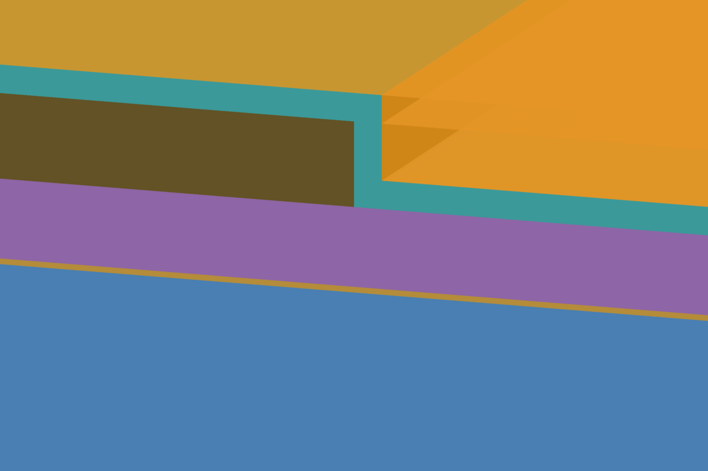
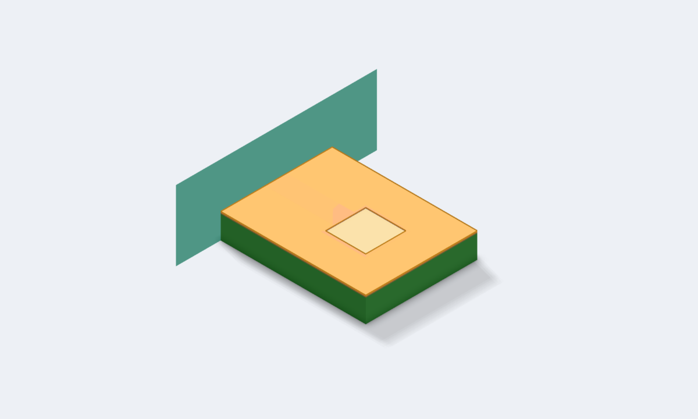
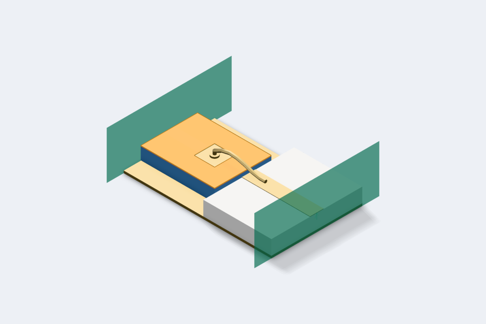
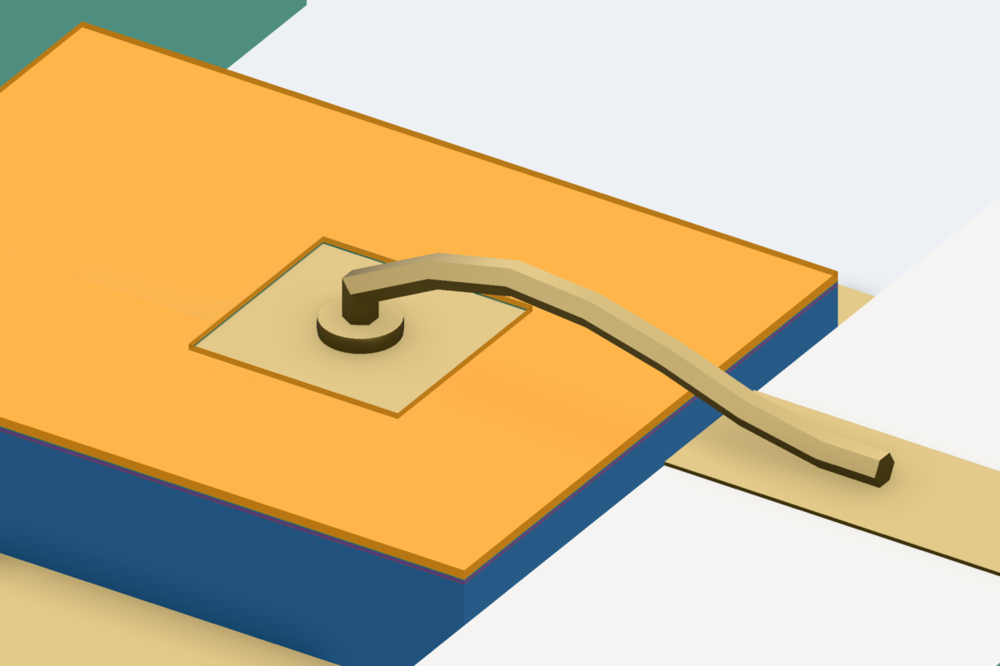

# Passivated Pad

**Run the numbered cells in order, top of the Workspace tree first.** Each is one EM setup, and none reads another's result:

- **`1a Bare Line`** and **`1b Covered Line`**: the same Metal2 line, without and with the two covers.
- **`2 Probe Pad`**: a probe pad seen through an opening in the covers, in 3D (its 3D view) and in the planar solver (its EM
  setup).
- **`3 Through-Silicon Via`**: a via that passes through two dielectrics on its way to the backside.
- **`4 Bonded Pad`**: the probe pad's die placed in a 3D view beside a carrier, with a bond wire from the pad, through the
  opening, to the carrier.

The stackup is entered as a process states it, with nothing added to suit the solver: two dielectrics over the top metal, a mask
that opens both over the pad, and a via that crosses from one dielectric into the next with no metal at the crossing.

## The technologies

`tech/mmic-GaAs_2LM_100um_passivated.ctech` is the workspace's technology. It starts from the shipped GaAs process and is
changed where that process is simplified, so that the 3D view looks like the die:

- **Interlayer**: 2.55 µm of polyimide, εr 3.3, between the capacitor's top plate and Metal2, where the shipped process has
  air. The shipped process treats Metal2 as an airbridge level everywhere; here a Metal2 line sits on dielectric, as it
  does on a die away from its airbridges.
- **MIM Dielectric**: the capacitor nitride, 0.2 µm, is a blanket layer rather than present only under a drawn capacitor,
  so no sliver of air is left where none is drawn. The technology states `MimCapDensity` as a constant, because the
  capacitor rule can no longer derive it from a dielectric tied to the capacitor mask.
- **Passivation**: 1 µm of nitride, εr 7.0, tanδ 0.001, **Conformal**, so it starts on top of the metal.
- **Polyimide**: 5 µm, εr 3.3, above it.
- **`PAD_OPEN`**: both covers are **Opened by** it, so each is cut away wherever it is drawn.
- **`Die Edge`**: the chip's outline, which bounds the substrate and the covers in 3D.

`1a Bare Line` uses `tech/mmic-GaAs_2LM_100um_uncovered.ctech`, the same stack without the two covers and their layers,
through its layout's own technology.
`3 Through-Silicon Via` uses `tech/rfic-Si_3LM_TFR_100um.ctech`, the shipped silicon process unchanged, the same way.

**In 3D the passivation follows the metal**: 1 µm on its top, down its sides and on the floor beside it, with square
corners, and the polyimide fills what that leaves. The planar runs treat both covers as flat slabs. Every opening has
straight walls, where a real one slopes.

## 1 · A line under two covers

A 1 mm Metal2 line, 95 µm wide, which is 50 Ω on the uncovered stack. Run **Bare Line** and **Covered Line** and compare
S21's phase.

| Line | S21 at 10 GHz and 40 GHz |
|---|---|
| Bare | −31.91° and −130.30° |
| Covered | −32.23° and −131.56° |

The covers raise the line's effective permittivity by 2.0 %, at every frequency. The covered run's notes name both covers
and the height the medium continues to above Metal2. They took 17 s and 21 s on a 10-core machine.

## 2 · A probe pad through an opening

A 200 µm square pad at the end of a 95 µm wide, 300 µm long feed, on a 650 × 500 µm piece of die. The pad is stacked, as a GaAs bond pad is
built: Metal1 under the Metal2 pad, joined over the whole pad by the Metal1–Metal2 post, so the pad is metal from the GaAs
up. `PAD_OPEN` is drawn 10 µm inside the pad's edge, so both covers overlap the pad's rim and the rest of the pad is bare.

- **The 3D view** (`3d/2 Probe Pad.c3d`, setup **Driven**, EMerge) cuts the opening out of both covers. Its notes say what
  was cut: one opening in each, 32,400 µm².
- **The planar setup** (`em/Probe Pad Planar.cem`) cannot make a dielectric stop, so it keeps both covers across the
  opening, and its notes say so with the fraction of the layout that is opened: 32.4 %.

With its feed, the pad reads 143.8 fF at 1 GHz in 3D and 140.5 fF in the planar run, and the two S11 phases are 2.1°
apart at 40 GHz. The 3D run took 30 s and the planar one 3 min 41 s: the post makes it a two-level run, and two levels
6 µm apart cost close to two minutes per frequency on this stack.

## 3 · A via through two dielectrics

On the silicon process, a 40 µm square through-silicon via joins the middle of an 800 µm Metal3 line to the backside. It
passes through the oxide under Metal3 and then through the silicon, with no metal level between them that it stops at.

The planar run solves it as one via, and the line sees it as a shunt of about 15 pH: |S21| is −42 dB at 2 GHz and −25.5 dB at
14 GHz. It took 36 to 56 s, most of it the calibration.

## 4 · A bond wire on the opened pad

`3d/4 Bonded Pad.c3d` places the `2 Probe Pad` die, `U1`, on a gold floor beside a 127 µm alumina carrier with a 120 µm gold
trace on it. A 1 mil gold wire, `w1`, bonds a ball onto the pad, inside the opening, and a wedge onto the trace, with a held
100 µm loop. Port 1 is the die's line at its edge, port 2 the trace's far end.

The ball lands on `U1/Metal2/1`, the pad's metal, at its top, below the two covers; `explain` lists the wire as running from
`U1/Metal2/1` to `trace`. The path through it loses 0.02 dB at 1 GHz and 0.69 dB at 40 GHz, where the wire's inductance
has brought the return loss down to 8.3 dB. About a minute, on EMerge at **Accurate**.

**A bond reaches bare metal only.** Draw the wire onto a pad the covers still hide, here by deleting the `PAD_OPEN`
rectangle from `2 Probe Pad`'s layout, and `check` and the run warn that `w1`'s start lands under `Passivation` and
`Polyimide`, naming both ways out. The wire is still built, so the run would connect it through the dielectric.

The ball and wedge sizes are circuitRF's built-in starting values, and the run's notes say so. Put the real ones on the
wire's ends, or in the workspace's assembly rules.

## What was traded for speed

- **The line runs** are solved at 10, 20, 30 and 40 GHz only. Add points in the setup's frequency list for a smooth curve;
  each one costs a few seconds.
- **The via run** stops at 14 GHz, with three points. Above about 18 GHz the de-embedding's error shows as a slightly
  non-passive answer, because a line shorted by a via reflects almost all of its power, and above 39.6 GHz the via is
  too long for one vertical basis. The run says so in either case.
- **The planar probe pad** is solved at 1 and 40 GHz only, the two ends of the 3D sweep, because each frequency of a
  two-level run on this stack costs close to two minutes.
- **The 3D runs** have four frequencies each, at EMerge's **Accurate** quality. The bonded pad's answer is passive to within
  0.9 % of the power.
