# Planar Filters

Microstrip filters placed as single parts, one cell per form, on a 20 mil RO4350B board. Unlike the dividers, these parts
store **geometry**: each one's widths, lengths and gaps are a design, worked out here from the same textbook closed forms
the parts' own tests use, and the part draws and simulates exactly those numbers. Three families hold them all: the
coupled-resonator filter (MCRC), the ladder (MLAD) and the coupled array (MCLA). Each cell is laid out by Update Layout
from Schematic and is LVS clean.

Each cell has a test bench beside it. The bench holds the cell's circuit and the **ideal prototype** the design came
from: circuitRF's Filter block at the design's response, order, ripple and band, the equations the closed forms start
from. Six cells also have a coarse Planar MoM setup in their `em/` folder, and their bench adds an SnP block that reads the
Touchstone file the setup writes into `results/`. Simulate a bench and open the cell's `.cdd`: the circuit model is a
red line, the prototype a dashed green one, and the solve a set of markers. No results ship; the benches read what
your own runs write.

## The cells

| Cell | Part | What it is |
|---|---|---|
| **Edge-Coupled** | MCRC, `Straight` | Cohn's three-resonator 0.5 dB Chebyshev filter, 10 % wide at 2.4 GHz |
| **Hairpin** | MCRC, `Hairpin`, tapped | The same resonators folded into hairpins and fed by taps |
| **Open-Loop** | MCRC, `OpenLoop`, `Cross` | Four square open loops with loops 1 and 4 cross-coupled: a zero either side of the band |
| **Stepped-Z** | MLAD | A six-section Butterworth lowpass at 2 GHz of 15 Ω and 120 Ω lines |
| **Stub Lowpass** | MLAD | Richards and Kuroda's three-element Butterworth lowpass at 2 GHz: open stubs λ/8 long |
| **End-Coupled** | MLAD and two 0402 capacitors | Cohn's three-resonator end-coupled Butterworth filter, 2 % wide at 2.4 GHz |
| **Lumped LC** | MLAD sites and three 0402 parts | A third-order Butterworth LC lowpass at 2 GHz, sites alone |
| **Interdigital** | MCLA, `Interdigital` | Matthaei's three-resonator 0.1 dB Chebyshev filter, 20 % wide at 2.4 GHz |
| **Combline** | MCLA, `Combline`, tapped | Three resonators 45° long, loaded by 0402 capacitors, tuned to an 8 % Chebyshev band |
| **Edge-Coupled Bench** … **Combline Bench** | schematic | One per cell: the cell's circuit, the ideal prototype, and its Planar result where it has a setup |
| `Edge-Coupled.cdd` … `Combline.cdd` | data display | One per cell, at the top of the workspace |

## Run it

Simulate a cell's bench and open its `.cdd`. Where the cell has a **Planar** setup (its `em/` folder), run that first.

| Cell | Planar MoM | Then |
|---|---|---|
| Edge-Coupled | 1½ min | Simulate **Edge-Coupled Bench**, open `Edge-Coupled.cdd` |
| Hairpin | 4 min | Simulate **Hairpin Bench**, open `Hairpin.cdd` |
| Stepped-Z | 6 min | Simulate **Stepped-Z Bench**, open `Stepped-Z.cdd` |
| Interdigital | 25½ min | Simulate **Interdigital Bench**, open `Interdigital.cdd` |
| Stub Lowpass | 5 min | Simulate **Stub Lowpass Bench**, open `Stub Lowpass.cdd` |
| Lumped LC | 8 min | Simulate **Lumped LC Bench**, open `Lumped LC.cdd` |
| Open-Loop, End-Coupled, Combline | — | Simulate the bench, open the cell's `.cdd` |

Times are from a Linux machine with 8 threads. Every setup is a Draft mesh: 2 cells across the narrowest conductor, the
edge mesh off; the interdigital's is coarser still (below). A bench with a Planar block sweeps the frequencies the setup
solves, so every marker is one of its points (the interdigital's seven make its lines coarse; its own schematic sweeps
finely, and the tables use that); the other benches sweep finely. A bench simulates in under a second.

**A part on the board is a component port.** The LC lowpass's three parts are each a port across their own pads in the
Planar run, and the bench closes each with the cell's own part, as the co-simulation netlist each run writes does.

**LVS** finds no error in any cell. A resonator that touches no pin (all but the ends of the coupled filters) is copper in
no net, which LVS reports as a warning: that is what it is.

**The tables** give each filter at its key points. A bandpass: the centre (the middle of the edges 3 dB below its best
point), its least loss, the spread of |S21| over the prototype's band (its ripple; a Butterworth's band edges are its
3 dB points) and |S21| one bandwidth either side of the centre. A lowpass: the −3 dB point, and |S21| at 1 and 3 GHz.
The prototype is lossless; the board is not.

## Edge-coupled filter

Cohn's parallel-coupled filter (S. B. Cohn, [10.1109/TMTT.1958.1124542](https://doi.org/10.1109/TMTT.1958.1124542)):
three half-wave resonators 1.058 mm wide and 37.169 mm long, the couplings' J-inverters as gaps of 0.126 mm at the ends and
0.574 mm between resonators, each section λg/4 in its modes' mean εeff less the open ends. The prototype is the
Chebyshev bandpass of order 3 with 0.5 dB ripple over 2.283–2.523 GHz.

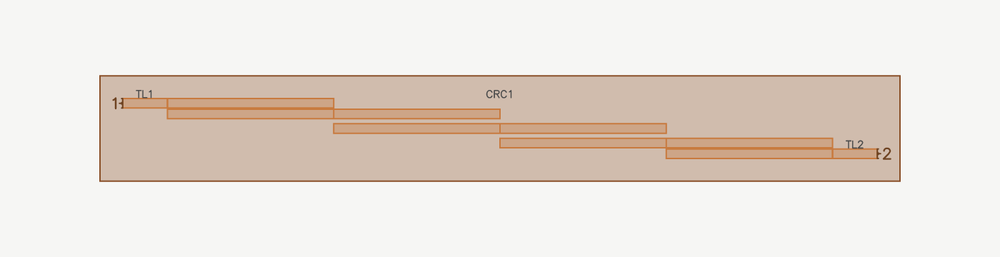

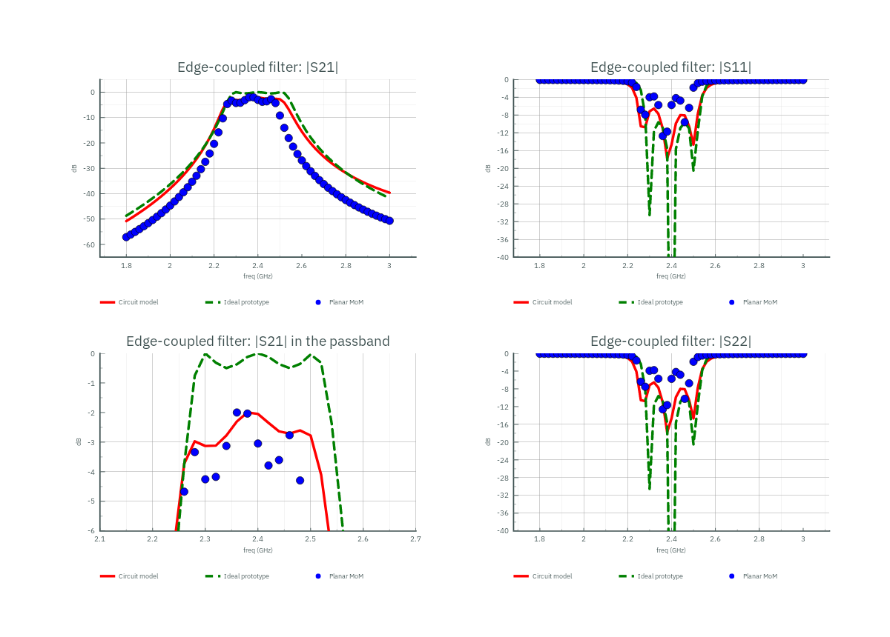

| | Prototype | Circuit | Planar MoM |
|---|---|---|---|
| Centre | 2.404 GHz | 2.389 GHz | 2.371 GHz |
| Least loss | 0 dB | 2.00 dB | 2.00 dB |
| Spread over 2.283–2.523 GHz | 0.50 dB | 2.10 dB | 12.0 dB |
| \|S21\| at 2.16 / 2.64 GHz | −20.8 / −17.8 dB | −21.0 / −20.1 dB | −27.4 / −31.2 dB |

The model is 0.6 % below the prototype, its ripple the loss's slope across the band. On the Draft mesh Planar's band
is 0.8 % lower again and 19 % narrower, so its spread over the prototype's band takes in its own skirts.

## Hairpin filter

The edge-coupled design folded: each resonator a U whose arms are `Sa` = 2.116 mm apart, its length grown by its two
corners, and the feeds tapped at `Tap` = 3.86 mm from the end resonators' midpoints, where one tapped hairpin has the
design's external Q, g0·g1/FBW (J.-S. Hong and M. J. Lancaster, [10.1002/0471221619](https://doi.org/10.1002/0471221619)).
The prototype is the edge-coupled one.

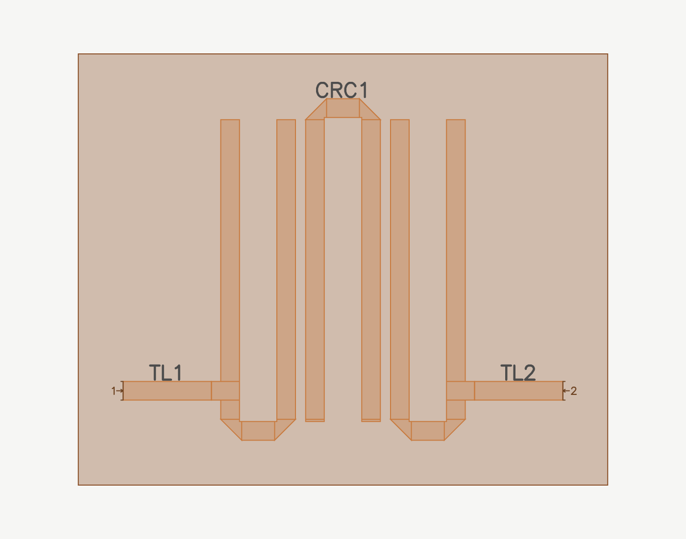

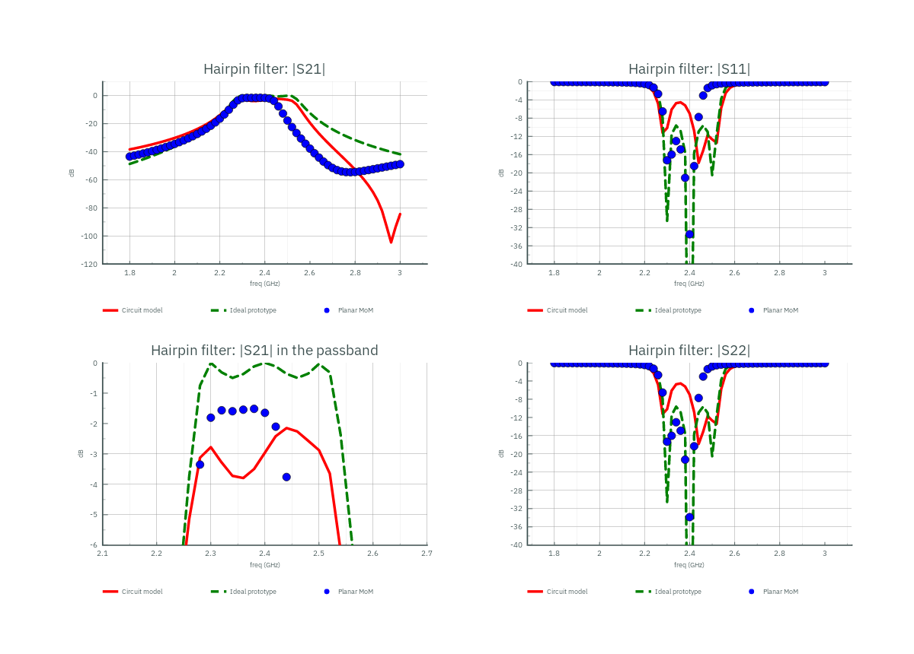

| | Prototype | Circuit | Planar MoM |
|---|---|---|---|
| Centre | 2.404 GHz | 2.396 GHz | 2.358 GHz |
| Least loss | 0 dB | 2.15 dB | 1.52 dB |
| Spread over 2.283–2.523 GHz | 0.50 dB | 1.64 dB | 20.9 dB |
| \|S21\| at 2.16 / 2.64 GHz | −20.8 / −17.8 dB | −18.5 / −27.0 dB | −21.4 / −44.2 dB |

The model holds the prototype's centre within 0.4 %. Planar's band is 1.6 % lower and 37 % narrower; `Coupling` = `Full`,
which couples each hairpin's own two arms, narrows the model's by only 9 %, so most of that is something else.

## Cross-coupled open loops

Four square loops 1.058 mm wide in Hong and Lancaster's square
([10.1109/22.543968](https://doi.org/10.1109/22.543968)): loops 1 and 4 cross-coupled across their openings, 2 and 3 back
to back, tapped feeds. The part's own test sizes them from a three-pole design's coupling coefficients, which in the
square ripple by 4 dB; from there circuitRF's Optimizer moved six numbers (two loop lengths, three gaps, the tap) until
the model met |S11| below −15 dB over 2.36–2.44 GHz and |S21| below −25 dB either side, in a few seconds. The prototype
is those goals' elliptic bandpass: order 4, 0.14 dB ripple (15 dB return loss), 2.36–2.44 GHz, 25 dB stopband.

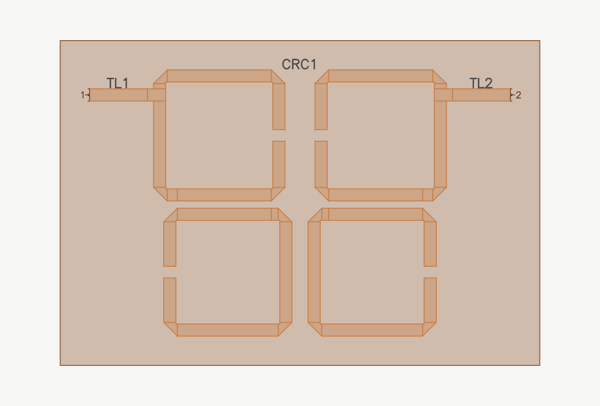

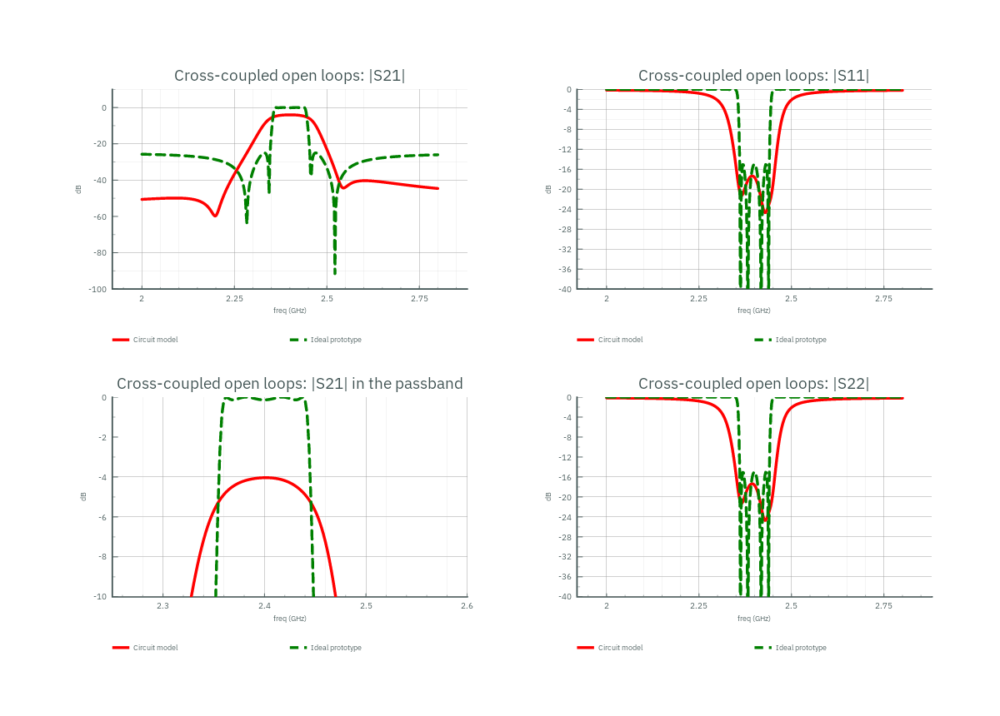

| | Prototype | Circuit |
|---|---|---|
| Centre | 2.400 GHz | 2.400 GHz |
| Least loss | 0 dB | 4.03 dB |
| Spread over 2.36–2.44 GHz | 0.14 dB | 0.85 dB |
| \|S21\| at 2.32 / 2.48 GHz | −27.0 / −26.3 dB | −12.5 / −13.6 dB |

The model has one zero each side, at 2.20 and 2.55 GHz; the prototype has two, at 2.28 and 2.34 and at 2.46 and
2.52 GHz, so its skirts are far steeper one bandwidth out. The 4 dB is four loops' loss over a 3.3 % band.

## Stepped-impedance lowpass

A six-section Butterworth lowpass at 2 GHz from its g-values: each shunt capacitor a 15 Ω line of βl = g·15/50 and each
series inductor a 120 Ω line of βl = g·50/120 at the cutoff (D. M. Pozar, *Microwave Engineering*, 4th ed., §8.6, a
book with no DOI: [the publisher's page](https://www.wiley.com/en-us/Microwave+Engineering%2C+4th+Edition-p-9780470631553)).
The prototype is the order-6 Butterworth lowpass at 2 GHz.

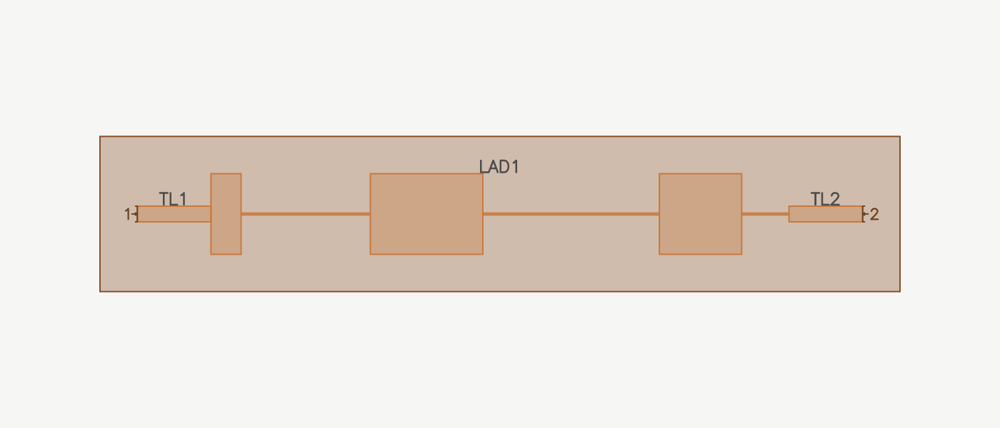

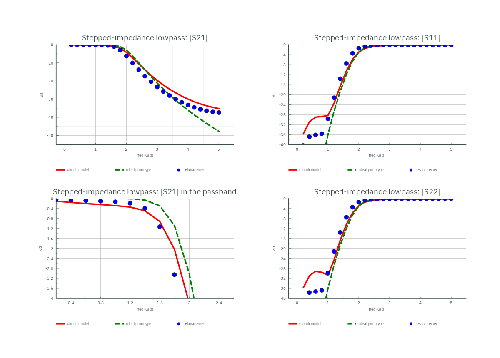

| | Prototype | Circuit | Planar MoM |
|---|---|---|---|
| −3 dB | 1.999 GHz | 1.889 GHz | 1.795 GHz |
| \|S21\| at 1 GHz | 0.00 dB | −0.28 dB | −0.13 dB |
| \|S21\| at 3 GHz | −21.2 dB | −19.7 dB | −23.3 dB |

Short lines only approximate the elements: the model cuts off 5.5 % below the prototype. Planar is 5 % lower again,
from the steps between widths, which the model leaves out.

## Stub lowpass

Richards and Kuroda's form of the three-element Butterworth at 2 GHz (P. I. Richards,
[10.1109/JRPROC.1948.233274](https://doi.org/10.1109/JRPROC.1948.233274); Kuroda's identities are textbook, with no
DOI): open stubs of 100 Ω, 25 Ω (drawn as two 50 Ω arms) and 100 Ω, joined by 100 Ω lines, every section λ/8 at the
cutoff and each open stub drawn short by its end extension. The prototype is the order-3 Butterworth lowpass at 2 GHz.

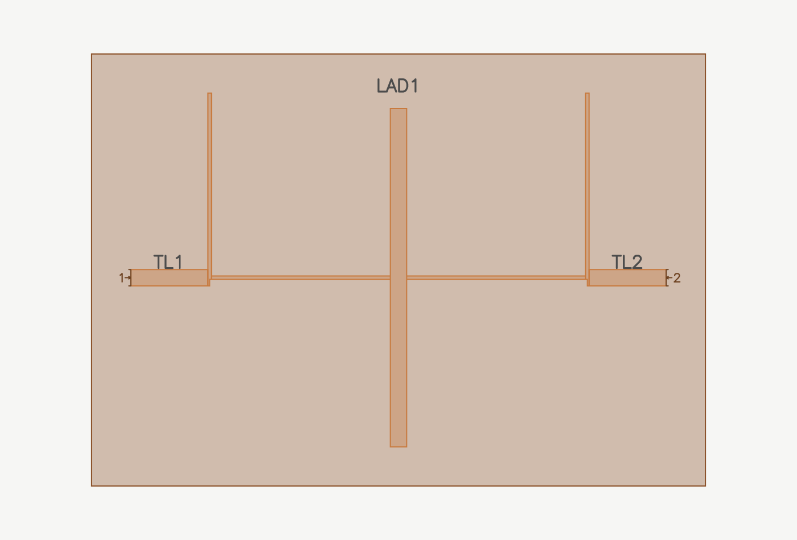

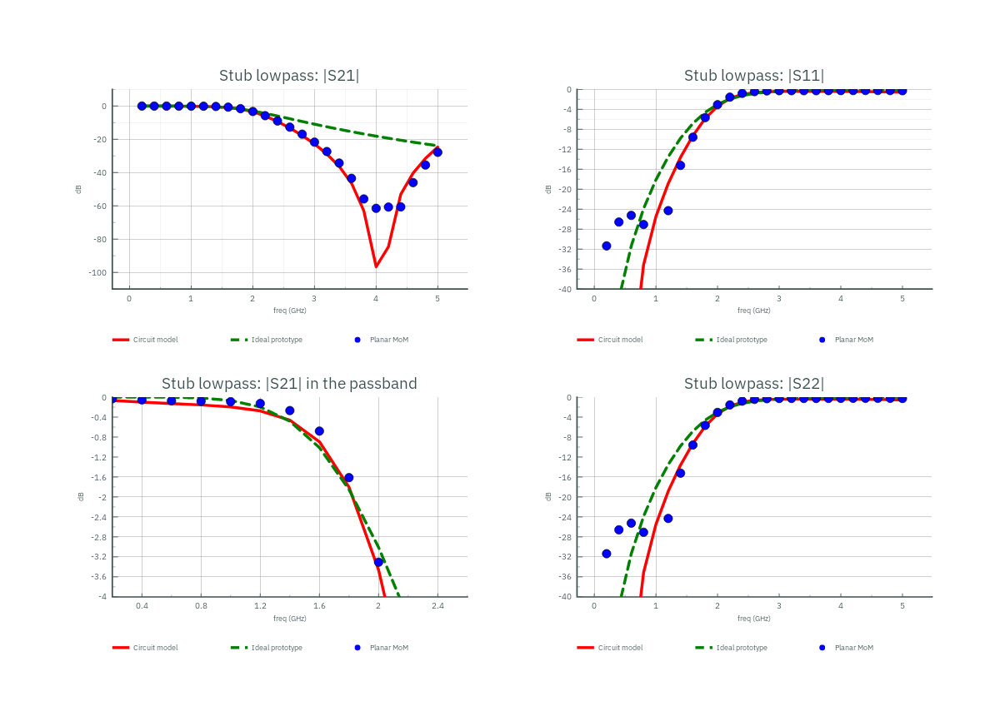

| | Prototype | Circuit | Planar MoM |
|---|---|---|---|
| −3 dB | 1.998 GHz | 1.944 GHz | 1.964 GHz |
| \|S21\| at 1 GHz | −0.07 dB | −0.20 dB | −0.09 dB |
| \|S21\| at 3 GHz | −10.9 dB | −22.8 dB | −21.7 dB |

Richards' transformation compresses the response into tan βl, so the stubs fall far faster past the cutoff than the
lumped prototype and null at 4 GHz, where every stub is a quarter wave. Planar lands within 1 % of the model's cutoff.

## End-coupled filter

Cohn's end-coupled filter (S. B. Cohn, [10.1109/JRPROC.1957.278389](https://doi.org/10.1109/JRPROC.1957.278389)), a
three-resonator Butterworth 2 % wide at 2.4 GHz: each J-inverter a series capacitance, each resonator a 50 Ω line
π − ½(atan 2bk + atan 2bk+1) long less its gaps' end capacitance. The two inner inverters are 0.075 mm gaps; the outer
two need 0.243 pF, which no gap on this board reaches (MGAP gives 0.05 pF at 20 µm), so they are capacitor sites that
Place Site Parts filled with 0402 parts. The prototype is the order-3 Butterworth bandpass over 2.376–2.424 GHz.

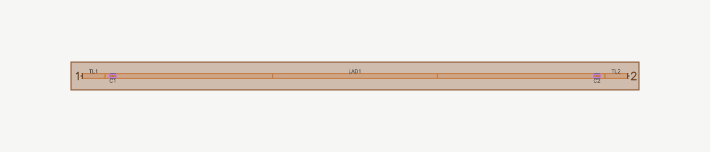

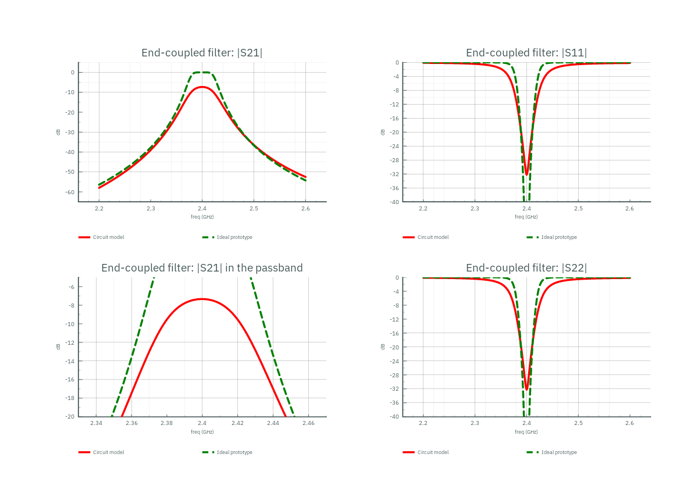

| | Prototype | Circuit |
|---|---|---|
| Centre | 2.400 GHz | 2.400 GHz |
| Least loss | 0 dB | 7.34 dB |
| Spread over 2.376–2.424 GHz | 3.01 dB | 3.39 dB |
| \|S21\| at 2.352 / 2.448 GHz | −18.4 / −17.9 dB | −21.2 / −20.3 dB |

The closed form lands on the centre. A 2 % band is all the inner gaps allow on this board (3 % needs 0.029 mm), and its
resonators' loss is the 7.3 dB.

## Lumped LC lowpass

A third-order Butterworth at 2 GHz, L = g·R0/ωc and C = g/(R0·ωc) (Pozar §8.3): `site(role=L, value=3.979nH);
site(role=C, value=3.183pF, type=shunt); site(role=L, value=3.979nH)`, the ladder's `Footprint` `smt:0402`. The
ladder draws only pads; Place Site Parts put an 0402 inductor across each series site and an 0402 capacitor from the
shunt site to a via, and Update Layout landed each on its pads. The prototype is the same Butterworth, ideal.

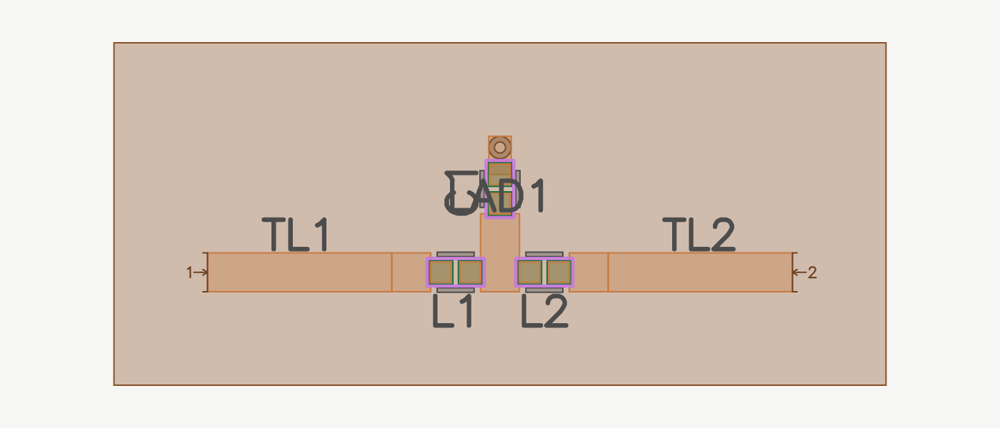

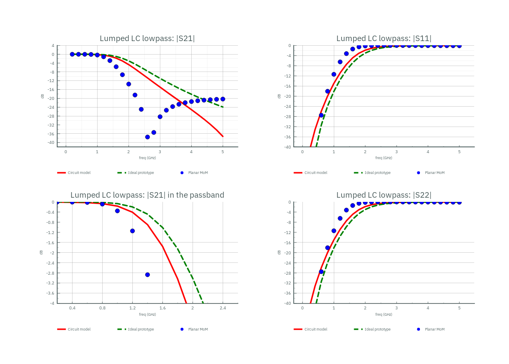

| | Prototype | Circuit | Planar MoM |
|---|---|---|---|
| −3 dB | 1.998 GHz | 1.794 GHz | 1.409 GHz |
| \|S21\| at 1 GHz | −0.07 dB | −0.17 dB | −0.35 dB |
| \|S21\| at 3 GHz | −10.9 dB | −14.9 dB | −28.3 dB |

The pads put the model's cutoff 10 % below the prototype's. Planar's is 21 % lower again, with a null near 2.6 GHz: C1's
land and ground via, which the schematic's ideal ground leaves out; with 1.2 nH there the schematic cuts off at 1.406 GHz.

## Interdigital filter

Matthaei's interdigital filter ([10.1109/TMTT.1962.1125556](https://doi.org/10.1109/TMTT.1962.1125556)): three
resonators, 0.1 dB Chebyshev, 20 % wide at 2.4 GHz, between two terminating strips, each line's admittance to ground and
each pair's mutual one realised as the widths (0.732, 0.873, 1.014, 0.873, 0.732 mm) and gaps (0.09, 0.438, 0.438,
0.09 mm) whose field-solved cross-section has them, the strips 19.148 mm long. Place Site Parts put a via on each
shorted end. The port lines leave the terminating strips through a 90° bend at the strip's own width, away from the
neighbouring strip's via. The prototype is the order-3 0.1 dB Chebyshev bandpass over 2.172–2.652 GHz.

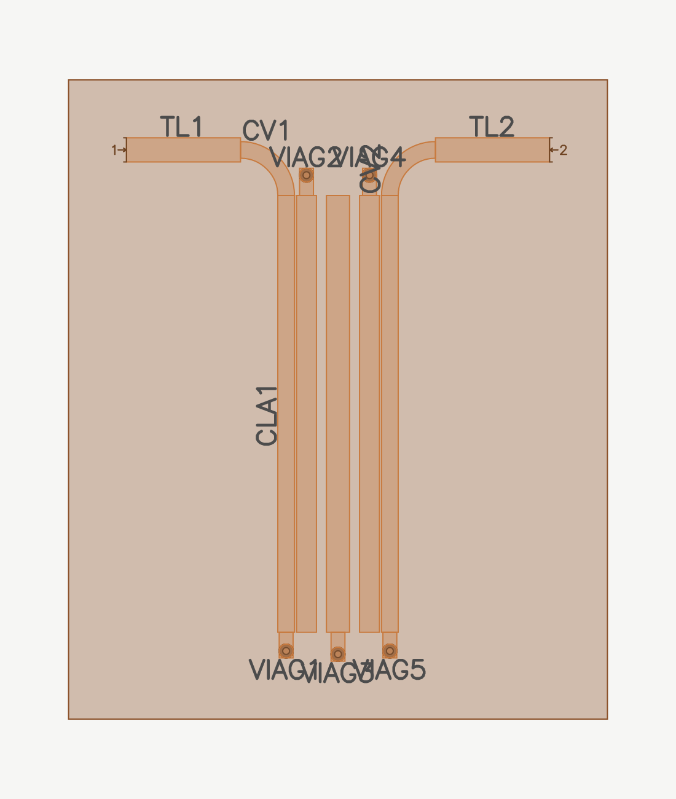

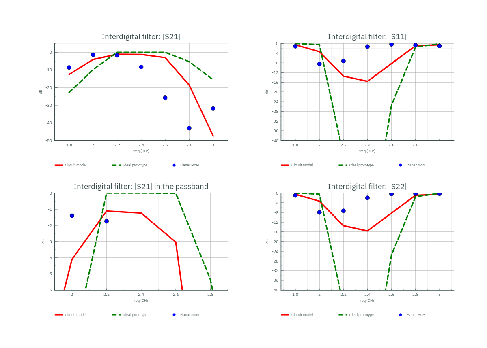

| | Prototype | Circuit | Planar MoM, 7 points |
|---|---|---|---|
| Centre | 2.423 GHz | 2.312 GHz | about 2.10 GHz |
| Least loss | 0 dB | 0.97 dB | 1.41 dB |
| Spread over 2.172–2.652 GHz | 0.10 dB | 4.68 dB | 24.0 dB |
| \|S21\| at 1.92 / 2.88 GHz | −15.6 / −9.8 dB | −7.7 / −26.4 dB | −4.3 / −38.6 dB |

The model sits 4.6 % below the prototype: 2.8 % is microstrip's unequal mode speeds, which the TEM design leaves out,
and 1.8 % the vias, which its shorts leave out. Planar, at seven points, puts the band lower still, near 2.1 GHz.

## Combline filter

Three 1 mm strips 9.192 mm long, 45° at 2.4 GHz, shorted at one end and loaded at the other. The part's own test loads
them by C = Y·cot θ0/ω0, with Y and θ0 each strip's own with its neighbours grounded (Matthaei, *Microwave J.* 1963,
no DOI; the same design is in Matthaei, Young and Jones, chapter 10:
[the book at the Internet Archive](https://archive.org/details/microwavefilters0000matt)), which sets the centre but not
the band. From there the Optimizer moved the gap, the tap and the two capacitances until the model met |S11| below
−15 dB over 2.3–2.5 GHz: 1.021 mm gaps, the taps 2.457 mm up from the shorts, 1.234, 1.186 and 1.234 pF. Place Site
Parts put a via on each short and an 0402 capacitor on each loaded end. The prototype is the order-3 Chebyshev bandpass
with 0.14 dB ripple (15 dB return loss) over 2.3–2.5 GHz.

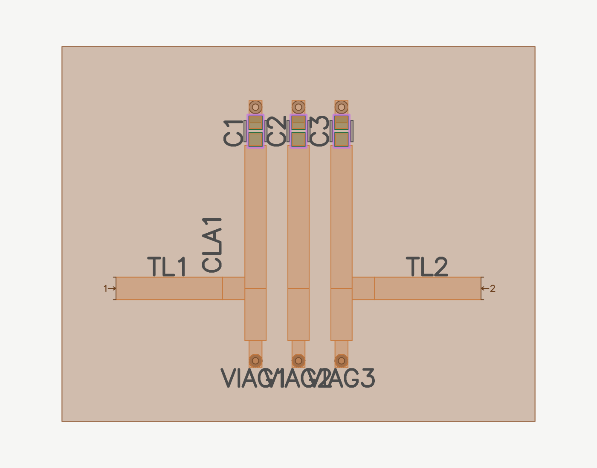

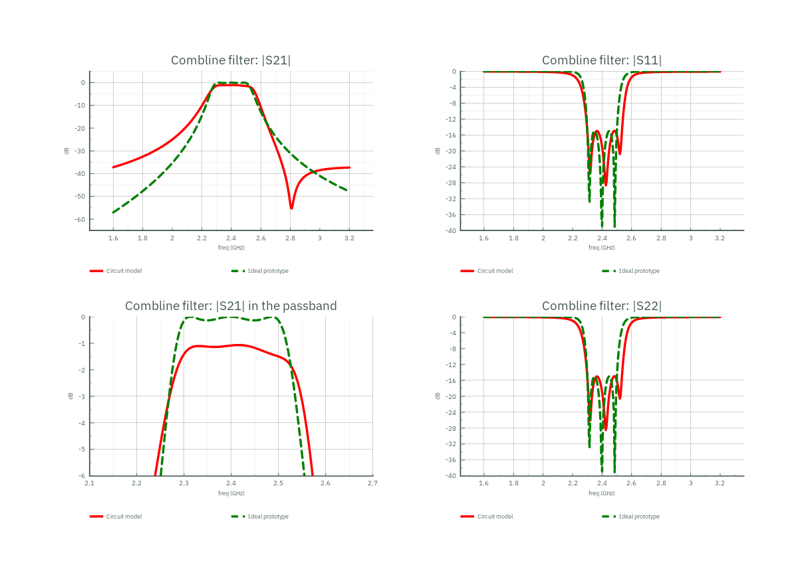

| | Prototype | Circuit |
|---|---|---|
| Centre | 2.402 GHz | 2.408 GHz |
| Least loss | 0 dB | 1.07 dB |
| Spread over 2.3–2.5 GHz | 0.14 dB | 0.43 dB |
| \|S21\| at 2.198 / 2.598 GHz | −14.9 / −12.5 dB | −10.5 / −10.4 dB |

The model holds the band; its skirts are shallower close in, and it has a zero at 2.81 GHz that the prototype does
not.

## Open points

- **The hairpin:** Planar's band is 37 % narrower than the model's, and the arms' own coupling (`Coupling` = `Full`)
  accounts for only 9 % of it.
- **The interdigital's vias** are 21.8 mm apart, past the 0.1 λ at the band top that Planar's fitted vertical kernel is
  validated to, so its setup turns on the direct kernel, which is accurate at any distance and slow: about seven minutes
  a point on the Draft mesh. The setup is coarser still for that (10 cells per wavelength) and solves seven points, which
  place its band near 2.1 GHz, well below the model's; a finer run would say whether that is the mesh.
- **No radial-stub lowpass yet.** MLAD draws radial ends (`stub(end=radial, …)`), but no closed form here sizes `Ro`
  and the angle for a given stub admittance, so the stub lowpass keeps straight stubs.

## Things to try

- **Set `Coupling` = `Full` on Hairpin**: the circuit couples each hairpin's own arms, and its band moves 1.5 % up.
- **Change a part on Lumped LC Bench**, such as `C1_pl`, and watch the Planar markers move with no EM run.
- **Edit `Sections` on Stepped-Z**: a section added or changed is redrawn by Update Layout for a new EM run.
- **Change the prototype on a bench**: the `IDEAL` block's order, ripple and band are ordinary parameters.
