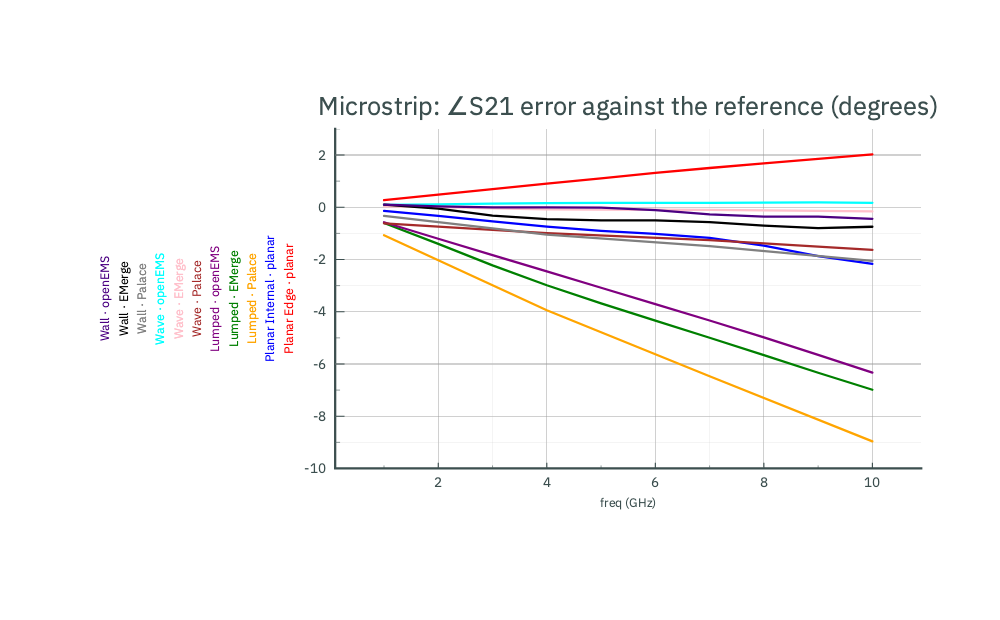
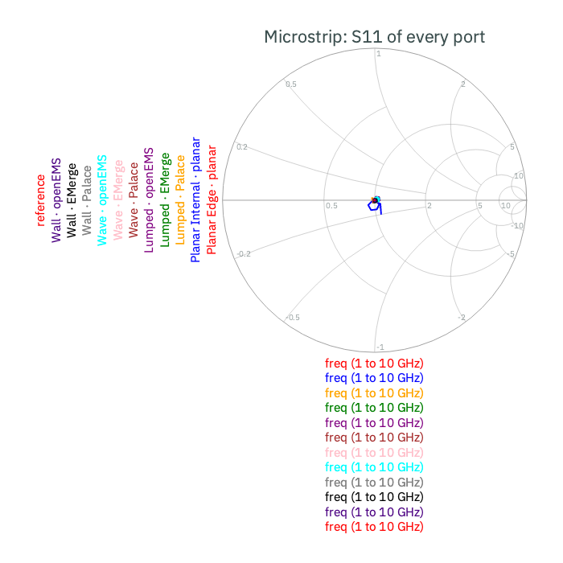
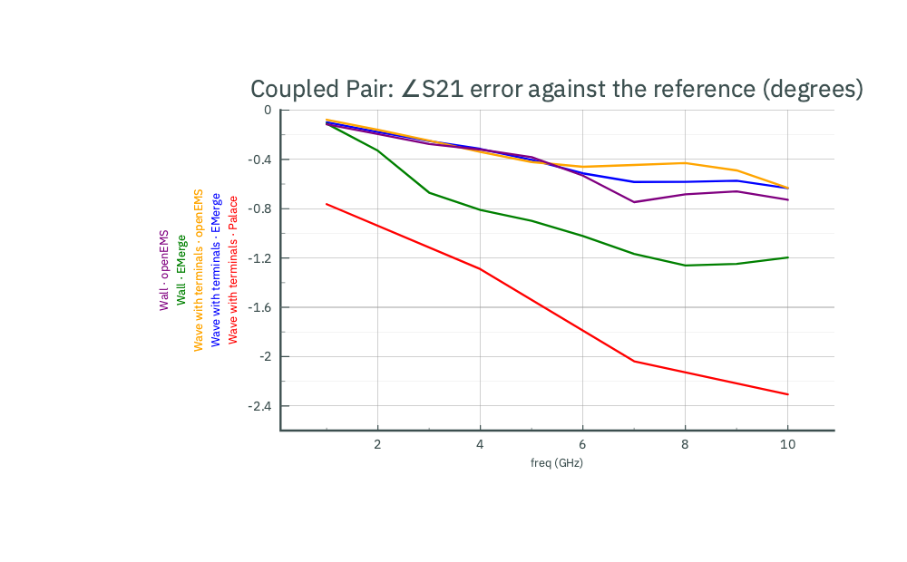
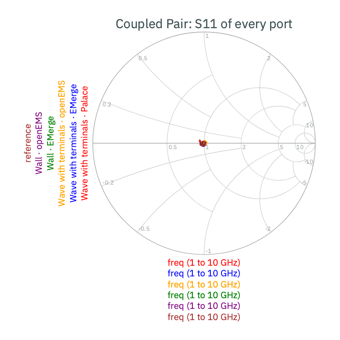
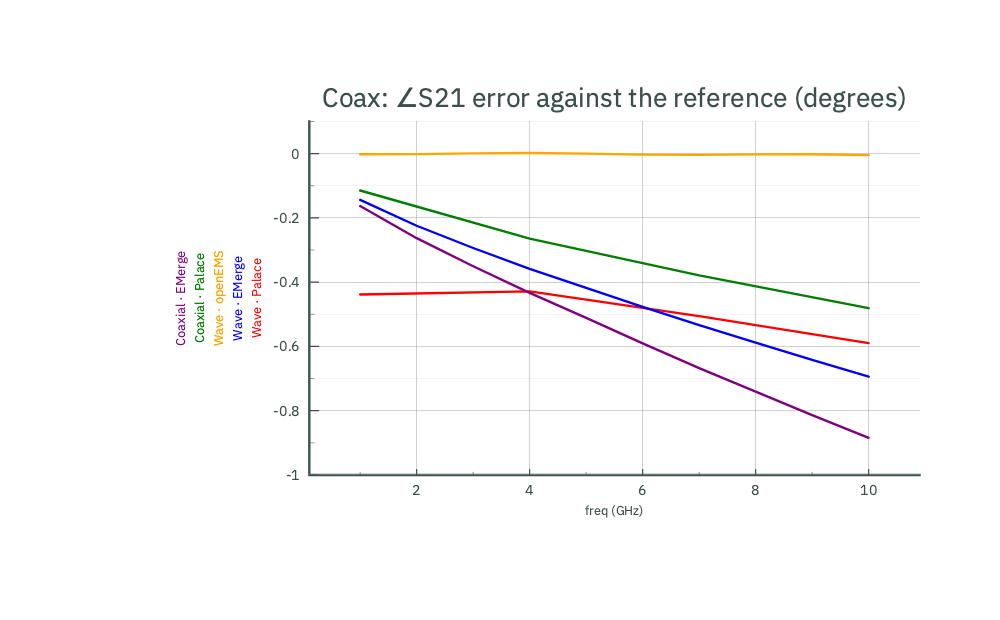
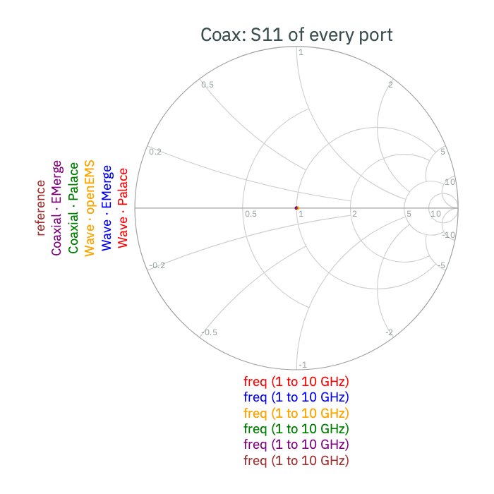
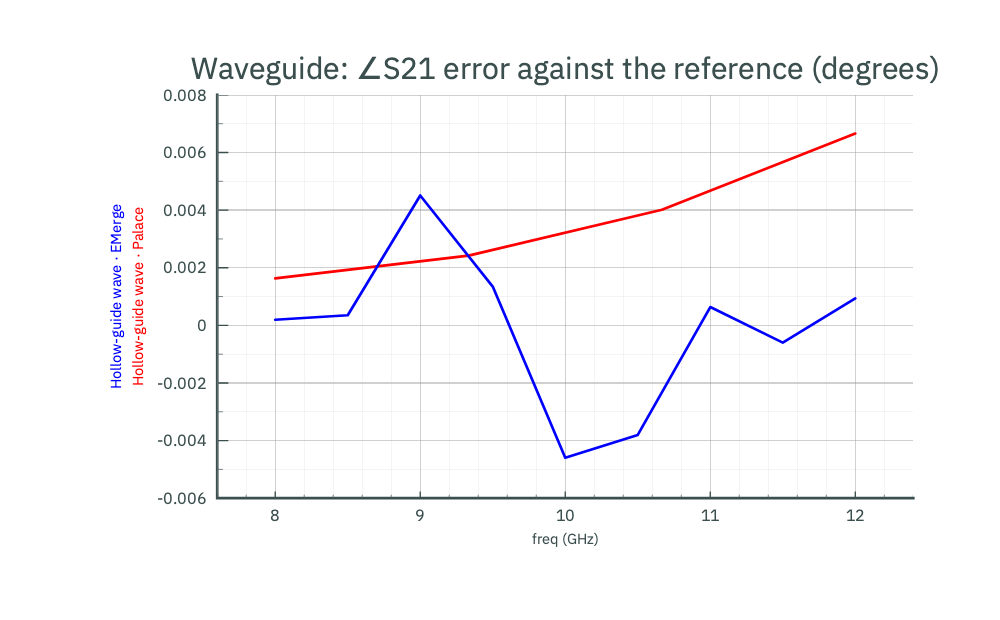
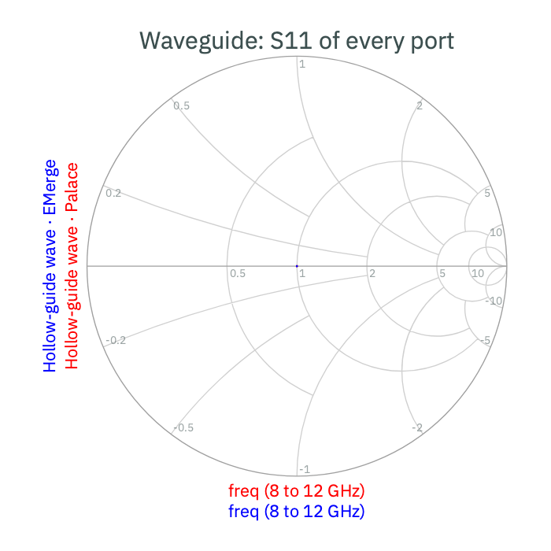
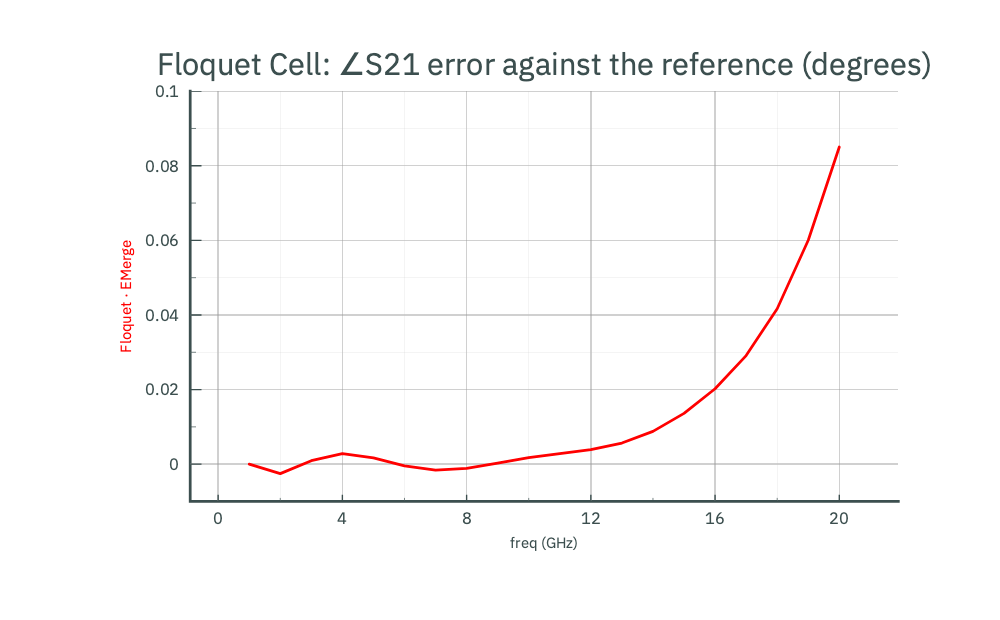
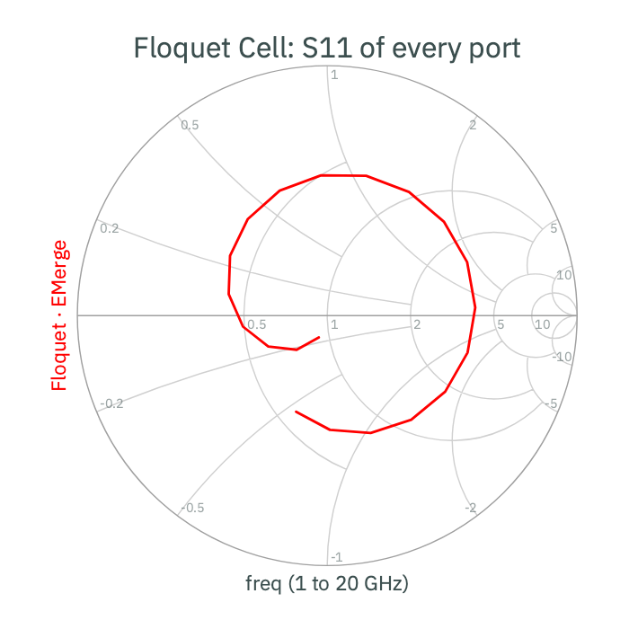

# Port Types

Every way circuitRF feeds a structure, each on the simplest structure it takes, run side by side. Each cell is one structure with an answer known in closed form where one exists; each of its ports is run on every solver that runs it, and the results are compared with the closed form and with each other. The first question a designer asks of a new structure is *which port should I use here?*; the table below answers it, and the sections after it show what each choice costs on structures where the right answer is known.

Every number on this page came from running this workspace (the machine and versions are at the end). Nothing in `results/` is shipped: run any setup and its result lands there.

## Choosing a port

Each port's own section in **Help ▸ circuitRF Documentation** (EM Setup ▸ Choosing a port holds this same table) says how to draw and set it up. The sections below measure the ones a simple structure can show.

| Port | Solvers | Best used for | Avoid when |
|---|---|---|---|
| Planar **Edge** | planar | Lines on a layered board or MMIC entering the structure at a conductor's end; the fastest route to a de-embedded answer, the port discontinuity removed | The structure has 3D features (connectors, bond wires, board edges that matter), or other metal sits within a few substrate heights of the feed and cannot be grouped with it |
| Planar **Internal** | planar | A component or device terminal inside the metal, between the metal and the ground plane | Power enters the structure along a line: an internal port is not de-embedded and its own parasitic stays in the answer |
| 3D **Lumped** | Palace, EMerge, openEMS | A small gap between two conductors: pads, a component site, a quick first setup on any solver | The sheet is tall against the wavelength (thick substrate, high frequency): its series inductance stays in S11 and nothing removes it |
| 3D **Lumped, turned** | Palace, EMerge | Pads placed at an angle, such as a part at 45° | openEMS (refused); a gap that is not a true rectangle |
| 3D **Lumped on a cylinder** | openEMS | A gap on a curved surface solved on a cylindrical grid, such as a birdcage coil | Any other solver, or a structure not coaxial with the grid's axis |
| 3D **Coaxial** | Palace, EMerge; openEMS inside the model | A connector or coax fed in its own TEM field, anywhere in the model | A line that is not coaxial; on openEMS, a ring on a face of the air box |
| 3D **Wave** | Palace, EMerge, openEMS | One line ending on the air box's face, fed and measured in its own mode, with no port parasitic | The substrate is lossy or conducting enough that the face's mode can change from one frequency to the next; the line cannot run to the box's face; a coax on openEMS's Cartesian grid (use its cylindrical grid) |
| 3D **Wave with terminals** | openEMS any number; Palace two whose modes differ in speed; EMerge | Coupled lines ending together on the box's face, in terminal S-parameters | Lines in a homogeneous fill on Palace (use openEMS); three or more terminals on Palace |
| 3D **Hollow-guide wave** | Palace, EMerge (two modes: EMerge) | Waveguide sections, transitions and filters | Anything with a centre conductor; openEMS |
| 3D **Floquet** | EMerge | One cell of an infinite array: frequency-selective surfaces, reflectarray and metasurface elements | A finite structure, or a cell that cannot be made periodic on both side axes |
| 3D **Wall** | Palace, EMerge, openEMS | Lines meeting a PEC wall: shielded circuits, RFIC stacks over conducting silicon, coupled lines or a bus at one wall; the port discontinuity and the coupling at the port are calibrated out | The line cannot run straight and uniform to the wall for its end run; coupled lines whose modes travel at one speed; a face that must radiate (the wall is PEC); a cross-section so large that its standards cost more than the run |
| **Component ports** | planar, Palace, EMerge, openEMS | A placed part's pads, with nothing drawn: every part's terminals at once | A connection that is a line rather than a part |
| Planar **Internal delta gap** | planar | A lumped element or device cut into the middle of a conductor | An end-fed line (use Edge) |
| Cross-section **conductor ends** | cross-section kernel | A uniform line or coupled lines from their cross-section alone, in milliseconds | Anything that is not uniform along its length |

**Reading the tables below.** Each result is compared with its cell's reference over the band: the worst |ΔS11| and |ΔS21| (complex differences), the worst error in ∠S21, and the **worst VSWR** between the result's port reflections and the reference's, `RfHelpers.VswrFromGamma(reference, answer)`: s = (z₂ − z₁)/(z₂ + z₁*), which reads exactly 1 when the two are the same impedance (both in one real 50 Ω reference). The VSWR is the port-match figure, and RF circuit performance follows it; |ΔS21| is dominated by the phase of a long line, so the two sit side by side and neither stands in for the other. No VSWR is formed from a transmission term. **Then the agreement matrix**, the table to read first: every result of the cell against every other, each entry the worst VSWR between the two results' reflections at the frequencies they share, and beside it the worst |ΔS| of the transmission terms.

## What is here

| Cell | View | What it is |
|---|---|---|
| **Microstrip** | layout, 3D view | A 50 Ω line, 20 mm, 1.54 mm wide, on 20 mil of PTFE-glass laminate (εr 2.2, tanδ 0.0009) with 18 µm copper. The layout's two edge ports run on the planar solver (*Edge · Planar*); the 3D view's two wave ports run as drawn (*Wave · Palace*, *· EMerge*, *· openEMS*) and as wall ports (*Wall · …*) |
| **Microstrip Internal** | layout | The same line with internal ports (*Internal · Planar*): a port's planar kind lives on its label, so this is a copy of the layout |
| **Microstrip Lumped** | 3D view | The same line with air beyond each end and a lumped sheet from the floor to the strip at each end (*Lumped · …*) |
| **Coupled Pair** | layout, 3D view | Two 1.5 mm strips 0.3 mm apart on the same laminate, 20 mm: planar edge ports, and a two-terminal wave port at each end of the 3D view, run as drawn (*Wave · …*) and as wall ports (*Wall · …*) |
| **Coax** | 3D view | The 3D Connector's coax, a 0.4 mm pin in a 1.34 mm PTFE bore (εr 2.1), 20 mm in a copper housing, with a wave port at each end |
| **Coax Coaxial** | 3D view | The same coax with an annular (coaxial) lumped port at each end |
| **Waveguide** | 3D view | An empty WR90 guide, 22.86 × 10.16 mm, 30 mm, 8–12 GHz: the air box's PEC faces are its walls, and each end is a hollow-guide wave port |
| **Floquet Cell** | 3D view | One 10 mm cell of an infinite 3 mm slab of εr 4, broadside, 1–20 GHz, between Floquet ports 5 mm above and below it |
| **Line over Silicon** | 3D view | A 10 µm line on 5 µm of oxide over 200 µm of 10 Ω·cm silicon, 2 mm, 1–40 GHz: wave ports as drawn, and as wall ports |
| **Line over Silicon Lumped** | 3D view | The same line with lumped ports |
| **Microstrip Reference**, **Coupled Pair Reference**, **Coax Reference** | schematic | The closed forms the cells are compared with: an MLIN, an MCLIN and a TLIN between 50 Ω ports, each a test bench with its sweep |

The closed forms are the three **… Reference** cells, each a test bench whose schematic is the line between two 50 Ω ports (`circuitrf sparam "Microstrip Reference/schematic/Microstrip Reference.csch"` runs one), and `tech/board-and-connector.ctech` is the 3D Connector's technology with 18 µm copper and the slab's, the silicon's and the oxide's materials added.

**Wave and Wall share one 3D view and one set of drawn ports.** The ports are drawn as wave ports, and each *Wall · …* setup runs them as wall ports through its Analysis Setup's port table (**Simulate ▸ Setup Analyses…**, Kind column). Make *Wall · Palace* the active setup and watch the overlay: the wave port's whole-face region becomes a short gap from the PEC wall to the line, with the line cut back by it, and the face itself turns PEC. To make wall ports from nothing, right-click the air box's face where the lines end and choose *Make Port ▸ Wall*: one right-click writes one port per line. Lumped ports need sheets of their own, so they are on a second view of the same line.

**Each solver's mesh is the one this series measured a port on.** Palace runs at Standard quality on four frequencies (1, 4, 7 and 10 GHz) to keep its runs short; EMerge's elements are 0.05 λ with an edge refinement of 0.1 on the board cells (0.1 λ on the silicon; its Standard preset on the Floquet cell); openEMS's grid is 40 cells per wavelength, 60 where its wave port's current probe needs room round a strip over its floor, and a cylindrical grid about the coax's axis for the coax's wave port.

## Microstrip

A 50 Ω line, 20 mm long and 1.54 mm wide, on 20 mil (0.508 mm) of PTFE-glass laminate (εr 2.2, tanδ 0.0009), with 18 µm copper. The reference is circuitRF's closed form for it, the **Microstrip Reference** cell's schematic: an MLIN of the same line (Hammerstad–Jensen impedance, Kirschning–Jansen dispersion, conductor and dielectric loss) between two 50 Ω ports. At 4 GHz, where every sweep below has a point, it gives ε_eff 1.892.

The 3D view's line is an 18 µm copper box over the laminate, the floor of the air box PEC beneath it and its other faces absorbing, the lid 5 mm above the strip. Its two ports are drawn as **wave ports** over the whole of each end face. The **wall** setups run those same ports as wall ports (the Kind column of their Analysis Setup); drawing them from nothing is one right-click, *Make Port ▸ Wall* on the air box's end face. The **lumped** view puts a sheet from the floor to the strip at each end of the same line, with 2 mm of air beyond it. The planar **Edge** ports are the layout's port labels at the line's ends; the **Internal** ports stand on a 0.6 mm via at each end (an internal port drives the via under it), so its line is 19.4 mm between the vias, and its setup integrates the vias' coupling directly (`DirectVerticalKernel`), because two vias 20 mm apart are past the fitted kernel's range at 10 GHz.

| Port | Solver | worst \|ΔS11\| | worst \|ΔS21\| | worst ∠S21 error | worst VSWR | ε_eff at 4 GHz | size | time |
|---|---|---|---|---|---|---|---|---|
| Planar Edge | planar | 1.6e−2 | 3.5e−2 | 2.03° | 1.0322 | 1.866 | 416 unknowns | 6 s |
| Planar Internal | planar | 1.0e−1 | 3.9e−2 | 2.17° | 1.2220 | 1.913 | 519 unknowns | 100 s |
| Lumped | Palace | 2.2e−2 | 1.5e−1 | 8.96° | 1.0444 | 2.007 | 144,004 unknowns | 111 s |
| Lumped | EMerge | 1.7e−2 | 1.2e−1 | 6.99° | 1.0357 | 1.978 | 305,038 unknowns | 60 s |
| Lumped | openEMS | 3.8e−2 | 1.1e−1 | 6.33° | 1.0782 | 1.963 | 134,976 cells | 45 s |
| Wave | Palace | 1.9e−2 | 2.8e−2 | 1.63° | 1.0377 | 1.920 | 172,948 unknowns | 2 min 49 s |
| Wave | EMerge | 1.6e−2 | 4.9e−3 | 0.16° | 1.0322 | 1.894 | 289,138 unknowns | 55 s |
| Wave | openEMS | 3.5e−2 | 1.3e−2 | 0.19° | 1.0728 | 1.887 | 239,400 cells | 69 s |
| Wall | Palace | 1.6e−2 | 3.7e−2 | 2.05° | 1.0331 | 1.922 | 313,264 unknowns | 14 min 10 s |
| Wall | EMerge | 1.9e−2 | 1.5e−2 | 0.80° | 1.0388 | 1.905 | 291,724 unknowns | 118 s |
| Wall | openEMS | 1.2e−2 | 9.0e−3 | 0.44° | 1.0241 | 1.892 | 87,024 cells | 100 s |
| reference | closed form | | | | | 1.892 | | |

**Agreement**, worst VSWR between the two results' reflections at 1, 4, 7, 10 GHz (the frequencies every result has):

| | Planar Edge · planar | Planar Internal · planar | Lumped · Palace | Lumped · EMerge | Lumped · openEMS | Wave · Palace | Wave · EMerge | Wave · openEMS | Wall · Palace | Wall · EMerge | Wall · openEMS | reference |
|---|---|---|---|---|---|---|---|---|---|---|---|---|
| **Planar Edge · planar** |  | 1.2211 | 1.0691 | 1.0399 | 1.0718 | 1.0563 | 1.0268 | 1.0554 | 1.0227 | 1.0338 | 1.0218 | 1.0242 |
| **Planar Internal · planar** | 1.2211 |  | 1.2645 | 1.1939 | 1.2273 | 1.2190 | 1.1971 | 1.1946 | 1.1976 | 1.1853 | 1.2022 | 1.2220 |
| **Lumped · Palace** | 1.0691 | 1.2645 |  | 1.0636 | 1.1030 | 1.0379 | 1.0575 | 1.0846 | 1.0772 | 1.0757 | 1.0666 | 1.0444 |
| **Lumped · EMerge** | 1.0399 | 1.1939 | 1.0636 |  | 1.0853 | 1.0342 | 1.0305 | 1.0694 | 1.0315 | 1.0317 | 1.0269 | 1.0357 |
| **Lumped · openEMS** | 1.0718 | 1.2273 | 1.1030 | 1.0853 |  | 1.0962 | 1.0616 | 1.0294 | 1.0596 | 1.0655 | 1.0655 | 1.0782 |
| **Wave · Palace** | 1.0563 | 1.2190 | 1.0379 | 1.0342 | 1.0962 |  | 1.0328 | 1.0782 | 1.0576 | 1.0555 | 1.0465 | 1.0377 |
| **Wave · EMerge** | 1.0268 | 1.1971 | 1.0575 | 1.0305 | 1.0616 | 1.0328 |  | 1.0444 | 1.0382 | 1.0329 | 1.0252 | 1.0215 |
| **Wave · openEMS** | 1.0554 | 1.1946 | 1.0846 | 1.0694 | 1.0294 | 1.0782 | 1.0444 |  | 1.0417 | 1.0440 | 1.0454 | 1.0610 |
| **Wall · Palace** | 1.0227 | 1.1976 | 1.0772 | 1.0315 | 1.0596 | 1.0576 | 1.0382 | 1.0417 |  | 1.0137 | 1.0135 | 1.0331 |
| **Wall · EMerge** | 1.0338 | 1.1853 | 1.0757 | 1.0317 | 1.0655 | 1.0555 | 1.0329 | 1.0440 | 1.0137 |  | 1.0144 | 1.0325 |
| **Wall · openEMS** | 1.0218 | 1.2022 | 1.0666 | 1.0269 | 1.0655 | 1.0465 | 1.0252 | 1.0454 | 1.0135 | 1.0144 |  | 1.0215 |
| **reference** | 1.0242 | 1.2220 | 1.0444 | 1.0357 | 1.0782 | 1.0377 | 1.0215 | 1.0610 | 1.0331 | 1.0325 | 1.0215 |  |

and worst |ΔS| of the transmission terms between them:

| | Planar Edge · planar | Planar Internal · planar | Lumped · Palace | Lumped · EMerge | Lumped · openEMS | Wave · Palace | Wave · EMerge | Wave · openEMS | Wall · Palace | Wall · EMerge | Wall · openEMS | reference |
|---|---|---|---|---|---|---|---|---|---|---|---|---|
| **Planar Edge · planar** |  | 7.2e−2 | 1.9e−1 | 1.5e−1 | 1.4e−1 | 6.3e−2 | 3.9e−2 | 3.8e−2 | 7.0e−2 | 4.8e−2 | 4.2e−2 | 3.5e−2 |
| **Planar Internal · planar** | 7.2e−2 |  | 1.2e−1 | 8.3e−2 | 7.3e−2 | 1.3e−2 | 3.8e−2 | 4.8e−2 | 8.4e−3 | 2.5e−2 | 3.1e−2 | 3.9e−2 |
| **Lumped · Palace** | 1.9e−1 | 1.2e−1 |  | 3.5e−2 | 4.7e−2 | 1.3e−1 | 1.5e−1 | 1.6e−1 | 1.2e−1 | 1.4e−1 | 1.5e−1 | 1.5e−1 |
| **Lumped · EMerge** | 1.5e−1 | 8.3e−2 | 3.5e−2 |  | 1.2e−2 | 9.2e−2 | 1.2e−1 | 1.3e−1 | 8.5e−2 | 1.1e−1 | 1.1e−1 | 1.2e−1 |
| **Lumped · openEMS** | 1.4e−1 | 7.3e−2 | 4.7e−2 | 1.2e−2 |  | 8.1e−2 | 1.1e−1 | 1.1e−1 | 7.4e−2 | 9.7e−2 | 1.0e−1 | 1.1e−1 |
| **Wave · Palace** | 6.3e−2 | 1.3e−2 | 1.3e−1 | 9.2e−2 | 8.1e−2 |  | 2.6e−2 | 3.5e−2 | 1.1e−2 | 1.6e−2 | 2.1e−2 | 2.8e−2 |
| **Wave · EMerge** | 3.9e−2 | 3.8e−2 | 1.5e−1 | 1.2e−1 | 1.1e−1 | 2.6e−2 |  | 1.1e−2 | 3.6e−2 | 1.6e−2 | 1.0e−2 | 4.9e−3 |
| **Wave · openEMS** | 3.8e−2 | 4.8e−2 | 1.6e−1 | 1.3e−1 | 1.1e−1 | 3.5e−2 | 1.1e−2 |  | 4.6e−2 | 2.7e−2 | 2.1e−2 | 1.3e−2 |
| **Wall · Palace** | 7.0e−2 | 8.4e−3 | 1.2e−1 | 8.5e−2 | 7.4e−2 | 1.1e−2 | 3.6e−2 | 4.6e−2 |  | 2.3e−2 | 2.8e−2 | 3.7e−2 |
| **Wall · EMerge** | 4.8e−2 | 2.5e−2 | 1.4e−1 | 1.1e−1 | 9.7e−2 | 1.6e−2 | 1.6e−2 | 2.7e−2 | 2.3e−2 |  | 8.0e−3 | 1.5e−2 |
| **Wall · openEMS** | 4.2e−2 | 3.1e−2 | 1.5e−1 | 1.1e−1 | 1.0e−1 | 2.1e−2 | 1.0e−2 | 2.1e−2 | 2.8e−2 | 8.0e−3 |  | 9.0e−3 |
| **reference** | 3.5e−2 | 3.9e−2 | 1.5e−1 | 1.2e−1 | 1.1e−1 | 2.8e−2 | 4.9e−3 | 1.3e−2 | 3.7e−2 | 1.5e−2 | 9.0e−3 |  |

**What the numbers say.** Every 3D wall port and the FEM solvers' wave ports land within VSWR 1.02–1.04 of the closed form's match (openEMS's wave port reads 1.073), and the three wall ports agree with each other more closely still, to VSWR 1.014: what separates them from the closed form is common to all of them, the full-wave line in its box against the closed form's ideal one, not the ports. The phase tells the ports apart. openEMS's and EMerge's wave ports and openEMS's wall port are within 0.16–0.44° of the closed form's ∠S21 over the band, and EMerge's wall port within 0.8°; Palace's wave and wall ports are 1.6° and 2.1° off, because Palace's line itself is 1.5 % slow here (ε_eff 1.92 against 1.892), which no port removes. The **lumped** sheets cost 6–9° of ∠S21 and read ε_eff 4–6 % high: the sheet's own series inductance, 0.5 mm tall, is in the answer, which is what the table's *Avoid when* says of a tall sheet. The planar **Edge** port is de-embedded and sits with the 3D ports, at VSWR 1.032; the planar **Internal** port is not, and its vias' inductance shows as VSWR 1.22, which is right for a component's terminal and wrong for a line's end.

## Coupled Pair

Two 1.5 mm strips 0.3 mm apart on the same laminate and copper, 20 mm long. The reference is the **Coupled Pair Reference** cell's schematic, circuitRF's MCLIN (Kirschning–Jansen coupled microstrip, each mode with its own dispersion and loss). Ports 1 and 2 are strip a's and strip b's near ends, 3 and 4 their far ends, so **S31 is the thru**, S21 the near-end coupling and S41 the far-end coupling; ε_eff below is read from the thru.

The 3D view has a **two-terminal wave port** on each end face, run as drawn and as **wall ports** (one calibration group of two lines at each end). Palace's wall setup did not finish within the 20 minutes each Palace run was allowed (its three 4-port standards and the structure, at four frequencies), so it is not in the table; PWL-3's own measurement of a coupled pair on Palace's wall port is in the EM Setup chapter.

| Port | Solver | worst \|ΔS11\| | worst \|ΔS31\| | worst ∠S31 error | worst VSWR | ε_eff at 4 GHz | size | time |
|---|---|---|---|---|---|---|---|---|
| Wave with terminals | Palace | 2.4e−2 | 3.9e−2 | 2.31° | 1.0483 | 1.871 | 200,274 unknowns | 7 min 53 s |
| Wave with terminals | EMerge | 1.8e−2 | 1.1e−2 | 0.63° | 1.0357 | 1.843 | 492,108 unknowns | 2 min 26 s |
| Wave with terminals | openEMS | 2.9e−2 | 1.9e−2 | 0.63° | 1.0608 | 1.844 | 258,400 cells | 3 min 46 s |
| Wall | EMerge | 1.2e−2 | 2.2e−2 | 1.26° | 1.0247 | 1.857 | 499,312 unknowns | 6 min 39 s |
| Wall | openEMS | 7.4e−3 | 1.3e−2 | 0.75° | 1.0149 | 1.843 | 97,902 cells | 4 min 00 s |
| reference | closed form | | | | | 1.834 | | |

**Agreement**, worst VSWR between the two results' reflections at 1, 4, 7, 10 GHz (the frequencies every result has):

| | Wave with terminals · Palace | Wave with terminals · EMerge | Wave with terminals · openEMS | Wall · EMerge | Wall · openEMS | reference |
|---|---|---|---|---|---|---|
| **Wave with terminals · Palace** |  | 1.0566 | 1.0894 | 1.0717 | 1.0626 | 1.0483 |
| **Wave with terminals · EMerge** | 1.0566 |  | 1.0355 | 1.0267 | 1.0257 | 1.0278 |
| **Wave with terminals · openEMS** | 1.0894 | 1.0355 |  | 1.0382 | 1.0398 | 1.0512 |
| **Wall · EMerge** | 1.0717 | 1.0267 | 1.0382 |  | 1.0108 | 1.0235 |
| **Wall · openEMS** | 1.0626 | 1.0257 | 1.0398 | 1.0108 |  | 1.0142 |
| **reference** | 1.0483 | 1.0278 | 1.0512 | 1.0235 | 1.0142 |  |

and worst |ΔS| of the transmission terms between them:

| | Wave with terminals · Palace | Wave with terminals · EMerge | Wave with terminals · openEMS | Wall · EMerge | Wall · openEMS | reference |
|---|---|---|---|---|---|---|
| **Wave with terminals · Palace** |  | 2.8e−2 | 3.4e−2 | 1.9e−2 | 2.7e−2 | 3.9e−2 |
| **Wave with terminals · EMerge** | 2.8e−2 |  | 1.7e−2 | 1.1e−2 | 9.0e−3 | 1.1e−2 |
| **Wave with terminals · openEMS** | 3.4e−2 | 1.7e−2 |  | 2.4e−2 | 1.7e−2 | 1.9e−2 |
| **Wall · EMerge** | 1.9e−2 | 1.1e−2 | 2.4e−2 |  | 9.5e−3 | 2.1e−2 |
| **Wall · openEMS** | 2.7e−2 | 9.0e−3 | 1.7e−2 | 9.5e−3 |  | 1.4e−2 |
| **reference** | 3.9e−2 | 1.1e−2 | 1.9e−2 | 2.1e−2 | 1.4e−2 |  |

**What the numbers say.** The **wall** ports are closest to the closed form, openEMS's at VSWR 1.015 with ∠S31 within 0.75° and EMerge's at 1.025, and they agree with each other to VSWR 1.011: their calibration removes the port discontinuity and the coupling at the port together. The **wave ports with terminals** come next, VSWR 1.036 (EMerge), 1.048 (Palace) and 1.061 (openEMS), and Palace's thru is 2.3° off for the reason the Microstrip's was, its line's own speed. The planar Edge ports are not shown: in this run the planar solver's calibration group returned its two far-end ports in the wrong order, a defect this example found, recorded for a fix; it is not a property of the port.

## Coax

The 3D Connector's coax: a 0.4 mm copper pin in a 1.34 mm bore of PTFE (εr 2.1) through a copper housing, 20 mm long. Its impedance is exact, Z₀ = η₀/(2π√εr)·ln(D/d) = **50.02 Ω**, and its ε_eff is the PTFE's 2.1; the **Coax Reference** cell's schematic is that line, a TLIN, lossless (the PTFE's and the copper's loss over 20 mm are below 0.01 dB).

**Coax** has a **wave port** on each end face, a 2 mm square round the coax; **Coax Coaxial** has an **annular lumped port** across each end's PTFE ring, from the shell to the pin. The housing has 0.5 mm of air round it, because Palace selects each face of the air box in its mesh and a face the copper fills selects nothing. On openEMS the wave port runs on a **cylindrical grid** about the coax's axis, the grid's circles on the pin and the bore, which `check` recommends; the coaxial port is not run on openEMS, which refuses a ring on a face of the air box (its wall would short it).

| Port | Solver | worst \|ΔS11\| | worst \|ΔS21\| | worst ∠S21 error | worst VSWR | ε_eff at 4 GHz | size | time |
|---|---|---|---|---|---|---|---|---|
| Coaxial | Palace | 1.6e−3 | 1.0e−2 | 0.48° | 1.0032 | 2.108 | 285,720 unknowns | 2 min 12 s |
| Coaxial | EMerge | 7.4e−3 | 1.6e−2 | 0.88° | 1.0150 | 2.113 | 550,580 unknowns | 43 s |
| Wave | Palace | 4.4e−3 | 1.2e−2 | 0.59° | 1.0089 | 2.113 | 212,074 unknowns | 88 s |
| Wave | EMerge | 6.1e−3 | 1.4e−2 | 0.69° | 1.0136 | 2.111 | 518,906 unknowns | 37 s |
| Wave | openEMS | 1.2e−2 | 4.1e−4 | 0.01° | 1.0245 | 2.100 | 523,776 cells | 27 s |
| reference | closed form | | | | | 2.100 | | |

**Agreement**, worst VSWR between the two results' reflections at 1, 4, 7, 10 GHz (the frequencies every result has):

| | Wave · Palace | Wave · EMerge | Wave · openEMS | Coaxial · Palace | Coaxial · EMerge | reference |
|---|---|---|---|---|---|---|
| **Wave · Palace** |  | 1.0139 | 1.0260 | 1.0092 | 1.0171 | 1.0089 |
| **Wave · EMerge** | 1.0139 |  | 1.0297 | 1.0097 | 1.0081 | 1.0116 |
| **Wave · openEMS** | 1.0260 | 1.0297 |  | 1.0234 | 1.0297 | 1.0222 |
| **Coaxial · Palace** | 1.0092 | 1.0097 | 1.0234 |  | 1.0119 | 1.0032 |
| **Coaxial · EMerge** | 1.0171 | 1.0081 | 1.0297 | 1.0119 |  | 1.0134 |
| **reference** | 1.0089 | 1.0116 | 1.0222 | 1.0032 | 1.0134 |  |

and worst |ΔS| of the transmission terms between them:

| | Wave · Palace | Wave · EMerge | Wave · openEMS | Coaxial · Palace | Coaxial · EMerge | reference |
|---|---|---|---|---|---|---|
| **Wave · Palace** |  | 5.1e−3 | 1.2e−2 | 5.6e−3 | 5.1e−3 | 1.2e−2 |
| **Wave · EMerge** | 5.1e−3 |  | 1.4e−2 | 3.7e−3 | 3.5e−3 | 1.4e−2 |
| **Wave · openEMS** | 1.2e−2 | 1.4e−2 |  | 1.0e−2 | 1.6e−2 | 4.0e−4 |
| **Coaxial · Palace** | 5.6e−3 | 3.7e−3 | 1.0e−2 |  | 7.0e−3 | 1.0e−2 |
| **Coaxial · EMerge** | 5.1e−3 | 3.5e−3 | 1.6e−2 | 7.0e−3 |  | 1.6e−2 |
| **reference** | 1.2e−2 | 1.4e−2 | 4.0e−4 | 1.0e−2 | 1.6e−2 |  |

**What the numbers say.** Every port is within VSWR 1.025 of the exact line. Palace's **coaxial** port is closest (VSWR 1.003), and on openEMS's cylindrical grid the **wave** port's ∠S21 is within 0.01° of the closed form, the grid's circles lying on the pin and the bore; the FEM solvers read ε_eff 0.5 % high (0.5–0.9° at 10 GHz). On openEMS's Cartesian grid the same wave port staircased the bore in about 4 cells, and its answer was far off: run a coax on openEMS on the cylindrical grid `check` proposes.

## Waveguide

An empty WR90 guide, 22.86 × 10.16 mm, 30 mm long, swept 8–12 GHz. The air box's six faces are PEC and are the guide's walls; each end is a **hollow-guide wave port** normalised to its own mode (Z0 "mode"). The reference is exact: matched TE10 ports see S11 = 0 and S21 = e^(−jβL) with β = √(k₀² − (π/a)²), cut off at 6.557 GHz. openEMS refuses a hollow guide's port, so the guide runs on Palace and EMerge.

| Port | Solver | worst \|ΔS11\| | worst \|ΔS21\| | worst ∠S21 error | worst VSWR | ε_eff | size | time |
|---|---|---|---|---|---|---|---|---|
| Hollow-guide wave | Palace | 8.4e−6 | 1.2e−4 | 0.01° | 1.0000 | — | 194,000 unknowns | 2 min 15 s |
| Hollow-guide wave | EMerge | 7.0e−7 | 8.0e−5 | 0.00° | 1.0000 | — | 119,488 unknowns | 19 s |

**Agreement**, worst VSWR between the two results' reflections at 8, 12 GHz (the frequencies every result has):

| | Hollow-guide wave · Palace | Hollow-guide wave · EMerge | reference |
|---|---|---|---|
| **Hollow-guide wave · Palace** |  | 1.0000 | 1.0000 |
| **Hollow-guide wave · EMerge** | 1.0000 |  | 1.0000 |
| **reference** | 1.0000 | 1.0000 |  |

and worst |ΔS| of the transmission terms between them:

| | Hollow-guide wave · Palace | Hollow-guide wave · EMerge | reference |
|---|---|---|---|
| **Hollow-guide wave · Palace** |  | 1.0e−4 | 1.2e−4 |
| **Hollow-guide wave · EMerge** | 1.0e−4 |  | 1.6e−5 |
| **reference** | 1.2e−4 | 1.6e−5 |  |

**What the numbers say.** Both solvers' hollow-guide ports reproduce the exact TE10 line: |ΔS21| at most 1.2e-4 and VSWR 1.00002 on Palace, and the same to the last digit shown on EMerge. A mode-normalised wave port on a hollow guide is exact when the guide is.

## Floquet Cell

One 10 mm square cell of an infinite slab, 3 mm of εr 4, at broadside, swept 1–20 GHz. The cell's four side faces are periodic pairs, and a **Floquet port** covers the whole of each z face 5 mm from the slab, with two modes (TE00 and TM00, ports 1 and 2 below, 3 and 4 above). The reference is exact: a plane wave through air, the slab and air again, in the ports' own wave impedance. Only EMerge runs a Floquet port, here at its Standard mesh (the board cells' finer one reached the machine's memory at 20 GHz).

| Port | Solver | worst \|ΔS11\| | worst \|ΔS31\| | worst ∠S31 error | worst VSWR | ε_eff | size | time |
|---|---|---|---|---|---|---|---|---|
| Floquet | EMerge | 1.7e−3 | 1.5e−3 | 0.09° | 1.0043 | — | 20,000 unknowns | 7 s |

**Agreement**, worst VSWR between the two results' reflections at 1, 2, 3, 4, 5, 6, 7, 8, 9, 10, 11, 12, 13, 14, 15, 16, 17, 18, 19, 20 GHz (the frequencies every result has):

| | Floquet · EMerge | reference |
|---|---|---|
| **Floquet · EMerge** |  | 1.0043 |
| **reference** | 1.0043 |  |

and worst |ΔS| of the transmission terms between them:

| | Floquet · EMerge | reference |
|---|---|---|
| **Floquet · EMerge** |  | 1.5e−3 |
| **reference** | 1.5e−3 |  |

**What the numbers say.** EMerge's Floquet ports reproduce the slab's exact transmission and reflection to |ΔS| 1.7e-3 and VSWR 1.0043 over 1–20 GHz, at its Standard mesh in 7 seconds.

## Line over Silicon

A 10 µm copper line on 5 µm of oxide (εr 3.9) over 200 µm of 10 Ω·cm silicon (εr 11.9, σ 10 S/m) on a PEC floor, 2 mm long, swept 1–40 GHz. **Nothing here has a closed form, so nothing below is an accuracy figure**: the ports are compared with each other, and ε_eff is shown over the band from each. Over conducting silicon a line is slow at low frequency, its field reaching into the silicon, and approaches the oxide's at high frequency: that is the slow-wave mode, and a port that reads it wrongly says so in the agreement matrix.

The view has **wave ports** on its end faces, run as drawn and as **wall ports**; **Line over Silicon Lumped** has lumped sheets from the floor to the line. Palace is not run on this cell (each of its line standards took about 15 minutes when this series measured one); EMerge's mesh is 0.1 λ here (its wall standards reached the machine's memory at 0.05).

ε_eff and |Z_c| (Ω) over the band, as each result reads them (from its own S: Z_c is √(B/C) of its ABCD, the port's own parasitic included):

| Port | Solver | 1 GHz | 4 GHz | 10 GHz | 19 GHz | 28 GHz | 40 GHz |
|---|---|---|---|---|---|---|---|
| Lumped | EMerge | 19.90 · 82 | 16.42 · 93 | 10.68 · 107 | 7.20 · 115 | 6.97 · 117 | 6.93 · 132 |
| Lumped | openEMS | 18.44 · 78 | 16.16 · 97 | 10.48 · 113 | 6.77 · 124 | 6.34 · 119 | 6.65 · 128 |
| Wave | EMerge | 12.95 · 57 | 10.95 · 67 | 7.78 · 90 | 5.77 · 106 | 5.52 · 114 | 5.79 · 120 |
| Wave | openEMS | 14.96 · 93 | 13.61 · 99 | 9.15 · 115 | 5.80 · 128 | 5.11 · 134 | 5.61 · 139 |
| Wall | EMerge | 20.30 · 105 | 15.68 · 108 | 9.52 · 122 | 6.05 · 134 | 5.49 · 140 | 6.00 · 143 |
| Wall | openEMS | 15.70 · 96 | 13.87 · 102 | 9.09 · 117 | 5.75 · 130 | 5.10 · 136 | 5.64 · 139 |

**Agreement**, worst VSWR between the two results' reflections at 1, 4, 7, 10, 13, 16, 19, 22, 25, 28, 31, 34, 37, 40 GHz (the frequencies every result has):

| | Wave · EMerge | Wave · openEMS | Wall · EMerge | Wall · openEMS | Lumped · EMerge | Lumped · openEMS |
|---|---|---|---|---|---|---|
| **Wave · EMerge** |  | 1.7008 | 1.7510 | 1.7107 | 1.5780 | 1.6890 |
| **Wave · openEMS** | 1.7008 |  | 1.1927 | 1.0461 | 1.5814 | 1.3297 |
| **Wall · EMerge** | 1.7510 | 1.1927 |  | 1.1701 | 1.4886 | 1.2690 |
| **Wall · openEMS** | 1.7107 | 1.0461 | 1.1701 |  | 1.5940 | 1.3446 |
| **Lumped · EMerge** | 1.5780 | 1.5814 | 1.4886 | 1.5940 |  | 1.2266 |
| **Lumped · openEMS** | 1.6890 | 1.3297 | 1.2690 | 1.3446 | 1.2266 |  |

and worst |ΔS| of the transmission terms between them:

| | Wave · EMerge | Wave · openEMS | Wall · EMerge | Wall · openEMS | Lumped · EMerge | Lumped · openEMS |
|---|---|---|---|---|---|---|
| **Wave · EMerge** |  | 7.5e−2 | 1.1e−1 | 7.7e−2 | 2.4e−1 | 1.7e−1 |
| **Wave · openEMS** | 7.5e−2 |  | 8.7e−2 | 1.1e−2 | 3.0e−1 | 2.3e−1 |
| **Wall · EMerge** | 1.1e−1 | 8.7e−2 |  | 7.8e−2 | 2.2e−1 | 1.4e−1 |
| **Wall · openEMS** | 7.7e−2 | 1.1e−2 | 7.8e−2 |  | 2.9e−1 | 2.2e−1 |
| **Lumped · EMerge** | 2.4e−1 | 3.0e−1 | 2.2e−1 | 2.9e−1 |  | 8.8e−2 |
| **Lumped · openEMS** | 1.7e−1 | 2.3e−1 | 1.4e−1 | 2.2e−1 | 8.8e−2 |  |

**What the numbers say.** Read the agreement matrix, not a reference: there is none. openEMS's **wave** and **wall** ports agree with each other to VSWR 1.046, the closest pair here, and their ε_eff agree to within 5 % at 1 GHz (15.0 and 15.7) and 1 % from 10 GHz up, both following the slow-wave mode from about 15 at 1 GHz down to 5.1 at 28 GHz, and their |Z_c| agree to within 3 Ω across the band. EMerge's **wave** port is the one that stands apart, VSWR 1.58–1.75 against every other result and |Z_c| 57 Ω at 1 GHz where openEMS's two read 93 and 96: over conducting silicon the face's mode is what a wave port solves for, and it is the hard part, which is the table's *Avoid when* for a wave port. EMerge's wall port follows openEMS's within VSWR 1.17 and reads ε_eff 20 at 1 GHz, its calibration's line standards seeing the low-frequency slow wave more strongly; the **lumped** ports agree with each other (VSWR 1.23) and read ε_eff 1–1.5 higher than the calibrated ports above 10 GHz, their sheets' inductance included. No result jumps between neighbouring frequencies: every ε_eff curve is smooth across the band.

## Not drawn here

- The **turned** lumped port (pads at an angle) and a lumped **gap on a cylinder** (openEMS's cylindrical grid): see **EM Setup ▸ Ports drawn as their corners** and the **Loop Sensor** example.
- **Component ports**: the **MMIC Component Ports** and **PCB Component Ports** examples.
- The planar **internal delta gap**, the planar Internal port's other form: **EM Setup ▸ Ports**.
- The **cross-section** kernel's conductor ends: the **Klopfenstein Taper** example.

## Measured on

An Apple M4 (10 cores, 16 GB), macOS 27.2, circuitRF's Release build; Palace 0.18.1 on 10 processes, EMerge 3.0.0, openEMS 0.37.0. A time is the run's wall clock, standards included for a wall port; no test holds a time.
