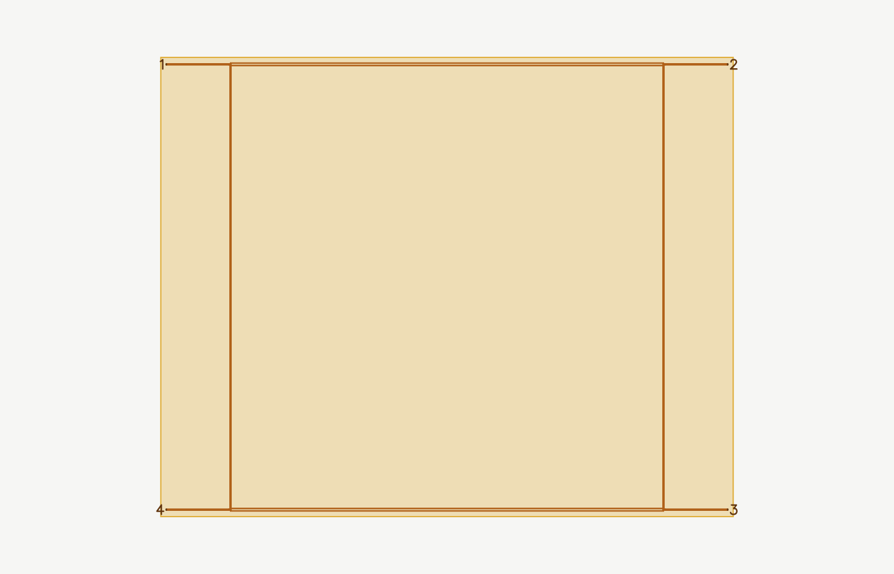
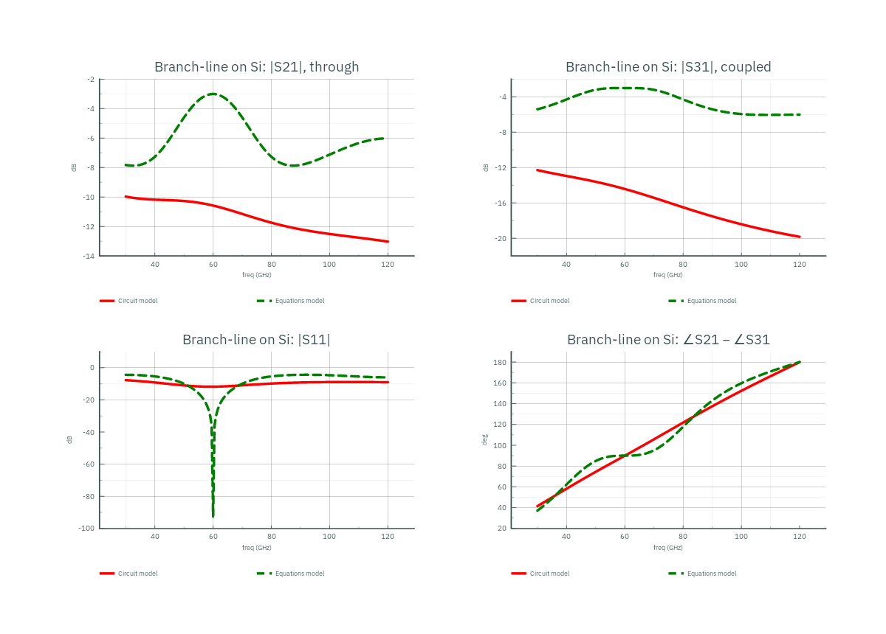

# RFIC Branch-Line

The branch-line hybrid of the Dividers and Couplers example on a silicon back-end: an MBLC at 60 GHz on the top metal of
the shipped three-metal stack, over Metal1 as its ground, a thin-film microstrip. It is laid out by Update Layout from
Schematic, and a test bench sets its circuit model beside an equations model. The workspace's default technology is the
die's, `tech/rfic-Si_3LM_TFR_100um.ctech`.

## The cells

| Cell | Views | What it is |
|---|---|---|
| **Branch-Line** | schematic, layout | A one-section MBLC with a 0.1 mm line from each of its four pins to a port, all on Metal3 over Metal1 |
| **Branch-Line Bench** | schematic | The cell's circuit, and its equations model: ideal lines of the closed-form impedances and lengths, and each feed an ideal line of its own impedance and length at F |
| `Branch-Line.cdd` | data display | \|S21\|, \|S31\|, \|S11\| and the phase of S21 against S31, the circuit model as a line and the equations model dashed |

## Run it

Simulate **Branch-Line Bench** and open `Branch-Line.cdd`. No results ship.

## Branch-line hybrid

An MBLC with `Z0` 50 Ω and `F` 60 GHz: 35.4 Ω series arms and 50 Ω shunt arms, each a quarter wave between the
reference planes of its junctions. Every line has `SignalLayer` Metal3 and `GroundReference` Metal1, so its field stays
in the 1.8 µm of oxide between them, out of the conducting silicon below, and 50 Ω is 1.8 µm wide. Update Layout draws
the Metal1 ground under the lines, and LVS finds no error.

| At 60 GHz | Equations | Circuit |
|---|---|---|
| \|S11\| | −92.6 dB | −11.8 dB |
| \|S21\|, through | −3.01 dB | −10.6 dB |
| \|S31\|, coupled | −3.01 dB | −14.4 dB |
| ∠S21 − ∠S31 | 90.0° | 90.0° |

The quadrature holds, but the 1.8 µm of oxide costs about 9 dB in the lines' conductor loss. Referenced to the backside
instead, the lines would sit on the conducting silicon, whose loss their closed form leaves out.
